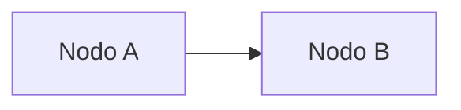

# Scrivi Lezione GinnyTech

Sei incaricato di scrivere o riscrivere una lezione MDX per il corso GinnyTech (ginnytech.it).
Argomento/lezione: $ARGUMENTS

---

## PRIMA DI INIZIARE

1. **Controlla lo stato**: apri `.claude/lesson-status.md` e trova la lezione target
2. **Leggi le lezioni di riferimento** (almeno 2 prima di scrivere):
   - `src/content/corso/gestione-data-driven/framework-jtbd.mdx` — struttura e profondità
   - `src/content/corso/analisi-prodotto/analisi-coorte.mdx` — rigore + pedagogia
   - `src/content/corso/analisi-marketing/performance-marketing.mdx` — profondità tecnica
   - `src/content/corso/gestione-data-driven/ciclo-deming-hadi.mdx` — framework applicato
3. **Leggi il file esistente** se esiste — anche se è uno stub, conserva il frontmatter

---

## REGOLE DI BASE — MDX per il corso `corso`

### Frontmatter obbligatorio
```yaml
---
title: "Titolo Lezione"           # Tra virgolette se contiene ':'
description: "Descrizione breve che spiega cosa impara lo studente."
module: "Modulo N: Nome Modulo"    # Esatto come in course-modules.ts
order: 3                           # Numero d'ordine nella sezione
prerequisites: ["modulo/lezione"]  # Array di slug lezioni precedenti
category: "Nome Categoria"         # Es: "Strategia", "Analisi", "Tecnica"
---
```

### Componenti Starlight disponibili
```mdx
import { Aside, Steps, Tabs, TabItem } from '@astrojs/starlight/components'
```

**Regole critiche MDX:**
- `<Steps>`: content DEVE essere lista numerata (`1. passo`, `2. passo`). MAI paragrafi bold. MAI blocchi di codice dentro Steps (rompono la struttura HTML)
- `<Aside type="tip|caution|note|danger">`: chiudere SEMPRE con `</Aside>`, non `</Card>`
- Titoli con `:` nel YAML vanno sempre tra virgolette: `title: "CDC: Pattern e Implementazione"`
- Non aggiungere un `# Titolo H1` extra — il frontmatter genera automaticamente l'H1

### Diagrammi Mermaid
```mdx

```
Usare per architetture, flussi decisionali, pipeline dati.

---

## STRUTTURA OBBLIGATORIA DI OGNI LEZIONE

### 1. Hook iniziale (no H2, subito dopo il frontmatter)
- Inizia con un fatto specifico, un caso reale, una contraddizione
- VIETATO: "In un mondo dove il dato è il nuovo petrolio..."
- VIETATO: elenchi di "cosa imparerai" come prima cosa

**Esempio eccellente (da dashboard-strategiche.mdx):**
> Nell'estate del 2022, il management di Gorillas guardava una dashboard con metriche "tutte verdi". Quattro mesi dopo l'azienda tagliò il 40% del personale. Le metriche erano tecnicamente corrette — misuravano le cose sbagliate.

### 2. Corpo con H2/H3 logici
- Flusso: problema → teoria → pratica → applicazione
- Ogni H2 deve avere almeno 200–400 parole di contenuto sostanziale
- Alternare testo, tabelle, codice/formule, esempi

### 3. Esempi concreti (almeno 1 con numeri reali)
Formato ideale:
```
Contesto → Problema → Soluzione/Insight → Risultato misurabile
```

**Buoni esempi**: McDonald's milkshake, Dropbox 75K waitlist, Netflix 33M abbonati, Gorillas dashboard failure, Binet/Field 60/40 rule

### 4. Framework o template actionable
Qualcosa che lo studente può usare subito: tabella, checklist, formula, algoritmo step-by-step

### 5. Recap o checklist finale
Consolidare i concetti principali. Può essere una `<Aside type="tip">` o una lista bullet.

---

## PROFONDITÀ PER TIPO DI LEZIONE

### Lezione METODOLOGICA (framework, processi, strategia)
- Contesto storico/origini del framework (chi lo ha inventato, quando, perché)
- Citare ricercatori reali: Christensen, Kaplan, Binet/Field, Shewhart/Deming, Ries
- Teoria con schema mermaid se utile
- Esempio passo-passo applicato a un caso reale
- Errori comuni + come evitarli
- Template/checklist usabile immediatamente
- **Target**: 4000–7000 parole

### Lezione TECNICA (codice, architettura, tool)
- Perché questo strumento/approccio (vs alternative — usa `<Tabs>`)
- Architettura/concetti chiave prima del codice
- Codice funzionante con commenti che spiegano il PERCHÉ (non il cosa)
- Considerazioni di produzione (performance, costi, limitazioni)
- Troubleshooting o errori comuni
- **NON**: dump di configurazioni senza contesto
- **Target**: 3000–5000 parole

### Lezione ANALITICA (metriche, statistiche, data science)
- Il problema che la tecnica/metrica risolve (perché esiste)
- Formula/definizione precisa con esempio numerico
- Come calcolarla (con codice SQL o Python se pertinente)
- Come interpretarla correttamente
- Trappole, bias e errori di interpretazione comuni
- Benchmark di riferimento settoriali
- **Target**: 4000–6000 parole

---

## COSA È VIETATO (segnali di bassa qualità)

| Vietato | Alternativa |
|---------|-------------|
| "Il dato è il nuovo petrolio" | Inizia con un caso reale specifico |
| "I Tre Pilastri Fondamentali" | Struttura con nomi specifici al contenuto |
| Stesso scenario e-commerce+SaaS B2B in ogni lezione | Varia i settori: fintech, healthcare, retail, media |
| Titolo promette X, contenuto è Y | Verifica sempre la corrispondenza titolo-contenuto |
| Placeholder non riempiti ("Componente X da definire") | Scrivi il contenuto vero o elimina il placeholder |
| Codice senza spiegazione del perché | Ogni snippet deve avere contesto e interpretazione |
| Paragrafi di 2 righe una dopo l'altra | Sviluppa ogni punto con sostanza |
| Elenchi di bullet points senza testo di collegamento | Alterna bullets e paragrafi narrativi |

---

## LUNGHEZZA E DENSITÀ

| Tipo lezione | Minimo | Ottimale |
|--------------|--------|----------|
| Standard | 3000 parole | 4000–6000 |
| Lezione principale modulo | 4000 parole | 6000–9000 |
| Cheat Sheet | 500 parole | 800–1500 |
| Caso Studio | 1500 parole | 2000–3000 |

**Regola**: ogni paragrafo deve aggiungere informazione nuova. Se puoi eliminarlo senza perdere contenuto, eliminalo.

---

## CONTROLLO QUALITÀ FINALE

Prima di consegnare la lezione, verifica:
- [ ] Il frontmatter ha tutti i campi obbligatori?
- [ ] Il titolo corrisponde esattamente al contenuto?
- [ ] L'hook iniziale è specifico e non generico?
- [ ] C'è almeno 1 esempio con numeri reali e nome di azienda/ricercatore?
- [ ] La lezione insegna qualcosa di specifico, non generico?
- [ ] I tag MDX sono tutti chiusi correttamente (`</Aside>`, `</Tabs>`, ecc.)?
- [ ] `<Steps>` usa lista numerata (non bold paragraphs)?
- [ ] Nessun blocco di codice DENTRO `<Steps>`?
- [ ] Ogni H2 ha almeno 200 parole di contenuto?
- [ ] C'è un framework, template o checklist che lo studente può usare subito?
- [ ] Il tono è professionale ma accessibile (non accademico pesante)?
- [ ] Parole totali ≥3000 (per lezione standard)?

---

## AGGIORNARE IL FILE DI TRACKING

Dopo aver scritto/riscritto una lezione, aggiorna `.claude/lesson-status.md`:
- Cambia lo status da ❌/⚠️ a ✅
- Aggiorna il conteggio parole
- Aggiorna la data in cima al file
