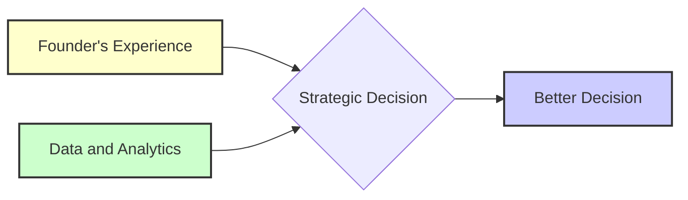

In 2012, JCPenney hired Ron Johnson, the man behind Apple Stores, as CEO. Despite his experience and vision, he eliminated promotions without testing the idea or analyzing data. Within 16 months, JCPenney lost nearly a billion dollars and saw a 25% drop in revenue. It turned out middle-class American customers loved coupons, and without them, they stopped buying. This scenario repeats daily in many Italian SMEs, where founders rely on intuition instead of data that is often outdated or missing.

## The Italian Gap: Data vs Intuition

Italy boasts an impressive network of family-run SMEs, but the founders' deep experience often hinders the adoption of a data-driven culture. In many companies with fewer than 10 employees, the founder holds all the knowledge, with no CRM or structured decision history. According to the 2025 DESI index, Italy ranks last in Europe for advanced cloud service adoption, and ISTAT reports 72% of SMEs lack a dedicated IT manager.

| Characteristic | Traditional Strength | Data-Driven Limitation |
|---|---|---|
| Founder's experience | Deep product knowledge | Resistance to data contradicting intuition |
| Personal client relationships | Loyalty and trust | Lack of CRM and structured data |
| Decision agility | Speed of execution | Undocumented, non-reproducible decisions |
| Oral culture | Flexibility | No historical data for analysis |

### The Competence Paradox

Daniel Kahneman showed that experience breeds confidence faster than competence. When contexts change rapidly, like in digital markets, intuition becomes noise. Philip Tetlock found that more experienced experts are less likely to revise their views, reducing long-term forecast accuracy. Jeff Bezos built Amazon on data and continuous testing, knowing intuition does not scale with millions of customers.

## Five Signs Your Company Decides by Gut Feeling

1. Strategy meetings without data or reports.
2. Repeated discussions with no decision history.
3. Marketing budgets set by feelings, not analysis.
4. No CRM or poor CRM usage.
5. Prices set by fixed markups without market analysis.

## The Five Stages of Data Maturity: Where Is Your Company?

1. Ad-Hoc: no structured data, instinct-based decisions (35% SMEs).
2. Reporting: data collection without analysis (40% SMEs).
3. Analytical: descriptive analysis, no predictive models (20% SMEs).
4. Predictive: forecasting and machine learning models (4% SMEs).
5. Prescriptive: AI-driven autonomous decisions (<1% SMEs).

The biggest efficiency gains come in the first two stages. Jumping straight to AI is unnecessary.

## How to Start: The "Minimum Viable Data" Framework

Netflix began tracking one key metric: DVD return rates. You should start with a handful of essential metrics linked to recurring decisions:

| Decision | Metric | Data Source |
|---|---|---|
| Which products to invest in | Contribution margin per SKU | ERP |
| Which marketing channel works | CAC and ROAS per channel | Google Analytics + CRM |
| Which customers to focus on | LTV and purchase frequency | CRM / e-commerce |
| How to set prices | Demand elasticity | Sales history + A/B tests |
| Where to cut costs | Cost per unit produced | ERP |

Build a simple weekly dashboard (Google Sheets and Looker Studio suffice) and meet every Monday to review numbers, not opinions.

## Cultural Resistance: How to Manage It

Founders may see data as a threat. Tetlock's research shows changing opinions is hard but possible when shifting from "defending views" to "updating strategy."

### Strategy: "Data as Co-Pilot, Not Pilot"

Data does not replace experience; it enhances it. Experience sets the destination; data shows the path.

### Three Tactics to Overcome Resistance

1. Start with a concrete problem, not an abstract vision.
2. Show immediate financial results.
3. Find an internal ally comfortable with numbers.

## Case Study: A Food Company in Veneto

A company with 15 million euros in revenue used a fixed 35% markup for 20 years without market analysis. After studying willingness-to-pay and demand elasticity through 180 buyer interviews and six months of scanner data, they found:

- Category A (premium organic): buyers accepted up to 12% price increases without order drops.
- Category B (standard): competitors lowered prices by 5%, unnoticed by the company.
- Category C (private label): contribution margin was 2.1%, below operational breakeven.

Result: +420,000 euros annual margin by optimizing prices with data, no new products or markets needed.

## The Myth of "Data Complexity"

Waiting for perfect data is the surest way to never act. Jeff Immelt of GE said, "Perfect data is the enemy of good data." Start with the data you have and improve it over time.

## What's the Value of Better Decisions?

McKinsey analyzed over a thousand strategic decisions and found data-driven companies achieve 5-6% higher returns. For a 15 million euro company, that's 750,000 euros better resource allocation and fewer costly mistakes.

## Conclusion

Deciding by gut is natural but no longer enough. Kahneman's System 1 is fast and intuitive; System 2 is slow, analytical, and data-driven. In 2026's global markets with compressed margins, data provides the right questions for better decisions. Start small: one metric, one dashboard, one fact-based decision each week. Avoid JCPenney's costly mistake  -  you don't need a Nobel, just a spreadsheet and the will to look at it every Monday.

Explore managing data-driven culture in our module [gestione data-driven](/course/gestione-data-driven/).
