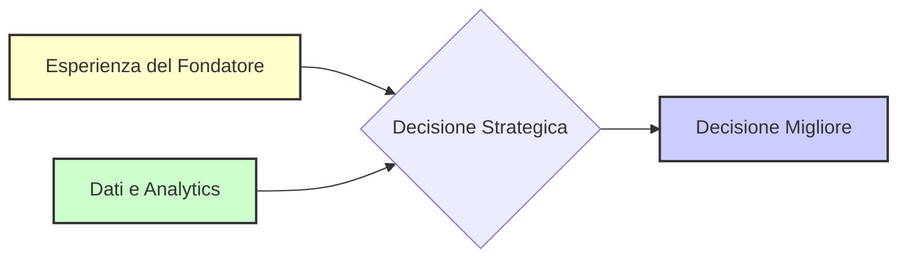

Nel 2012, JCPenney assunse Ron Johnson, l'uomo che aveva costruito gli Apple Store, come CEO. Johnson aveva esperienza e intuizione, ma decise di eliminare le promozioni senza testare l'ipotesi né analizzare i dati. In 16 mesi, JCPenney perse quasi un miliardo di dollari e il fatturato calò del 25%. I clienti americani di fascia media amavano i coupon, e senza di essi non compravano. Questa storia si ripete quotidianamente in molte PMI italiane, dove l'intuito del fondatore prevale sui dati, spesso obsoleti o inesistenti.

## Il Gap Italiano: Dati vs Istinto

L'Italia vanta un tessuto imprenditoriale di PMI familiari eccellenti, ma la profonda esperienza dei fondatori diventa un freno all'adozione di una cultura data-driven. In molte aziende con meno di 10 dipendenti, il fondatore è l'unico depositario della conoscenza, senza CRM o storico decisionale strutturato. Secondo l'indice DESI 2025, l'Italia è ultima in Europa nell'adozione di servizi cloud avanzati, e l'ISTAT segnala che il 72% delle PMI non ha un responsabile IT dedicato.

| Caratteristica | Forza Tradizionale | Limite Data-Driven |
|---|---|---|
| Esperienza del fondatore | Conoscenza profonda del prodotto | Resistenza ai numeri che contraddicono l'intuito |
| Relazioni personali con i clienti | Fedeltà e fiducia | Mancanza di CRM e dati strutturati |
| Agilità decisionale | Velocità di esecuzione | Decisioni non documentate, non replicabili |
| Cultura orale | Flessibilità | Nessuno storico su cui costruire analisi |

### Il Paradosso della Competenza

Daniel Kahneman ha mostrato che l'esperienza genera fiducia più rapidamente della competenza. Quando il contesto cambia rapidamente, come nel digitale, l'intuito diventa rumore. Philip Tetlock ha dimostrato che esperti più esperti sono meno inclini a rivedere le proprie opinioni, riducendo l'accuratezza delle previsioni a lungo termine. Jeff Bezos ha costruito Amazon su dati e test continui, sapendo che l'intuito non scala con milioni di clienti.

## I 5 Segnali Che la Tua Azienda Decide "a Naso"

1. Riunioni strategiche senza dati o report.
2. Discussioni ripetitive senza storico decisionale.
3. Budget marketing deciso a sentimento senza analisi.
4. Assenza o cattivo uso del CRM.
5. Prezzi fissati con ricarico fisso senza analisi di mercato.

## I 5 Stadi del Data Maturity Model: Dove è la Tua Azienda

1. Ad-Hoc: nessun dato strutturato, decisioni a istinto (35% PMI).
2. Reporting: raccolta dati senza analisi (40% PMI).
3. Analitico: analisi descrittiva, nessuna predittiva (20% PMI).
4. Predittivo: modelli di forecasting e machine learning (4% PMI).
5. Prescrittivo: AI che prende decisioni autonome (<1% PMI).

Il salto più significativo avviene nei primi due stadi. Non serve passare subito all'AI.

## Come Iniziare: Il Framework "Dati Minimi Vitali"

Netflix iniziò con una metrica chiave: il tasso di restituzione dei DVD. Anche tu devi partire da poche metriche essenziali, legate alle decisioni ricorrenti:

| Decisione | Metrica | Fonte Dati |
|---|---|---|
| Prodotti su cui investire | Margine di contribuzione per SKU | ERP |
| Canale marketing efficace | CAC e ROAS per canale | Google Analytics + CRM |
| Clienti da curare | LTV e frequenza d'acquisto | CRM / e-commerce |
| Prezzi da fissare | Elasticità della domanda | Storico vendite + A/B test |
| Costi da tagliare | Costo per unità prodotta | ERP |

Costruisci una dashboard settimanale semplice (anche con Google Sheets e Looker Studio) e riunisci il team ogni lunedì per discutere i numeri, non le opinioni.

## La Resistenza Culturale: Come Gestirla

Il fondatore può percepire i dati come una minaccia. Tetlock mostra che cambiare opinione è difficile, ma possibile se si cambia il contesto da "difendere l'opinione" a "aggiornare la strategia".

### Strategia: "I Dati Come Copilota, Non Come Pilota"

I dati non sostituiscono l'esperienza, la potenziano. L'esperienza indica la direzione, i dati mostrano la strada.

### 3 Tattiche per Vincere la Resistenza

1. Parti da un problema concreto, non da una visione astratta.
2. Mostra subito i risultati economici tangibili.
3. Trova un alleato interno che lavori con i numeri.

## Caso Pratico: L'Azienda Alimentare del Veneto

Un'azienda con 15 milioni di fatturato usava un ricarico fisso del 35% da 20 anni senza analisi di mercato. Dopo un'indagine sulla willingness-to-pay e l'elasticità della domanda, ha scoperto opportunità di aumento prezzi e tagli di costi nascosti, ottenendo +420.000 euro di margine annuo senza nuovi investimenti.

## Il Mito della "Complessità dei Dati"

Aspettare dati perfetti è un modo sicuro per non agire mai. Jeff Immelt di GE diceva: "Perfect data is the enemy of good data." Inizia con i dati che hai e migliorali nel tempo.

## Quanto Vale Decidere Meglio?

McKinsey ha dimostrato che aziende data-driven ottengono un rendimento superiore del 5-6%. Su 15 milioni di fatturato, sono 750.000 euro in più allocati meglio e meno errori.

## Conclusione

Decidere "a naso" è naturale, ma non basta più. Il System 1 veloce e intuitivo va integrato con il System 2 analitico e data-driven. Nel 2026, con mercati globali e margini compressi, i dati sono la domanda giusta per prendere decisioni migliori. Inizia con una metrica, una dashboard e una decisione alla settimana basata sui fatti. Non serve un Nobel, serve solo la volontà di guardare i numeri ogni lunedì.

Approfondisci la gestione della cultura data-driven nel nostro modulo [gestione data-driven](/course/gestione-data-driven/).
