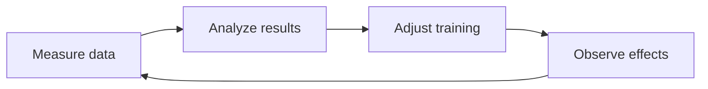

In 2002, Billy Beane, general manager of the Oakland Athletics baseball team, faced a tough challenge: a $40 million budget against the New York Yankees' $120 million. He couldn't compete by buying the most sought-after players. He needed a different approach.

With analyst Paul DePodesta, Beane revolutionized player evaluation by abandoning traditional metrics and focusing on those truly correlated with winning. They acquired undervalued players overlooked by the market but with winning traits.

The result? The Athletics won 103 out of 162 games, a franchise record, on a fraction of their competitors' budget.

Michael Lewis's "Moneyball" tells this story, which is more than a sports success - it's a model for making effective decisions under resource constraints and uncertainty, applicable in business.

Sports provide an ideal data lab: clear rules, objective metrics, and immediate feedback. Cycling, especially, has become highly quantitative thanks to power meters measuring every watt. Pro teams like Sky/INEOS use datasets that many tech companies envy.

This article uses a simulated dataset of 250 amateur cyclists to demonstrate how sports data analysis techniques apply directly to business analytics. We'll explore how performance is measured, talent identified, and training optimized, with lessons transferable to managing teams, products, and customers.

## Cycling Metrics: From Physiology to Data

A 160 km granfondo generates rich data: physical traits, training volume, and performance metrics.

| Cycling Metric | Type | Description | Business Equivalent |
|---|---|---|---|
| FTP (Functional Threshold Power, watts) | Absolute performance | Max power sustainable for one hour | Revenue or absolute productivity |
| Power/Weight (W/kg) | Efficiency | Watts per kg of body weight | Margin or ROI |
| Weekly kilometers | Input volume | Average training distance | Budget invested |
| Weekly training hours | Resources engaged | Time spent training | Operating cost |
| VO2max (ml/kg/min) | Maximum capacity | Max oxygen consumption | Growth potential |
| VAM (Average Climbing Speed, m/h) | Climbing performance | Speed on elevation gain | Performance in tough environments |
| Cadence (rpm) | Motor efficiency | Pedal revolutions per minute | Execution speed |
| Race finish time | Measured output | Time to complete race | Business outcome |
| Age | Contextual variable | Cyclist's age | Customer segment |
| Body weight | Structural factor | Cyclist's weight | Base cost |

These metrics and analyses - distribution, correlation, segmentation, outlier detection, diminishing returns - apply equally in sports and business. Learning to interpret them in sports, where intuition is easier, aids effective business application.

## Lesson 1: Distribution Matters More Than the Average

The average race time is 4 hours 12 minutes, but this is misleading because the 250 cyclists are not homogeneous:
- 180 in the "main group": 3h40-4h40
- 50 slower cyclists: 4h30-5h30
- 20 elite cyclists: 2h50-3h30

The average doesn't represent any group well. Training "for the average participant" would fail most.

**Application:** In business, averages can mask distinct segments. Decisions based on averages risk misaligning strategies for all groups.

## Lesson 2: Natural Segmentation with Clustering

Applying K-Means on FTP and training volume reveals four segments:

| Cluster | Segment | Characteristics | Percentage |
|---|---|---|---|
| 1 | Weekend Warriors | Low power, <6 hrs/week, often overweight | 35% |
| 2 | Steady | Medium power, 8-12 hrs/week, stable performance | 30% |
| 3 | Ambitious | Good power, 12-18 hrs/week, rapid improvement | 25% |
| 4 | Elite | High power, structured training, top 10% | 10% |

Weekend Warriors need simple structure and community; Ambitious cyclists are prime candidates for personalized coaching and upsell.

**Application:** Customers segment similarly. Occasional users and high-potential clients require different approaches to optimize resources and outcomes.

## Lesson 3: Input Doesn't Predict Output As You Think

Correlation between training volume and performance is weaker than between efficiency (watts/kg) and race time.

| Variable | Correlation with race time | Interpretation |
|---|---|---|
| Power/Weight (W/kg) | -0.89 | Efficiency is key |
| Absolute FTP | -0.72 | Power matters but less than efficiency |
| Weekly km | -0.45 | Volume helps but not decisive |
| Training hours | -0.38 | Hours less predictive than volume |
| Body weight | +0.52 | More weight slows down |
| Age | +0.31 | Age slightly slows |

A more efficient cyclist beats a more powerful but less efficient one. This applies wherever efficiency trumps raw power.

**Business application:** Spending more doesn't guarantee more revenue. ROAS and productivity per resource unit are true success metrics.

## Lesson 4: Outlier Detection  -  Champions and Issues

Among cyclists, eight outliers reveal unique stories:

### Positive Outliers

- A 52-year-old veteran with 340 watt FTP, trained with coach and diet, exceeding age expectations.
- A cyclist training only 6 hours/week using HIIT finishing top 20.

### Negative Outliers

- A cyclist with 15 hrs/week but declining performance, classic overtraining.
- A cyclist with sudden 15% FTP drop, possible burnout or injury.

**Application:** Positive outliers highlight best practices to replicate; negative ones signal problems needing early intervention.

## Lesson 5: The Feedback Loop  -  Measure, Analyze, Act, Repeat

Rapid improvement depends on continuous cycles of measurement, analysis, and intervention.

Those training "by feel" without data plateau. Team Sky applied "marginal gains," optimizing every detail for cumulative advantage.

**Application:** The HADI or Deming cycle is essential for effective decisions and continuous growth.

## Lesson 6: The Law of Diminishing Returns

Increasing training volume yields progressively smaller gains and higher injury risk.

| Weekly hours | FTP improvement | Injury risk | ROI |
|---|---|---|---|
| 0-5 | +15% | Low | Very high |
| 5-10 | +8% | Low | High |
| 10-15 | +3% | Medium-low | Medium |
| 15-20 | +1% | Medium-high | Low |
| 20+ | +0.5% or negative | High | Negative |

This model applies to marketing budgets, product features, and staffing.

## Case Study: How Team Sky Uses Data

Team Sky transformed pro cycling with a systematic approach:

1. Comprehensive measurement (power meter, heart rate, sleep tracking)
2. Segmenting race phases
3. Early detection of overtraining
4. Daily feedback to adapt training

Between 2010 and 2020, they dominated the Tour de France with 69 stage wins and 13 yellow jerseys.

## Conclusion

Beane's story shows that data, used methodically, enables effective competition despite limited resources. Sports teach us that immediate, measurable feedback is key to improvement.

In business, data doesn't replace talent or experience but amplifies them. A continuous feedback system and focus on efficiency metrics are essential for better decisions and sustainable growth.

Start measuring, segmenting, studying outliers, and building systematic feedback loops. Results will follow.

For deeper insights, see our [fundamental metrics](/course/fundamental-metrics/) module.
