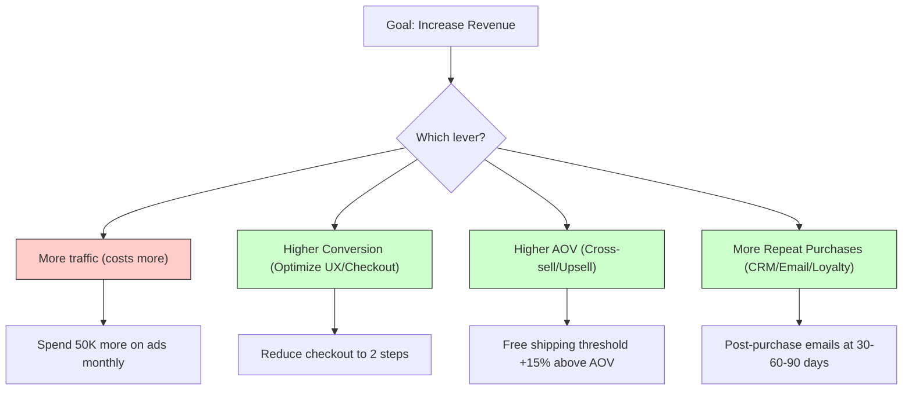

In 2011, Zappos had a 35% return rate. For a traditional retailer, this would be a disaster. But founder Tony Hsieh knew from data that customers with the highest return rates also had the highest Customer Lifetime Value (LTV). They bought more, ordered more frequently, and were less price-sensitive. Returns were not a cost but a signal of a higher-quality customer.

Zappos was sold to Amazon for $1.2 billion.

This story highlights a fundamental challenge for e-commerce managers: it's not a lack of metrics, but looking at the wrong ones or misinterpreting them. Zappos' return rate looked like a problem but was actually a competitive advantage.

## The E-commerce Metrics Pyramid: Priorities and Hierarchy

Not all metrics are equal. Time is limited, and optimizing the wrong metric can harm the right ones. Organize metrics into a priority pyramid:

           +-------------------+
           |  REVENUE & PROFIT |   <- CEO focus
           +-------------------+
         +---------------------+
         |  CONVERSION & AOV   |   <- CMO focus
         +---------------------+
       +-------------------------+
       |  TRAFFIC & ENGAGEMENT   |   <- Analyst focus
       +-------------------------+
     +-----------------------------+
     |  CHANNEL & CAMPAIGN         |   <- Media buyer focus
     +-----------------------------+

The golden rule is to optimize from the bottom only when the top metrics are healthy. If your Contribution Margin per order is negative, increasing traffic means losing money faster.

## The 10 Core Metrics: Acquisition → Conversion → Retention → Revenue Framework

### 1. Conversion Rate (CR): Your Site's Magnifying Glass

CR measures the percentage of sessions that convert into orders:

CR = (Number of Orders / Sessions) x 100

The global average is around 2-3%, but this aggregate number is nearly useless. Booking.com, running over 1,000 simultaneous A/B tests, knows CR varies 40-50% between segments. Optimizing the "average" CR without segmentation means optimizing noise.

| Sector | Italy Avg CR (2025) | Good | Excellent |
|---|---|---|---|
| Fashion | 1.5-2.5% | > 3% | > 5% |
| Electronics | 1.0-2.0% | > 2.5% | > 4% |
| Food & Grocery | 3.0-5.0% | > 5% | > 8% |
| Beauty | 2.0-3.5% | > 4% | > 6% |
| B2B / Industrial | 0.5-1.5% | > 2% | > 3% |

Always segment by device, channel, and user type (new vs returning). Mobile CR is typically half desktop, but mobile drives 60% of traffic. Organic CR is often double paid because purchase intent is higher. Returning users convert 3-5 times more.

### 2. Average Order Value (AOV): Increasing Revenue Per Transaction

AOV = Total Revenue / Number of Orders

Improving AOV is often easier than CR, and each extra euro costs almost nothing. Amazon proved this with collaborative filtering, which now generates about 35% of its revenue.

Effective strategies include:
- Setting free shipping thresholds above average AOV to encourage bigger carts.
- Bundles and cross-sells on product pages, like "Complete the look".
- Upsells at checkout, such as extended warranties.

### 3. Revenue Per Session (RPS): The Primary Metric for A/B Testing

RPS = Total Revenue / Total Sessions

RPS combines CR and AOV into one metric. It's essential for A/B tests because it captures both conversion and order value. Optimizing only CR can mislead if AOV drops.

### 4. Cart Abandonment Rate (CAR): The Implicit Return Rate

CAR = (1 - Completed Orders / Carts Created) x 100

The global average hovers around 70%. Above 80% signals serious checkout issues. But a 90% CAR isn't necessarily worse than 60% if average cart value is much higher.

Top causes of abandonment:
1. Shipping costs revealed too late (48%).
2. Forced account creation (24%).
3. Long or complicated checkout (22%).
4. Missing preferred payment methods (12%).

The most impactful fix is guest checkout, which can boost checkout conversion by 45%.

### 5. Customer Acquisition Cost (CAC): What It Costs to Acquire a Customer

CAC = Total Marketing Spend / New Customers Acquired

Dollar Shave Club had a CAC of about $8 versus Gillette's $32, thanks to a viral video and a subscription model that made customers more profitable long-term.

Always distinguish Blended CAC (includes organic, referral, direct) from Paid CAC (advertising only). If Paid CAC far exceeds Blended, scalability is an issue.

### 6. Customer Lifetime Value (LTV): Total Value of a Customer

LTV = AOV x Annual Purchase Frequency x Average Customer Lifespan (years)

12-month LTV is most useful operationally because it relies on real data. Five-year LTV is often speculative. Stitch Fix showed huge LTV variance: the top 20% of customers had LTVs over $2,000. Identifying and treating these customers differently early is a competitive edge.

### 7. LTV:CAC Ratio: The Sustainability Metric

The gold standard is 3:1. But watch the payback period: if it takes too long to recoup CAC, cash flow problems can arise even with a good ratio.

A healthy e-commerce aims for payback under 12 months and LTV/CAC above 3.

### 8. Return Rate: The Hidden Cost of Returns

Return Rate = (Returned Orders / Total Orders) x 100

In Italian fashion, return rates range 25-40%. Each return incurs operational costs: reverse logistics, refurbishment, depreciation, and customer service.

The most effective lever is detailed product descriptions with videos and realistic images. Zalando found this reduces return rates by 12-18%.

### 9. Repeat Purchase Rate: The Loyalty Metric

Repeat Rate = (Customers with 2+ Orders / Total Customers) x 100

| Sector | Typical Repeat Rate | Target |
|---|---|---|
| Fashion | 25-35% | > 40% |
| Food / Consumables | 40-60% | > 60% |
| Electronics | 10-20% | > 25% |
| Beauty (subscription) | 50-70% | > 70% |

A repeat rate below sector average means customers are leaking. Increasing ad spend in this scenario only accelerates losses.

Bain & Company's rule: a 5% retention increase can boost profits 25-95% depending on sector.

### 10. Contribution Margin per Order: The Metric Nobody Calculates

CM = Revenue - COGS - Shipping - Payment Processing - Return Costs

This metric is critical but often ignored. A 50-euro order with 5-euro margin is radically different from one with 25-euro margin, yet both look identical in traffic and conversion metrics.

An extreme case: an Italian electronics e-commerce with 3.2% CR, 180-euro AOV, and 20% revenue growth had a CM of just 4.50 euros per order. They were growing toward failure unnoticed.

## The Weekly E-commerce Manager Dashboard

| Metric | This Week | WoW | Target | Status |
|---|---|---|---|---|
| Revenue | 32,400 euros | +8% | 30,000 euros | OK |
| Orders | 540 | +5% | 500 | OK |
| CR (overall) | 2.1% | -0.1% | 2.0% | OK |
| AOV | 60 euros | +3% | 58 euros | OK |
| CAC (paid) | 22 euros | +12% | < 20 euros | PROBLEM |
| Cart Abandonment | 72% | +2% | < 70% | WARNING |
| Return Rate | 18% | -1% | < 20% | OK |
| Repeat Rate (30d) | 28% | = | 30% | WARNING |

Every off-target metric must have an action, a responsible person, and a deadline. If you can't answer "what will we do to get back on target within X weeks?" the metric doesn't belong in your operational dashboard.

## Essential SQL Queries: Calculating LTV and CAC from Scratch

Calculating 12-month LTV per customer involves summing completed orders in the past year and deriving frequency and average order value.

CAC by acquisition channel divides marketing spend by new customers acquired over a recent period.

Cohort analysis tracks repeat rates by acquisition month, useful to assess retention over time.

## The Fatal Mistake: Optimizing the Wrong Metric

This diagram reveals the uncomfortable truth: investing in conversion, AOV, and repeat purchases yields much higher ROI than just pumping more traffic. Traffic multiplies, but multiplying a small number yields a small bigger number. Fix the numerator (CR, AOV, CM) first, then scale the denominator (traffic).

Booking.com built its dominance by obsessively optimizing CR through continuous A/B testing for 20 years, then scaled traffic on a finely tuned conversion engine.

## Case Study: Reducing Cart Abandonment by 15%

An Italian fashion e-commerce had a CAR of 72%. Analysis showed:
- 48% abandoned due to late shipping cost reveal
- 24% abandoned due to forced registration
- 18% abandoned due to lengthy process

Actions taken:
1. Reveal shipping costs on product pages before adding to cart
2. Implement guest checkout
3. Simplify checkout from 6 to 3 steps

Result: CAR dropped from 72% to 61% in 8 weeks. With 500 weekly orders, this saved 55 orders weekly, adding 2,860 euros in weekly revenue and 148,720 euros annually, just by optimizing checkout.

## Conclusion

You don't need 50 metrics, but 10 well-measured ones every week. The key is linking each metric to a concrete action: if it worsens, what will you do? Without a clear answer, that metric does not belong in your dashboard.

Tony Hsieh at Zappos didn't have more metrics than competitors, but better ones. He knew his best customers had high return rates and used that as a signal to identify VIPs.

Start with Contribution Margin per order. It's the overlooked metric that changes everything. You can have perfect CR, growing AOV, and record traffic, but if each order costs you money, you're building a highly efficient money-losing machine  -  and smiling while doing it.

Explore marketing analysis and channel metrics in our [marketing analysis](/course/analisi-marketing/) module.
