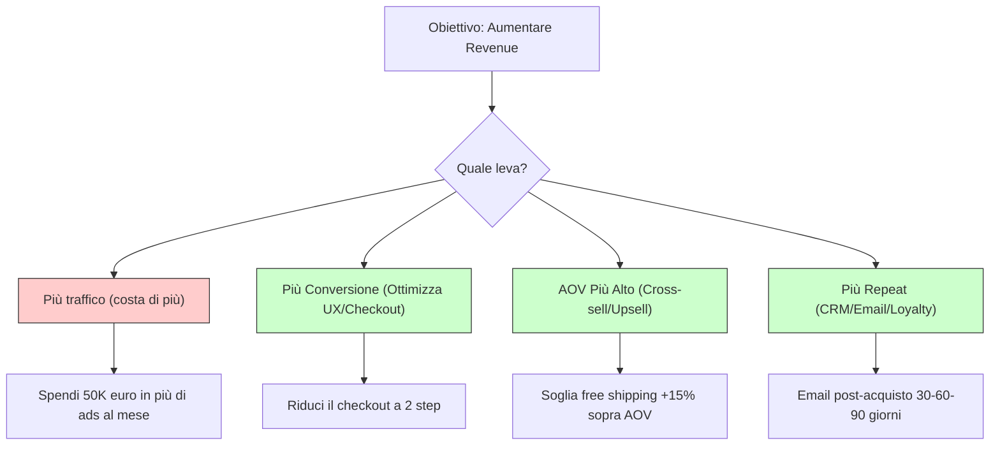

Nel 2011, Zappos registrava un tasso di reso del 35%. Per un retailer tradizionale sarebbe stato un disastro, ma Tony Hsieh, il fondatore, sapeva dai dati che i clienti con il tasso di reso più alto avevano anche il Customer Lifetime Value (LTV) più elevato. Questi clienti compravano di più, ordinavano più frequentemente e risultavano meno sensibili al prezzo. Il reso non era un costo, ma un segnale di un cliente di qualità superiore.

Zappos fu venduta ad Amazon per 1,2 miliardi di dollari.

Questa storia mette in luce un problema cruciale per chi gestisce un e-commerce: non mancano le metriche, ma spesso si guardano quelle sbagliate o si interpretano male. Il return rate di Zappos sembrava un problema, ma in realtà era un vantaggio competitivo.

## La Piramide delle Metriche E-commerce: Priorità e Gerarchia

Non tutte le metriche hanno lo stesso peso. Il tempo è limitato e ottimizzare una metrica sbagliata può danneggiare quelle più importanti. Organizza le metriche in una piramide di priorità:

           +-------------------+
           |  REVENUE & PROFIT |   <- Il CEO guarda qui
           +-------------------+
         +---------------------+
         |  CONVERSION & AOV   |   <- Il CMO guarda qui
         +---------------------+
       +-------------------------+
       |  TRAFFIC & ENGAGEMENT   |   <- L'analista guarda qui
       +-------------------------+
     +-----------------------------+
     |  CANALE & CAMPAGNA          |   <- Il media buyer guarda qui
     +-----------------------------+

La regola d'oro è ottimizzare dal basso solo quando le metriche in alto sono sane. Se il Contribution Margin per ordine è negativo, aumentare il traffico significa perdere soldi più velocemente.

## Le 10 Metriche Fondamentali: il Framework Acquisition → Conversion → Retention → Revenue

### 1. Conversion Rate (CR): la lente d'ingrandimento del sito

Il CR misura la percentuale di sessioni che si trasformano in ordini:

CR = (Numero Ordini / Sessioni) x 100

La media globale è intorno al 2-3%, ma questo valore aggregato è poco utile. Booking.com, che esegue oltre 1.000 A/B test simultanei, sa che il CR varia del 40-50% tra segmenti diversi. Ottimizzare il CR "medio" senza segmentare significa ottimizzare il rumore.

| Settore | CR Medio Italia (2025) | Buono | Eccellente |
|---|---|---|---|
| Fashion | 1.5-2.5% | > 3% | > 5% |
| Electronics | 1.0-2.0% | > 2.5% | > 4% |
| Food & Grocery | 3.0-5.0% | > 5% | > 8% |
| Beauty | 2.0-3.5% | > 4% | > 6% |
| B2B / Industrial | 0.5-1.5% | > 2% | > 3% |

Segmenta sempre per dispositivo, canale e tipo di utente (nuovo vs ritorno). Il CR mobile è tipicamente la metà di quello desktop, ma il mobile genera il 60% del traffico. Il CR organico è spesso doppio rispetto al paid perché l'intento di acquisto è più alto. Un utente di ritorno converte 3-5 volte di più.

### 2. Average Order Value (AOV): aumentare il valore medio degli ordini

AOV = Revenue Totale / Numero Ordini

Spesso è più facile migliorare l'AOV rispetto al CR, e ogni euro aggiuntivo ha un costo marginale quasi zero. Amazon ha dimostrato questo con il collaborative filtering, che oggi genera circa il 35% del fatturato.

Strategie efficaci includono:
- Soglia di spedizione gratuita posta sopra l'AOV medio per incentivare acquisti maggiori.
- Bundle e cross-sell nelle pagine prodotto, come "Completa il look".
- Upsell in fase di checkout, ad esempio garanzie estese.

### 3. Revenue Per Session (RPS): la metrica chiave per gli A/B test

RPS = Revenue Totale / Sessioni Totali

L'RPS integra CR e AOV in un'unica metrica. È fondamentale negli A/B test perché cattura sia la conversione sia il valore dell'ordine. Ottimizzare solo il CR può portare a scelte sbagliate se l'AOV diminuisce.

### 4. Cart Abandonment Rate (CAR): il tasso di abbandono del carrello

CAR = (1 - Ordini Completati / Carrelli Creati) x 100

La media globale è intorno al 70%. Se supera l'80%, il checkout ha problemi seri. Tuttavia, un CAR alto non è sempre negativo se il valore medio del carrello è molto alto.

Le cause principali di abbandono sono:
1. Costi di spedizione rivelati troppo tardi (48%).
2. Obbligo di creare un account (24%).
3. Processo di checkout lungo o complicato (22%).
4. Mancanza di metodi di pagamento preferiti (12%).

La soluzione più efficace è il checkout come guest, che può aumentare il tasso di conversione del 45%.

### 5. Customer Acquisition Cost (CAC): il costo per acquisire un cliente

CAC = Spesa Marketing Totale / Nuovi Clienti Acquisiti

Dollar Shave Club aveva un CAC di 8 dollari contro i 32 di Gillette, grazie a un video virale e un modello ad abbonamento che aumentava la profittabilità nel lungo termine.

Differenzia sempre tra Blended CAC (include organico, referral, diretto) e Paid CAC (solo advertising). Se il Paid CAC è molto più alto del Blended, la scalabilità è problematica.

### 6. Customer Lifetime Value (LTV): il valore totale di un cliente

LTV = AOV x Frequenza Acquisto Annuale x Vita Media Cliente (anni)

L'LTV a 12 mesi è più affidabile per il planning operativo. Stitch Fix mostrava una grande dispersione nell'LTV: il 20% dei clienti più fedeli valeva molto di più. Identificare e trattare diversamente questi clienti è un vantaggio competitivo.

### 7. LTV:CAC Ratio: la metrica di sostenibilità

La regola d'oro è un rapporto di 3:1. Attenzione però al payback period: se serve troppo tempo per recuperare il CAC, possono sorgere problemi di liquidità anche con un buon rapporto.

Per un e-commerce sano, il payback period dovrebbe essere inferiore a 12 mesi e il rapporto LTV/CAC superiore a 3.

### 8. Return Rate: il costo nascosto dei resi

Return Rate = (Ordini Resi / Ordini Totali) x 100

Nel fashion italiano il return rate varia tra il 25% e il 40%. Ogni reso comporta costi operativi significativi: logistica inversa, ricondizionamento, deprezzamento e customer care.

La leva più efficace per ridurlo è una descrizione prodotto dettagliata, con video e immagini realistiche. Zalando ha dimostrato che questo riduce il return rate del 12-18%.

### 9. Repeat Purchase Rate: la metrica della fedeltà

Repeat Rate = (Clienti con 2+ ordini / Clienti Totali) x 100

| Settore | Repeat Rate Tipico | Target |
|---|---|---|
| Fashion | 25-35% | > 40% |
| Food / Consumabili | 40-60% | > 60% |
| Electronics | 10-20% | > 25% |
| Beauty (abbonamento) | 50-70% | > 70% |

Un repeat rate sotto la media indica una perdita di clienti nel tempo. Aumentare il budget pubblicitario in questa situazione significa solo perdere più soldi più velocemente.

Secondo Bain & Company, aumentare la retention del 5% può aumentare i profitti dal 25% al 95% a seconda del settore.

### 10. Contribution Margin per Order: la metrica che nessuno calcola

CM = Revenue - COGS - Spedizione - Payment Processing - Return Costs

Questa metrica è fondamentale ma spesso ignorata. Un ordine da 50 euro con un margine di 5 euro è molto diverso da uno con margine di 25 euro, ma entrambi appaiono uguali nelle metriche tradizionali.

Un caso estremo: un e-commerce di elettronica con CR del 3,2%, AOV di 180 euro e revenue in crescita del 20% aveva un CM medio di soli 4,50 euro per ordine. Crescevano verso il fallimento senza accorgersene.

## La Dashboard Settimanale dell'E-commerce Manager

| Metrica | Questa settimana | WoW | Target | Status |
|---|---|---|---|---|
| Revenue | 32.400 euro | +8% | 30.000 euro | OK |
| Ordini | 540 | +5% | 500 | OK |
| CR (overall) | 2.1% | -0.1% | 2.0% | OK |
| AOV | 60 euro | +3% | 58 euro | OK |
| CAC (paid) | 22 euro | +12% | < 20 euro | PROBLEMA |
| Cart Abandonment | 72% | +2% | < 70% | ATTENZIONE |
| Return Rate | 18% | -1% | < 20% | OK |
| Repeat Rate (30d) | 28% | = | 30% | ATTENZIONE |

Ogni metrica fuori target deve avere un'azione, un responsabile e una scadenza. Se non sai cosa fare per rientrare nel target, quella metrica non dovrebbe essere nella tua dashboard operativa.

## SQL Query Essenziali: Calcolare LTV e CAC da Zero

Per calcolare l'LTV a 12 mesi per cliente, si sommano gli ordini completati negli ultimi 12 mesi e si calcolano le metriche di frequenza e valore medio:

Per il CAC per canale di acquisizione, si divide la spesa marketing per i nuovi clienti acquisiti in un intervallo recente.

L'analisi cohort permette di monitorare il repeat rate per mese di acquisizione, utile per valutare la fidelizzazione nel tempo.

## L'Errore Fatale: Ottimizzare la Metrica Sbagliata

Il grafico mostra che investire in conversione, AOV e repeat ha un ROI superiore rispetto a pompare solo il traffico. Il traffico è un moltiplicatore, ma se moltiplichi un numero piccolo ottieni un risultato piccolo più grande. Correggi prima il numeratore (CR, AOV, CM), poi scala il denominatore (traffico).

Booking.com ha costruito la sua supremazia ottimizzando ossessivamente il CR per 20 anni con A/B test continui, poi ha scalato il traffico su una macchina di conversione calibrata.

## Caso Studio: Riduzione del Cart Abandonment del 15%

Un e-commerce fashion italiano con un CAR del 72% ha analizzato le cause di abbandono:
- 48% per costi di spedizione rivelati tardi
- 24% per obbligo di registrazione
- 18% per processo lungo

Interventi:
1. Rivelare i costi di spedizione nella pagina prodotto
2. Implementare il guest checkout
3. Semplificare il checkout da 6 a 3 step

Risultato: CAR ridotto dal 72% al 61% in 8 settimane. Con 500 ordini/settimana, si sono salvati 55 ordini a settimana, pari a 2.860 euro di revenue aggiuntiva settimanale e 148.720 euro annuali, solo ottimizzando il checkout.

## Conclusione

Non servono decine di metriche, ma 10 metriche fondamentali misurate bene e ogni settimana. La chiave è collegare ogni metrica a un'azione concreta: se peggiora, cosa fai? Se non hai una risposta chiara, quella metrica non deve essere nella tua dashboard.

Tony Hsieh di Zappos non aveva più metriche dei competitor, ma metriche più giuste. Sapeva che il return rate dei suoi migliori clienti era alto e lo usava come segnale per identificarli e trattarli come VIP.

Inizia dalla Contribution Margin per ordine: è la metrica che nessuno guarda ma che cambia tutto. Puoi avere CR perfetto, AOV in crescita e traffico record, ma se ogni ordine ti costa soldi, stai costruendo una macchina per perdere denaro, e sorridendo mentre lo fai.

Approfondisci l'analisi marketing e le metriche di canale nel nostro modulo [analisi marketing](/course/analisi-marketing/).
