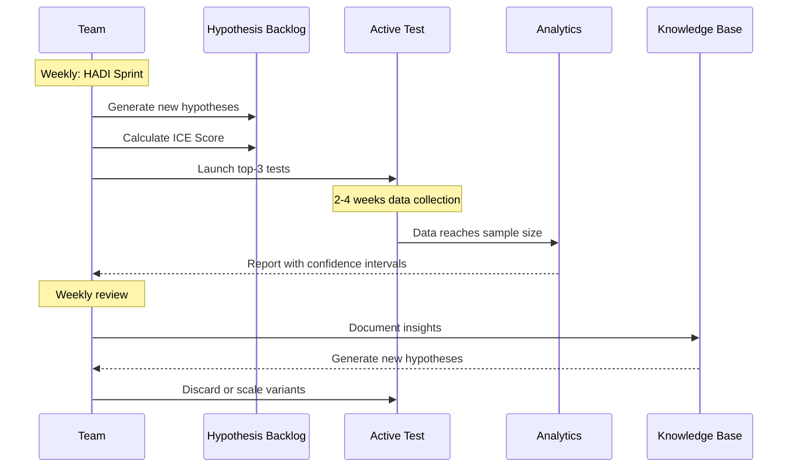

In 2012, Airbnb's growth team faced a concrete problem: the listing photos were poor quality - dark, poorly framed, and unappealing. The hypothesis was that better photos would increase bookings. The obvious solution was to build a system guiding hosts to take better photos, but that would have taken months.

Instead, the team took a different approach: they hired professional photographers in New York and offered hosts free professional photos of their apartments. The total cost was a few thousand dollars, and data collection took three weeks. The result showed listings with professional photos had double the bookings compared to average. The hypothesis was validated with real data, not simulations.

This professional photography program became one of Airbnb's key strategic initiatives. But the point is not the strategy - it's the method. The team didn't wait for a perfect system; they built the minimum needed to test the hypothesis, gathered real data, learned, and then scaled.

This is the HADI cycle in action: Hypothesis, Action, Data, Insight.

## Why learning speed is the real competitive advantage

Jeff Bezos distinguished two types of decisions in his 2016 shareholder letter: Type 1 decisions, irreversible and high-impact, requiring slow, thorough analysis; and Type 2 decisions, reversible and testable, which should be made quickly to learn.

Slow-growing companies often fail not because of lack of ideas or budget, but because they treat Type 2 decisions like Type 1 - spending months planning initiatives that could be tested in weeks with a fraction of the effort.

The HADI cycle is an operational framework to accelerate Type 2 decisions: it deliberately formulates hypotheses, tests them with minimal effort, collects real data, and converts data into systemic learning. The advantage isn't a single experiment but the ability to complete many more than competitors.

Amazon tested thousands of site variants in 2023. Booking.com runs over 1,000 simultaneous A/B tests daily. Spotify constantly tests homepage and recommendation variants. It's not about unlimited resources but a culture of systematic testing where every insight becomes a testable hypothesis before becoming strategy.

## The 4 phases of the HADI cycle

### Phase 1: Hypothesis  -  formulating testable hypotheses

The most common mistake is vagueness. "I want to improve conversion" is a wish, not a hypothesis. A hypothesis must be specific, falsifiable, and based on a plausible causal mechanism.

A useful structure is:

> "We believe that [specific action] for [segment or context] will produce [measurable result] because [causal mechanism]. We will consider the hypothesis confirmed if [metric] changes by [amount] within [timeframe]."

Examples:

| Poorly formed hypothesis | Well-formed hypothesis |
|---|---|
| "Improve product page" | "Adding 3 video reviews above the fold will increase CR by 8%+ because social proof reduces pre-purchase uncertainty" |
| "Test a different price" | "Price €97 will convert better than €99 for new desktop visitors, impacting CR by >5%" |
| "Improve email" | "Changing subject from open question to specific number will increase open rate by 3 percentage points among inactive users (>30 days)" |

The "because" part is crucial. Without an explicit causal mechanism, testing is blind. With it, a failed test helps identify if the hypothesis or the mechanism understanding is flawed.

### Phase 2: Action  -  the minimum needed to learn

The classic trap is perfectionism: waiting for a perfect solution before testing. The goal is not to launch a finished product but to gather information. The right question is: what is the fastest, cheapest way to get enough data to validate or invalidate this hypothesis?

Common tools:

- **A/B Test:** the gold standard for testing page, email, copy, price variations. Requires sufficient volume, with sample size calculated beforehand.

- **Fake Door Test:** launch a button or page announcing a feature not yet built to measure real interest.

- **Concierge MVP:** manually do what automation would do to validate value before investing.

- **Landing Page Test:** create a page describing the product and measure signups for launch notifications.

### Phase 3: Data  -  collecting useful data, not just lots of data

The risk is not too little data but wrong data or misinterpretation.

- **Statistical significance:** with few visitors, differences may be noise. Calculate sample size before starting.

- **OMTM (One Metric That Matters):** each experiment must have a primary metric defined before launch to avoid bias.

- **Novelty Effect:** tests often show an initial boost due to novelty that fades. For high-traffic tests, wait at least two weeks.

### Phase 4: Insight  -  turning data into systemic learning

The real value is not the single experiment but accumulated knowledge over time. A failed experiment is valuable information.

Documentation is critical: without it, teams risk rediscovering the same truths, wasting time and resources.

A minimal template to document each experiment:

EXPERIMENT: [Name]
DATE: [start] - [end]
HYPOTHESIS: [Full formulation]
VARIANT: [What was changed]
PRIMARY METRIC: [Name and definition]
SAMPLE SIZE: [Per group and calculation]
RESULTS: [Numbers with confidence intervals]
DECISION: [Scale / Discard / Replicate]
INSIGHT: [What we learned]
NEXT HYPOTHESES: [What to test next]

## HADI vs PDCA vs OKR vs OODA: when to use which

Different iterative improvement frameworks suit different contexts.

| Framework | Optimized for | Strength | Limitation |
|---|---|---|---|
| PDCA | Continuous improvement of known processes | Systematic, reduces variability | Assumes process knowledge |
| OKR | Alignment on long-term goals | Clear direction | Less suited for rapid experimentation |
| OODA | Rapid reaction in chaotic environments | Speed of decision | Less rigorous measurement |
| HADI | Discovery of new growth drivers | Rigorous, accumulates learning | Requires sufficient data |

## Experiment prioritization: ICE Score and RICE Score

Mature teams manage a portfolio of experiments in parallel, with disciplined prioritization.

### ICE Score (Impact, Confidence, Ease)

- Impact: how big would the impact be?
- Confidence: how sure are you?
- Ease: how easy is it to run the test?

ICE Score = (Impact + Confidence + Ease) / 3

### RICE Score (Reach, Impact, Confidence, Effort)

- Reach: how many users will this affect?
- Impact: how much will behavior change?
- Confidence: how sure are you?
- Effort: how much work does it require?

RICE Score = (Reach × Impact × Confidence) / Effort

Both help avoid bias toward unvalidated ideas.

## Case study: three HADI cycles to optimize checkout

**Cycle 1: Reduce form fields**

Hypothesis: reducing required checkout fields from 15 to 8 will increase completion rate by 12% by lowering cognitive load.

Action: A/B test full form vs streamlined form.

Data: 8,000 users per variant, 4 weeks.
- Completion A: 62.4%
- Completion B: 69.8%
- Difference: +7.4 points, p=0.002

Insight: hypothesis confirmed, effect smaller than expected. Mobile segment showed stronger effect.

Decision: scale variant B, generating ~$45k/month.

**Cycle 2: Add "Satisfaction or Refund" guarantee badge**

Hypothesis: visible guarantee will reduce pre-purchase anxiety on mobile, increasing conversions and reducing returns.

Action: A/B test with and without guarantee banner.

Data: 12,000 users per variant, 4 weeks.
- Completion A: 69.8%
- Completion B: 72.1%
- Difference: +2.3 points, p=0.08
- Returns similar (17% vs 18%)

Insight: conversion increased, but no significant reduction in returns. Indicates post-purchase issues.

Decision: scale variant B, generating $30k/month. New hypothesis for cycle 3.

**Cycle 3: Improve confirmation email tone**

Hypothesis: reassuring post-purchase email reduces returns by strengthening trust.

Action: A/B test standard vs personalized thank-you email.

Data: 15,000 orders per variant, 2 weeks.
- Returns A: 17.8%
- Returns B: 14.2%
- Difference: -3.6 points, p=0.001
- "Track order" CTR: 31%

Insight: hypothesis confirmed; email tone impacts buyer's remorse.

Decision: scale variant B. Net impact after 3 cycles: higher conversions and fewer returns, estimated $100k/month value.

## Managing multiple HADI cycles simultaneously

Mature teams run portfolios of experiments at different stages - from planning to post-test analysis - to maximize learning speed.

## Conclusion: learning speed as a strategic asset

Winning companies don't always start with the best ideas but learn faster. Each completed HADI cycle adds knowledge about the market, users, and growth drivers, creating a competitive advantage that's hard to replicate.

Amazon Web Services became a leader not by having the best idea in 2006, but by running more experiments, learning faster, and iterating more quickly for nearly two decades.

The difference between a team completing 2 HADI cycles per month and one completing 8 translates into hundreds of experiments and accumulated insights. With equal resources, the latter knows things the former doesn't.

Stop planning for years. Define a hypothesis, build the minimum to test it, measure rigorously, learn, and repeat. Learning speed is the only competitive advantage that can't be copied because it depends on what you know, the sum of all your past tests.

Explore the framework further in our [Growth and Statistical Significance module](/course/significativita-statistica/).
