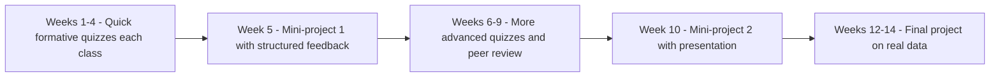

In 2011, Sebastian Thrun, a computer science professor at Stanford, made his Artificial Intelligence course freely available online, expecting a few thousand Silicon Valley enthusiasts. Instead, 160,000 people from 190 countries enrolled. Surprisingly, the top 400 students were not Stanford attendees or even university students - they were self-taught individuals from countries where elite universities were unreachable. Thrun left Stanford to found Udacity, predicting that in fifty years only ten institutions will truly deliver higher education. This story highlights a structural problem: traditional universities are built around outdated constraints like physical presence and limited expert access.

Italian universities, with centuries of history and entrenched bureaucracy, face the same tension. Recent data reveal a structural lag: first-year dropout rates between 15 and 20 percent, graduates aged 25-34 at 29 percent versus the EU average of 42 percent, lower satisfaction scores, limited use of learning analytics, lower employment rates after graduation, longer degree completion times, and lower per-student spending. These figures indicate a deep-rooted, persistent issue rather than a sudden crisis.

## The Five Pillars of the Innovative Professor

### 1. Flipped Classroom: Reversing the Traditional Model

Traditionally, professors deliver content in class and students apply it at home, often without support. The flipped classroom reverses this: content delivery happens at home via videos or readings, while class time is dedicated to practical application and discussion. This enables immediate feedback and targeted help. To work effectively, videos must be short and include comprehension questions, and classroom activities must assume students have watched the material.

### 2. Learning Analytics: Measuring What Matters

Modern platforms collect detailed data on student interactions: attendance, video views, quiz results, completion times, and engagement. These insights help identify at-risk students and improve materials and teaching methods. For example, multiple video reviews signal diligence rather than difficulty.

### 3. Project-Based Learning: Starting with Real Problems

Replacing abstract exercises with real-world problems forces students to make decisions about metrics, relevant data, and communication. This approach develops skills demanded by the job market, making theory immediately relevant and memorable.

### 4. Gamification: Motivating with Meaningful Incentives

Effective gamification changes incentive structures rather than just adding superficial elements. Examples include anonymous weekly leaderboards on short quizzes, team challenges with peer evaluation, and business simulations with measurable consequences. These increase engagement and social accountability.

### 5. Continuous Feedback: Assessing Before the Final Exam

Final exams come too late to fix deep misunderstandings. Weekly formative quizzes, intermediate mini-projects, and structured peer reviews identify and correct issues early, reducing anxiety and improving outcomes.

## Success Stories

At the University of Bologna, Professor Carlo Moretti implemented learning analytics in Process Management courses, reducing dropout from 18% to 7% and raising average grades from 22.1 to 24.8. At Politecnico di Milano, the Executive MBA program developed a predictive model to identify students at risk of employment difficulties, offering targeted interventions that increased placement rates to 92% within six months of graduation.

## Managing Resistance

Innovation faces resistance from traditional colleagues, academic bureaucracy, and students accustomed to passive learning. The strategy is to present concrete data, distinguish between content and teaching methods, and explicitly renegotiate the learning contract with students, explaining the value of active learning.

## National Context and Resources

Italy's Recovery and Resilience Plan (PNRR) allocated over 3 billion euros for university innovation, including digital infrastructure, faculty training, and online course development. Erasmus+ funds provide additional resources for innovation and best practice exchanges. The main barrier is not funding but awareness and access to these resources.

## Free Tools to Get Started

No investment is needed to start: tools like Google Colab, Moodle, Mentimeter, Kaggle, Slido, and Notion are free or open source and integrate with existing LMSs. Tool choice should follow pedagogical questions, not precede them.

## Framework for University Digital Transformation

A structured approach includes:

- Initial diagnosis (data audit, identifying early adopters, tool setup)
- Localized pilots with 5-10 professors and rigorous measurement
- Selective scaling to 30-50 professors and systematic training
- Cultural integration making innovative, data-driven teaching standard and establishing centers of pedagogical excellence

## Conclusion

Being an innovative professor means using modern data and methods to achieve an age-old goal: genuine student learning. Universities have a unique advantage in human contact and community that online platforms cannot replicate. The challenge is recognizing that change is possible, strategic, and economically beneficial - and acting with awareness and method.
