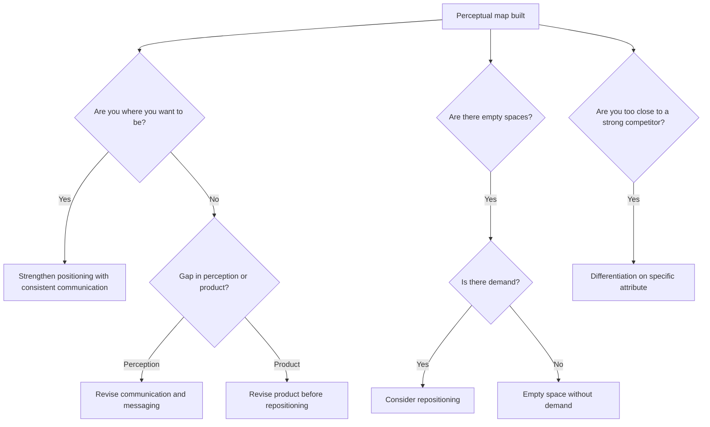

In 1983, Diet Coke arrived 30 years after Tab, Coca-Cola's original diet cola. Tab had a strong brand and loyal customers, so launching a second diet product seemed unnecessary. Yet a perceptual map of the beverage market revealed a clear gap: the space defined by "modern cola + low calorie + masculine brand" was empty. Tab was seen as feminine, traditional colas as high-calorie. That mental space was unoccupied.

Diet Coke launched into that space, becoming Coca-Cola's fastest-growing product ever: 200 million cases sold in the first year, and the third best-selling soda in the US by 1984.

The perceptual map did not create Diet Coke but identified where it could exist without cannibalizing Tab or competing head-on with Pepsi or traditional Coke. It was a map of consumers' mental space, highlighting unexplored territory.

## What is a perceptual map and why does it matter

A perceptual map is a two-dimensional chart where each axis represents a consumer-relevant attribute, and brands are positioned according to how consumers perceive them on those attributes.

The key distinction is that the map shows consumer perception, not objective reality. A technically superior product can be perceived as mid-tier if communication does not support a premium position, and vice versa.

The strategic value of a perceptual map includes:

- understanding your position in consumers' minds relative to competitors
- identifying unoccupied spaces
- diagnosing communication issues
- guiding repositioning decisions

### Classic example: the European car market

A well-known map uses two axes: economic-premium and sporty-comfort.

|                | Sporty             | Comfort            |
|----------------|--------------------|--------------------|
| Economic       | Alfa Romeo, Fiat, Dacia | Dacia, Volvo       |
| Premium        | Ferrari, BMW       | Mercedes           |

Alfa Romeo is sporty and mid-priced, BMW sporty and premium, Mercedes premium and comfort-oriented. The sporty-economic quadrant was a gap that Renault and Toyota later targeted.

## How to build a perceptual map: 4 steps

### 1. Choose the right attributes

Attributes must be relevant to purchase decisions, differentiating, and bipolar (clear opposite extremes). The best source is qualitative consumer research, not marketing teams.

| Sector           | Typical attributes                      |
|------------------|---------------------------------------|
| Fashion          | Price vs Quality, Classic vs Trendy   |
| Food & Beverage  | Healthy vs Indulgent, Traditional vs Innovative |
| SaaS             | Simple vs Powerful, Economical vs Enterprise |

### 2. Collect perceptual data

**Option A: structured survey** with Likert scales (1-7) rating each brand on each attribute, sampling a representative group including customers and non-customers.

**Option B: online review analysis** using NLP and sentiment analysis, useful for preliminary or ongoing monitoring.

### 3. Statistical analysis: MDS or PCA

With few attributes, you can plot directly; with many, dimensionality reduction is needed.

- MDS projects perceptual distances into 2D, ideal for direct similarity data
- PCA finds two principal components explaining variance, common with attribute scores

A practical example in the Italian SaaS market uses PCA to reveal a "simple + economical" empty space.

### 4. Interpret the map and define strategy

Key strategic readings:

- confirm if you occupy your intended position in consumers' minds
- identify empty spaces with potential demand
- analyze competitive clusters to differentiate
- monitor changes over time with regular updates

## Common pitfalls

- choosing attributes irrelevant to consumers
- confusing perception with technical reality
- biased samples (only current customers)
- failing to update the map over time

## Case study: specialty coffee market in Italy

A study of 250 consumers mapped brands like Illy, Lavazza, Blue Bottle, Intelligentsia, and a local artisan roaster.

PCA revealed two dimensions: "Italian tradition vs international modernity" and "accessible vs premium."

The roaster positioned near American brands in the "modern + premium" quadrant faces tough competition. The "modern + accessible" quadrant is nearly empty, representing an opportunity to offer quality and cool factor at accessible prices.

The suggested strategy is expanding online subscriptions at competitive prices, emphasizing modern craftsmanship and sustainability.

## Practical applications

Perceptual maps inform naming, pricing, product development, and advertising investments, ensuring alignment between perception and strategy.

## Conclusion

As Jocelyn Wyatt of IDEO U says, "design thinking starts with observation." Before deciding where to go, you must know where you are in consumers' minds. Perceptual maps are practical decision tools that reveal not just how much you sell, but why and where you can grow.
