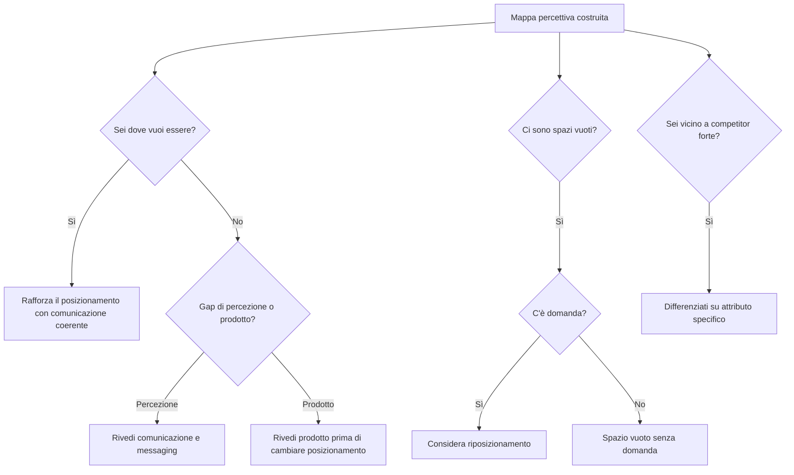

Nel 1983, Diet Coke arrivò con 30 anni di ritardo rispetto a Tab, la prima cola dietetica di Coca-Cola. Tab aveva un brand consolidato e una clientela fedele, quindi non sembrava necessario un secondo prodotto dietetico. Tuttavia, una mappa percettiva delle bevande mostrava uno spazio vuoto preciso: nel posizionamento "cola moderna + basso contenuto calorico + brand maschile" non c'era nessuno. Tab era percepita come femminile, le cole tradizionali come ad alto contenuto calorico. Quello spazio mentale non presidiato era enorme.

Diet Coke fu lanciata proprio lì, diventando il prodotto con la crescita più rapida nella storia di Coca-Cola: 200 milioni di casse vendute nel primo anno e terza bevanda gassata più venduta negli Stati Uniti nel 1984.

La mappa percettiva non creò Diet Coke, ma identificò lo spazio in cui poteva esistere senza cannibalizzare Tab e senza competere direttamente con Pepsi o Coke tradizionali. Era una mappa dello spazio mentale dei consumatori, che mostrava territori inesplorati.

## Cos'è una mappa percettiva e perché è importante

Una mappa percettiva è un grafico bidimensionale in cui ogni asse rappresenta un attributo rilevante per i consumatori, e i brand sono posizionati in base a come vengono percepiti su quegli attributi.

La differenza fondamentale è che la mappa mostra la percezione dei consumatori, non la realtà oggettiva. Un prodotto tecnicamente superiore può essere percepito come di fascia media se la comunicazione non supporta un posizionamento premium, e viceversa.

Il valore strategico di una mappa percettiva è:

- capire dove sei nella mente del consumatore rispetto ai competitor
- identificare spazi vuoti non presidiati
- diagnosticare problemi di comunicazione
- guidare decisioni di riposizionamento

### Esempio classico: il mercato automobilistico europeo

La mappa più nota usa due assi: economico-premium e sportivo-comfort.

|                | Sportivo           | Comfort            |
|----------------|--------------------|--------------------|
| Economico      | Alfa Romeo, Fiat, Dacia | Dacia, Volvo       |
| Premium        | Ferrari, BMW       | Mercedes           |

Alfa Romeo è sportiva e di prezzo intermedio, BMW sportiva e premium, Mercedes premium e orientata al comfort. Il quadrante sportivo-economico era uno spazio vuoto, che Renault e Toyota hanno cercato di occupare.

## Come costruire una mappa percettiva: i 4 passaggi

### 1. Scegliere gli attributi giusti

Gli attributi devono essere rilevanti per la decisione d'acquisto, differenzianti e bipolari (con due estremi opposti chiari). La fonte migliore sono le ricerche qualitative con i consumatori, non il team marketing.

| Settore           | Attributi tipici                        |
|-------------------|---------------------------------------|
| Fashion           | Prezzo vs Qualità, Classico vs Trendy |
| Food & Beverage   | Salutare vs Indulgente, Tradizionale vs Innovativo |
| SaaS              | Semplice vs Potente, Economico vs Enterprise |

### 2. Raccolta dati percettivi

**Opzione A: sondaggio strutturato** con scala Likert (1-7) su ogni brand e attributo, con un campione rappresentativo che includa clienti e non clienti.

**Opzione B: analisi delle recensioni online** con NLP e sentiment analysis, utile per analisi preliminari o monitoraggio nel tempo.

### 3. Analisi statistica: MDS o PCA

Con pochi attributi si può disegnare direttamente, con molti si usa riduzione dimensionale.

- MDS: proietta le distanze percettive in 2D, ottimo con dati di similarità diretta
- PCA: combina gli attributi in due componenti principali che spiegano la varianza, più comune con dati di punteggio

Un esempio pratico nel mercato SaaS italiano mostra come usare PCA per costruire la mappa e identificare uno spazio vuoto "semplice + economico".

### 4. Interpretare la mappa e definire la strategia

Le letture strategiche principali sono:

- confermare se sei dove vuoi essere nella mente del consumatore
- identificare spazi vuoti con potenziale domanda
- analizzare cluster competitivi per differenziarti
- monitorare l'evoluzione nel tempo con aggiornamenti regolari

## Errori da evitare

- scegliere attributi non rilevanti per i consumatori
- confondere percezione con realtà tecnica
- campione distorto (solo clienti attuali)
- non aggiornare la mappa nel tempo

## Caso pratico: mercato del caffè specialty in Italia

Uno studio su 250 consumatori ha mappato brand come Illy, Lavazza, Blue Bottle, Intelligentsia e un tostatore artigianale italiano.

La PCA ha evidenziato due dimensioni: "tradizione italiana vs modernità internazionale" e "accessibile vs premium".

Il tostatore si posiziona vicino ai brand americani nel quadrante "moderno + premium", molto competitivo. Lo spazio "moderno + accessibile" è quasi vuoto, rappresentando un'opportunità per offrire qualità e cool factor a prezzo accessibile.

La strategia suggerita è espandere la distribuzione online con abbonamenti competitivi, mantenendo la comunicazione su artigianalità moderna e sostenibilità.

## Applicazioni pratiche

Le mappe percettive guidano decisioni su naming, pricing, sviluppo prodotto e investimenti pubblicitari, assicurando coerenza tra percezione e strategia.

## Conclusione

Come dice Jocelyn Wyatt di IDEO U, "design thinking starts with observation". Prima di decidere dove andare, devi sapere dove sei nella mente dei consumatori. Le mappe percettive sono strumenti decisionali concreti che mostrano non solo quanto vendi, ma perché e dove puoi crescere.
