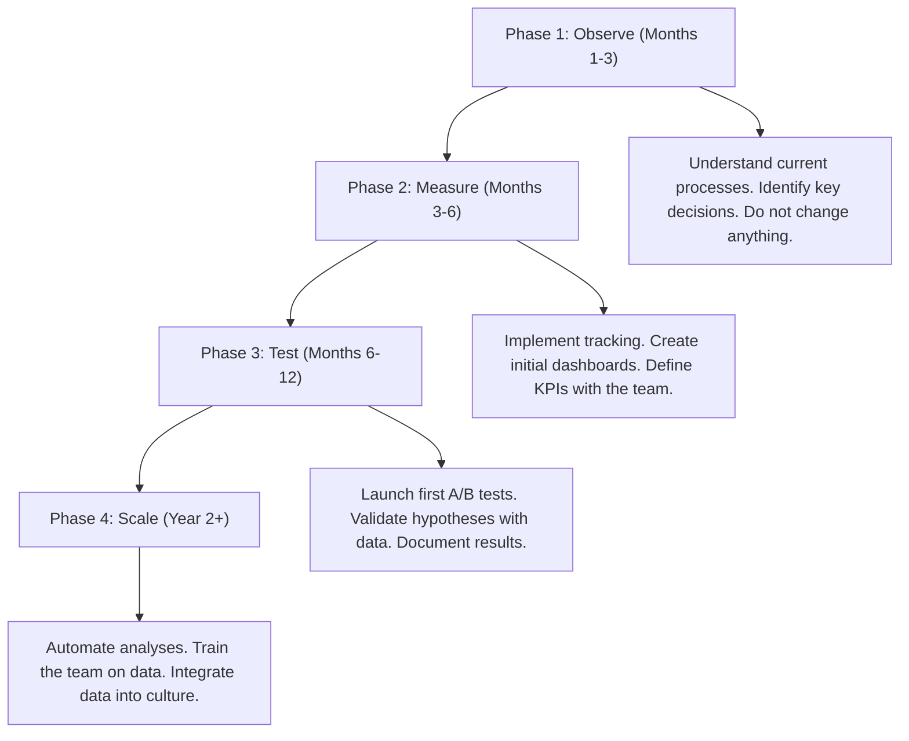

Italian SMEs are undergoing a profound transformation led by millennial managers who embrace the discipline of decision-making under uncertainty through a data-driven approach. This shift is not merely technological but epistemological: moving from intuition and experience to measurable data and continuous experimentation.

## Real-world problem

Many family-run Italian SMEs face a radical generational handover. New managers, often founders' children, return with Business Analytics degrees and international experience, only to find outdated management practices where decisions are still made by gut feeling and data is confined to annual reports or obsolete Excel sheets.

## Conceptual model

Millennials bring a collaborative, data-informed style that manifests in five key management changes:

1. From defensive resistance to change to a culture of continuous experimentation.
2. From hierarchical information control to data democratization.
3. From monthly reporting to real-time monitoring.
4. From respect based on seniority to competence demonstrated with data.
5. From office presence to hybrid work with output-based productivity metrics.

These shifts are enabled by practical tools like shared dashboards, self-service data analysis platforms, and people analytics models that turn HR management into a predictive science.

## Rigorous formalization

Decision-making under uncertainty is operationalized through the HADI cycle (Hypothesis, Action, Data, Insights), a framework that lowers error costs via rapid tests and real data. The data-driven transition unfolds in four phases:

- **Phase 1: Observe (Months 1-3)** - listen and map existing processes without immediate changes.
- **Phase 2: Measure (Months 3-6)** - implement essential tracking and co-define KPIs.
- **Phase 3: Test (Months 6-12)** - launch structured experiments with rigorous documentation.
- **Phase 4: Scale (Year 2+)** - automate, train the team, and embed data culture in daily decisions.

## Example or case study

A food distributor in Northeast Italy shifted from monthly reports to real-time dashboards. Sales agents, previously informed only at month-end, could now see daily performance against weekly targets. Within six months, the performance gap between top and bottom agents shrank by 40%, as underperformers identified and corrected issues promptly.

Booking.com exemplifies extreme continuous experimentation, running over 25,000 A/B tests annually to minimize costly intuition-based errors.

## Lab / exercise

**Basic level:** Map current decision-making processes without changes, identifying main data sources and key decisions.

**Intermediate level:** Define 3-5 relevant KPIs with the team and implement a simple data collection system (e.g., shared Google Sheets).

**Research-grade level:** Design and run a structured A/B experiment on a commercial decision, documenting hypotheses, control and test groups, duration, and success metrics.

**Recommended datasets and materials:** Monthly sales data, open-source dashboard tools (Metabase, Apache Superset), resources on the HADI cycle and continuous experimentation.

## Common pitfall to avoid

Mistaking data volume for decision quality. Implementing too many tools simultaneously without a clear plan breeds chaos and resistance. Turning every activity into a metric creates a control system that destroys trust and creativity. Defining a few meaningful KPIs and fostering shared culture is essential.

## Quiz or checkpoint

- What is the main advantage of the HADI cycle in managing uncertainty?
- Why does data democratization improve decision-making at all company levels?
- What risks arise from introducing too many technological tools at once?
- How can traditional experience be valued in a data-driven context?

## Conclusion

The future of management in Italian SMEs lies in balancing experience with data, craftsmanship with experimentation. Millennial managers are not merely introducing new technologies; they are instilling discipline in decision-making under uncertainty, grounded in real data, continuous testing, and transparency. Those who lead this transition with respect and method will build an unstoppable and lasting competitive advantage.
