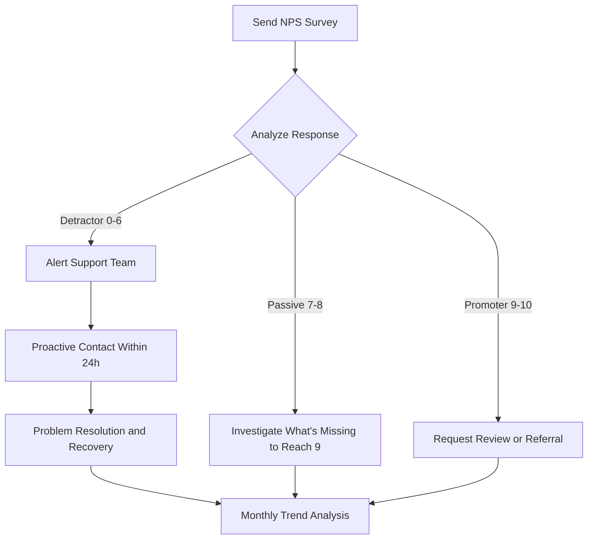

In 2003, Fred Reichheld introduced the Net Promoter Score (NPS) as the single metric that could predict business growth, based on a straightforward question: "How likely are you to recommend our company to a friend or colleague?" Since then, NPS has become a widespread standard, adopted by giants like Apple, Tesla, and Amazon. Yet, more than twenty years later, it's time for a critical assessment: NPS is powerful, but it is not the magic bullet many believe it to be.

## How NPS Is Calculated (The Math Behind the Myth)

NPS segments customers into promoters (9-10), passives (7-8), and detractors (0-6). The formula is simple: NPS = % Promoters - % Detractors. However, this simplicity hides methodological nuances: passives are included in the denominator but not in the numerator, a specific choice that can cause confusion.

A practical example with real responses shows how an NPS of 20 can arise from a mix of enthusiastic, satisfied, and dissatisfied customers, highlighting the aggregate and synthetic nature of the metric.

## The Scientific Issues with NPS

### 1. Intention vs Behavior

NPS measures declared intention to recommend, not actual behavior. Academic studies, such as Timothy Keiningham's, reveal that the correlation between NPS and growth is weaker than initially claimed, and other metrics can be equally or more predictive.

### 2. Cultural Bias

NPS responses vary according to cultural norms: a 7 in Italy may indicate satisfaction, while in other countries it may not. Comparing NPS across cultures is like comparing apples to oranges, potentially leading to misguided decisions.

### 3. Lack of Causality

A high or low NPS score does not reveal what to fix. Without qualitative follow-up questions, NPS is a thermometer without a diagnosis: it signals a problem but not its cause.

### 4. Timing and Context

NPS is influenced by when it is collected. The same person can give very different scores depending on recent experiences, making the metric volatile and sensitive to timing.

### 5. Statistical Stability

With small samples, NPS is highly volatile. For startups or companies with few customers, a single change can drastically alter the score, complicating interpretation.

## Better Alternative Metrics

NPS should not be discarded but complemented with more precise and actionable metrics:

- **CSAT (Customer Satisfaction Score):** measures satisfaction at specific touchpoints, useful for targeted improvements.
- **CES (Customer Effort Score):** assesses how easy it was for the customer to resolve an issue, often more predictive of loyalty.
- **Product-Market Fit Survey:** gauges how indispensable a product is to the customer.
- **Behavioral Metrics:** churn rate, retention rate, expansion rate, measuring actual customer actions.

| Metric | Measures | Churn Predictiveness | Actionability | Ease of Implementation | Cultural Bias |
|---|---|---|---|---|---|
| NPS | Intention to recommend | Medium-Low | Low | High | High |
| CSAT | Satisfaction per event | Medium | High | Medium | Medium |
| CES | Ease of problem resolution | High | High | Medium | Low |
| Churn Rate | Actual customer loss | Very High | High | High | None |
| Expansion Rate | Spending increase | Very High | Very High | High | None |
| PMF Survey | Perceived indispensability | Very High | Very High | Medium | Low |

## Closing the Loop

The value of NPS lies in the response process, not the number itself. For example, contacting a detractor within 24 hours can turn them into a loyal customer, while ignoring them can amplify damage.

## Real Case: How Apple Uses NPS

Apple doesn't chase a high NPS score per se but monitors weekly trends per store and per employee. A sudden drop triggers an alert and investigation, turning NPS into an early warning system and continuous improvement tool.

## Making NPS Actionable with Driver Analysis

Using multiple regression, NPS can be decomposed into contributing factors (quality, price, service, shipping, packaging), providing a strategic map for targeted interventions.

## Transactional vs Relational NPS

Distinguishing between NPS collected immediately after a transaction and NPS on the overall brand helps identify whether issues lie with the product or the company's broader image.

## Case Study: Italian SaaS Company

A SaaS company replaced NPS as the primary metric with a hybrid system integrating CSAT, CES, churn, and relational NPS with driver analysis, achieving a 37% churn reduction and 50% upsell increase in 18 months.

| Metric | Before | After | Impact |
|---|---|---|---|
| Churn rate | 8.2% monthly | 5.1% monthly | -37% |
| Average CSAT | Not measured | 4.2/5 | Benchmark >4.0 |
| Expansion rate | 12% | 18% | +50% |
| NPS | 38 (non-actionable) | N/A | Better prediction via churn |

## Conclusion

NPS is a useful but incomplete tool. It's a thermometer indicating a problem but not its cause. Effective decision-making under uncertainty requires integrating NPS with behavioral metrics, driver analysis, and rapid response processes for dissatisfied customers. Only then does a number become a real competitive advantage.

For deeper insights, see our [course on fundamental metrics and statistical significance](/course/metriche-fondamenti/).

The real question is not "What is our NPS?" but "What decisions do we want to make with this metric?" The number is a tool, not the goal.
