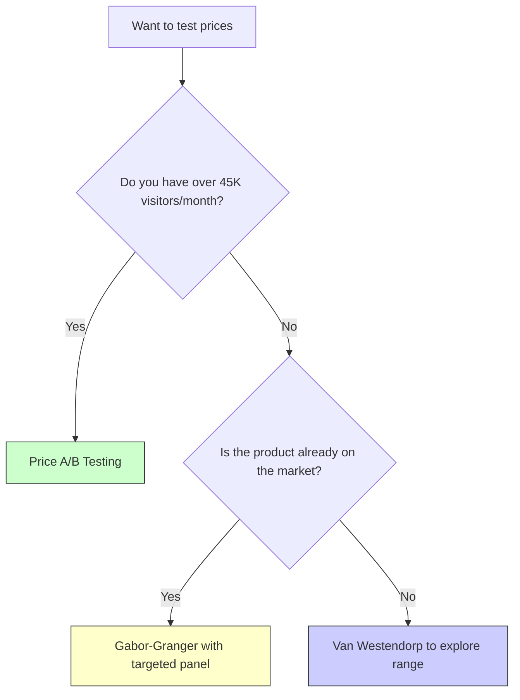

In 2006 Amazon made a move that seemed reckless: they eliminated shipping fees for orders above a certain threshold. Internally, it was called "the stupid move." Three years later, Prime became the company's most profitable product  -  not because they guessed the right price, but because they measured it with data.

Price is the most powerful lever in business. A 1% price increase typically yields a 10% profit boost (McKinsey, 2021). Yet many Italian companies still set prices by marking up costs or copying competitors, approaches that ignore the market or mimic strategies without understanding them.

I've often seen founders show price lists with vague reasons like "it seemed reasonable." Reasonable for whom? Based on what?

There are three scientific methods to test prices, accessible and more reliable than intuition. I apply them sequentially in pricing projects.

## Method 1: Van Westendorp (Price Sensitivity Meter)

In the 1970s, Peter van Westendorp proposed a method to identify psychological price boundaries rather than just asking purchase intent. Four questions explore where the market perceives the price as too low, a bargain, too high, or unacceptable.

### The 4 Questions

1. At what price would you consider the product too cheap, making you doubt its quality?
2. At what price would you consider it a bargain, affordable but good quality?
3. At what price would you start thinking it costs too much, but you'd still consider buying?
4. At what price would you consider it too expensive to buy?

### Analyzing Results

Plotting cumulative curves reveals:

| Intersection | Meaning |
|---|---|
| "Too cheap" ∩ "Too expensive" | Optimal Price Point (OPP): minimal psychological friction |
| "Bargain" ∩ "Expensive" | Indifference Price Point (IPP): perceived normal price |
| Range between intersections | Acceptable Price Range: maneuvering zone |

### Case Study: Italian SaaS Startup for Tax Compliance

An Italian startup entered the market at €89/month without testing, copying a US competitor's price. After interviewing 230 decision-makers, Van Westendorp showed an OPP at €67/month and an IPP at €95/month, with an acceptable range between €45 and €130. The initial price was perceived as "cheap," signaling low value. Raising the price to €110 and improving positioning increased conversion by 23% because the product appeared more "serious."

### Pros and Cons

| Pros | Cons |
|---|---|
| Easy and quick (200 responses suffice) | Based on opinions, not actual purchases |
| Provides a range, not a single point | Does not segment by customer type |
| Inexpensive to conduct | Does not measure true willingness to pay |
| Great for new products | Sensitive to question wording |

## Method 2: Gabor-Granger (Direct Price Testing)

Clive Granger and Andre Gabor developed a method to understand demand as a function of price. You present a price and ask if the customer would buy. The question adapts based on responses to find the maximum acceptable price.

### Procedure

1. Choose 5-7 prices covering your range.
2. Show a random price.
3. If the respondent says "yes," show a higher price; if "no," a lower price.
4. Continue until the maximum acceptable price is found.
5. Aggregate responses to build the demand curve.

### Example

A project management tool priced between €9 and €29 shows the highest Revenue Index at €15, balancing volume and margin.

| Price | % Willing to Buy | Revenue Index |
|---|---|---|
| €9 | 85% | 765 |
| €12 | 72% | 864 |
| €15 | 58% | 870 |
| €19 | 41% | 779 |
| €25 | 22% | 550 |
| €29 | 8% | 232 |

### Basecamp Case

Basecamp removed the $24 tier after finding demand concentrated between $49 and $99. Switching to a flat $99 price reduced churn by 15% because customers no longer felt nickel-and-dimed.

### Pros and Cons

| Pros | Cons |
|---|---|
| More realistic than Van Westendorp | Still based on stated intentions |
| Builds a true demand curve | Requires 300+ reliable responses |
| Finds optimal prices for different goals | Sensitive to question framing |
| Quantifies demand elasticity | Does not capture temporal dynamics |

## Method 3: Price A/B Testing (The Gold Standard)

In 2014, Netflix tested a price increase on a subset of US subscribers, finding churn unchanged. This allowed a company-wide increase the following year.

### Ethical Implementation

1. Test only on new customers.
2. Keep price variations within ±15%.
3. Run tests for at least two weeks.
4. Segment by channel.
5. Be transparent after the test.

### Technical Setup

Example code uses MD5 hashing to assign users deterministically to price groups, ensuring consistent assignment.

### SaaS Test Results

| Group | Price | CR (%) | Revenue per Visitor (RPV) | Margin per Visitor |
|---|---|---|---|---|
| price_low | €14.90 | 2.80 | €0.42 | €0.22 |
| price_mid | €17.90 | 2.33 | €0.42 | €0.15 |
| price_high | €19.90 | 1.87 | €0.37 | €0.09 |

Higher price doesn't guarantee higher RPV or margin.

### Required Traffic

Detecting a 0.5% conversion difference with 95% confidence and 80% power requires ~22,000 visitors per variant, explaining why only large companies can run many tests.

### Pros and Cons

| Pros | Cons |
|---|---|
| Real behavioral data, not stated intentions | Requires high traffic |
| Measures true demand elasticity | Ethical and reputational risks if mishandled |
| Captures effects surveys miss | Takes weeks |
| Gold standard for pricing research | Hard for long sales cycles |

## Demand Elasticity Formula

Elasticity is the ratio of the percentage change in quantity sold to the percentage change in price. Elasticity > 1 means demand is elastic; < 1 means inelastic.

## Which Method to Choose?

Depends on traffic, product stage, and certainty needed:

The ideal path is Van Westendorp to explore, Gabor-Granger to refine, and A/B testing to validate.

## A Case That Changed My Pricing Approach

An Italian HR software company priced at €199/month because "competitors did." Van Westendorp showed an OPP at €280, Gabor-Granger a max revenue at €249. Raising the price caused a 40% drop in conversions. The issue was positioning: different customers expected different services. Changing price changes the customer profile.

## Conclusion

There is no absolute "right" price, only an optimal price for your goal. Use Van Westendorp to explore, Gabor-Granger to estimate demand, and A/B testing to validate with real data. This turns pricing from art into applied science.

For deeper understanding, check out the [Mathematics for Data Analysis](/course/matematica-analisi-dati/) module on GinnyTech.
