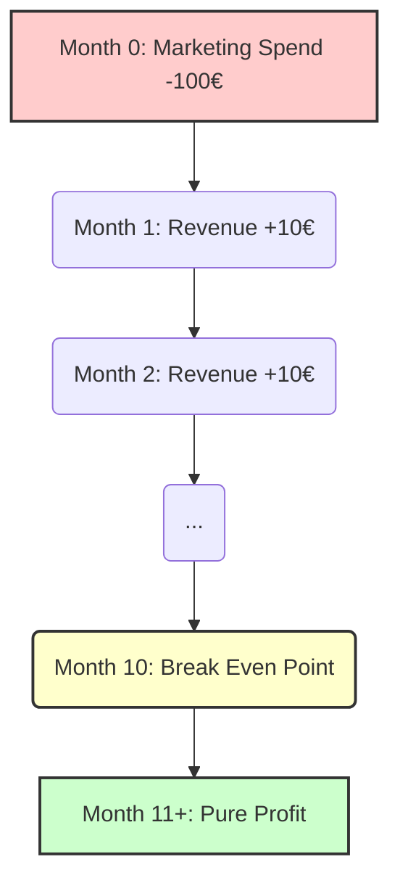

Back in 2015, Oliver Samwer, CEO of Rocket Internet, was known as the most effective "startup clone" globally. His approach was straightforward: replicate American business models in Europe and emerging markets, grow acquisition numbers at any cost, then go public. The catch? No one checked the unit economics.

Take Zalando: they spent 40 euros acquiring customers who bought 50-euro shoes, returned 70% of them, and disappeared. Acquisition costs were real; net revenue was nearly zero. When financial markets started asking the right questions about fundamentals, valuations collapsed. The lesson is clear: optimizing funnel metrics endlessly is futile if the basic math per customer doesn't add up.

Unit economics isn't accounting. It's the most honest question you can ask your business: do I make money on every sale, or do I lose it?

## Why Most People Get the Calculation Wrong

Marketing teams often make these mistakes:

- Confusing revenue with margin. Selling a product for 100 euros that costs 70 euros doesn't mean you earn 100 euros, but 30 euros.
- Using a blended CAC that mixes organically acquired customers (zero cost) with paid ad customers, resulting in an overly optimistic, unhelpful figure.
- Ignoring time: a high LTV spread over years can be unsustainable if you need cash now.

## LTV (Lifetime Value): The Correct Formula

The common formula is:

`LTV = Average Order Value x Annual Purchase Frequency x Average Customer Lifespan`

But it's incomplete. The right formula is:

`LTV = Contribution Margin per Transaction x Annual Purchase Frequency x Average Customer Lifespan`

Contribution margin is revenue minus all variable costs (production, logistics, returns, payment fees), excluding fixed costs.

### Concrete Example

An apparel e-commerce with:
- AOV: 90 euros
- Product cost: 30 euros
- Logistics: 8 euros
- 25% return rate with 12 euros return handling cost
- Payment fees 2% (1.80 euros)

Contribution margin = 90 - 30 - 8 - (0.25 x 12) - 1.80 = 47.20 euros

If the customer buys 3 times a year and stays 2 years:

`LTV = 47.20 x 3 x 2 = 283.20 euros`

Not 540 euros as a naive calculation would suggest. Planning acquisition campaigns on 540 euros leads to unsustainable CAC targets.

## CAC: Blended vs Paid

- **Blended CAC**: total marketing spend divided by new customers, includes all channels and costs.
- **Paid CAC**: paid advertising spend divided by customers acquired via paid channels.

The gap reveals your reliance on organic channels. If Paid CAC is much higher, scaling paid acquisition is risky.

## The Golden Rule: LTV:CAC > 3:1

- Below 1:1: losing money on every customer.
- Between 1:1 and 2:1: zero margin for fixed costs, fragile business.
- 3:1: healthy, scalable business.
- Above 5:1: possible underinvestment, missing growth opportunities.

### Industry Benchmarks (2025-2026)

| Sector        | Ideal LTV:CAC | Payback Period | Gross Margin |
|---------------|---------------|----------------|--------------|
| SaaS B2B      | 5:1 - 7:1     | 12-18 months   | 75%+         |
| SaaS B2C      | 3:1 - 4:1     | 6-12 months    | 70%+         |
| E-commerce    | 2:1 - 3:1     | 4-8 months     | 40-50%       |
| Marketplace   | 2:1 - 3:1     | 6-12 months    | 20-30% (take rate) |
| Fintech       | 4:1 - 6:1     | 18-24 months   | 60%+         |

## Payback Period: How Long to Recoup CAC

Payback Period measures how many months it takes to recover CAC via monthly contribution margin:

`Payback Period = CAC / Monthly Contribution Margin`

If CAC is 120 euros and monthly margin 20 euros, payback is 6 months. During this time, capital is tied up without return.

### Payback benchmarks

- Under 6 months: excellent
- 6-12 months: acceptable
- 12-18 months: risky
- Over 18 months: typical for enterprise SaaS, requires significant capital

Many startups fail not due to flawed models but because of long payback periods and cash shortages.

## Visualizing Cash Flow

Payback multiplies with each new customer, rapidly increasing the cash gap.

## How to Calculate Your Unit Economics in Practice

1. Calculate contribution margin per transaction by subtracting all variable costs.
2. Measure actual purchase frequency by cohort and channel.
3. Calculate average customer lifespan using historical churn rate.
4. Separate CAC by channel.
5. Calculate LTV:CAC ratio per channel to guide investment.

## The Dropbox Case: Unit Economics Driving Strategy

In 2008, Dropbox spent $388 to acquire a customer paying $99/year - a disastrous ratio. Instead of optimizing campaigns, they built a referral program with negligible marginal costs. LTV:CAC skyrocketed, and users grew from 100,000 to 4 million in 15 months.

The lesson: unit economics force creative solutions beyond incremental optimization.

## SQL to Calculate CAC and LTV

The provided query calculates blended CAC, paid CAC, and historical LTV by monthly cohorts, helping monitor channel efficiency.

## Monthly Questions to Ask

- Is my paid channel LTV:CAC above 3:1?
- Is my payback period lengthening or shortening?
- Does the latest cohort have higher projected LTV than 12 months ago?
- Which channel has the best LTV:CAC?
- Am I investing more in channels with LTV:CAC > 3:1?

## Updated 2026 Benchmarks

| Sector          | Minimum Sustainable | Healthy Business | Aggressive Targets |
|-----------------|---------------------|------------------|--------------------|
| SaaS B2B        | 2.5:1               | 5:1              | 8:1+               |
| SaaS B2C        | 2:1                 | 3.5:1            | 5:1+               |
| Fashion E-commerce | 1.5:1             | 2.5:1            | 3.5:1              |
| Grocery E-commerce | 1.2:1             | 2:1              | 2.5:1              |
| Marketplace     | 1.5:1               | 2.5:1            | 3.5:1              |
| Fintech         | 3:1                 | 5:1              | 7:1+               |
| Creator Economy | 2:1                 | 3.5:1            | 5:1+               |

## Conclusion

Unit economics tell the real story of your business. If the numbers don't add up, no narrative or campaign can save you. If they do, you have mathematical certainty that every euro invested returns positive value. They are brutally honest and force data-driven decisions, not wishful thinking. Track them rigorously and let these metrics guide your growth strategy.
