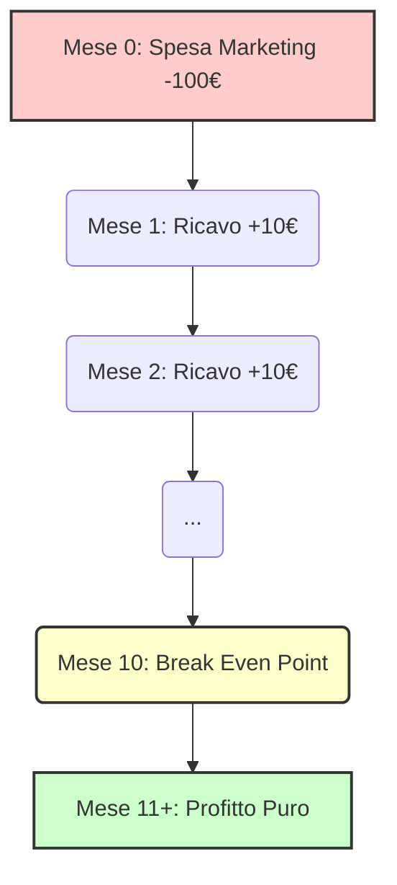

Nel 2015, Oliver Samwer, CEO di Rocket Internet, era noto come il "clonatore di startup" più efficace al mondo. Il suo modello consisteva nel replicare business model americani in Europa e mercati emergenti, puntando a crescere a ogni costo e a quotarsi in borsa. Il problema? Nessuno controllava le unit economics.

Zalando, per esempio, spendeva 40 euro per acquisire clienti che compravano scarpe da 50 euro, le restituivano al 70% e poi sparivano. Il costo di acquisizione era reale, ma il ricavo netto quasi nullo. Quando i mercati finanziari iniziarono a interrogarsi sui fondamentali, le valutazioni crollarono. La lezione è chiara: ottimizzare i numeri in cima al funnel non serve se la matematica di base per ogni cliente non torna.

Le unit economics non sono contabilità. Sono la domanda più onesta che puoi fare al tuo business: guadagno soldi su ogni vendita o li perdo?

## Perché Quasi Tutti Sbagliano il Calcolo

Molti team di marketing commettono errori comuni:

- Confondere fatturato con margine. Vendere un prodotto a 100 euro che costa 70 euro non significa guadagnare 100 euro, ma 30 euro.
- Usare un CAC "blended" che mescola clienti acquisiti organicamente (costo zero) con quelli da paid ads, ottenendo un dato ottimistico ma poco utile.
- Ignorare il fattore tempo: un LTV alto ma diluito su anni può essere insostenibile se serve liquidità subito.

## LTV (Lifetime Value): La Formula Corretta

La formula comunemente usata è:

`LTV = Valore Medio Ordine x Frequenza Acquisto Annuale x Anni di Vita Media`

Ma è incompleta. La versione corretta è:

`LTV = Margine di Contribuzione per Transazione x Frequenza Acquisto Annuale x Anni di Vita Media`

Il margine di contribuzione è il ricavo al netto di tutti i costi variabili (produzione, logistica, resi, commissioni di pagamento), non i costi fissi.

### Esempio concreto

Un e-commerce di abbigliamento con:
- AOV: 90 euro
- Costo merce: 30 euro
- Logistica: 8 euro
- Resi al 25% con costo gestione reso di 12 euro
- Commissioni pagamento 2% (1,80 euro)

Margine di contribuzione = 90 - 30 - 8 - (0,25 x 12) - 1,80 = 47,20 euro

Se il cliente compra 3 volte l'anno e resta per 2 anni:

`LTV = 47,20 x 3 x 2 = 283,20 euro`

Non 540 euro come calcolato senza margini. Pianificare campagne con 540 euro porta a CAC target insostenibili.

## CAC: Blended vs Paid

- **CAC Blended**: totale spesa marketing diviso nuovi clienti, include tutti i canali e costi.
- **CAC Paid**: spesa solo in paid advertising diviso clienti acquisiti da paid.

Il gap tra i due indica la dipendenza dall'organico. Se il CAC Paid è molto più alto, scalare con paid diventa rischioso.

## La Regola d'Oro: LTV:CAC > 3:1

- Sotto 1:1: perdi soldi su ogni cliente.
- Tra 1:1 e 2:1: margine zero per costi fissi, business fragile.
- 3:1: business sano e scalabile.
- Sopra 5:1: possibile underinvestment, stai perdendo opportunità di crescita.

### Benchmark per settore (2025-2026)

| Settore       | LTV:CAC Ideale | Payback Period | Margine Lordo |
|---------------|----------------|----------------|---------------|
| SaaS B2B      | 5:1 - 7:1      | 12-18 mesi     | 75%+          |
| SaaS B2C      | 3:1 - 4:1      | 6-12 mesi      | 70%+          |
| E-commerce    | 2:1 - 3:1      | 4-8 mesi       | 40-50%        |
| Marketplace   | 2:1 - 3:1      | 6-12 mesi      | 20-30% (take rate) |
| Fintech       | 4:1 - 6:1      | 18-24 mesi     | 60%+          |

## Payback Period: Quanto Tempo per Recuperare il CAC

Il Payback Period misura quanti mesi servono per recuperare il CAC tramite margine mensile:

`Payback Period = CAC / Margine di Contribuzione Mensile`

Se CAC è 120 euro e margine mensile 20 euro, il payback è 6 mesi. Durante questo periodo il capitale è impegnato senza ritorno.

### Benchmark payback

- <6 mesi: eccellente
- 6-12 mesi: accettabile
- 12-18 mesi: rischioso
- >18 mesi: tipico SaaS enterprise, serve capitale significativo

Molte startup falliscono non per modello sbagliato, ma per payback troppo lungo e mancanza di cassa.

## Visualizzare il Flusso di Cassa

Il payback si moltiplica per ogni cliente acquisito, creando un buco di cassa che cresce rapidamente.

## Come Calcolare le Tue Unit Economics in Pratica

1. Calcola il margine di contribuzione per transazione sottraendo tutti i costi variabili.
2. Misura la frequenza di acquisto reale per coorti e canali.
3. Calcola la vita media cliente usando il churn rate storico.
4. Separa il CAC per canale.
5. Calcola il rapporto LTV:CAC per canale per decidere dove investire.

## Il Caso Dropbox: Le Unit Economics Guidano la Strategia

Nel 2008 Dropbox spendeva 388 dollari per acquisire un cliente che pagava 99 dollari all'anno, un rapporto disastroso. Invece di ottimizzare le campagne, costruirono un programma referral con costi marginali bassissimi. LTV:CAC esplose e gli utenti crebbero da 100.000 a 4 milioni in 15 mesi.

La lezione: le unit economics ti costringono a soluzioni creative oltre l'ottimizzazione incrementale.

## SQL per Calcolare CAC e LTV

La query mostra come calcolare CAC blended, CAC paid e LTV per coorti mensili, utile per monitorare l'efficienza dei canali.

## Domande da Fare Ogni Mese

- Il mio LTV:CAC per canale paid è sopra 3:1?
- Il Payback Period si sta allungando o accorciando?
- La coorte più recente ha un LTV superiore a quella di 12 mesi fa?
- Qual è il canale con il miglior LTV:CAC?
- Sto investendo di più nei canali con LTV:CAC > 3:1?

## Benchmark Aggiornati 2026

| Settore          | Minimo Sostenibile | Business Sano | Target Aggressivi |
|------------------|--------------------|---------------|-------------------|
| SaaS B2B         | 2.5:1              | 5:1           | 8:1+              |
| SaaS B2C         | 2:1                | 3.5:1         | 5:1+              |
| E-commerce Moda  | 1.5:1              | 2.5:1         | 3.5:1             |
| E-commerce Grocery| 1.2:1              | 2:1           | 2.5:1             |
| Marketplace      | 1.5:1              | 2.5:1         | 3.5:1             |
| Fintech          | 3:1                | 5:1           | 7:1+              |
| Creator Economy  | 2:1                | 3.5:1         | 5:1+              |

## Conclusione

Le unit economics sono il termometro reale del tuo business. Se i numeri non tornano, nessuna narrazione o campagna può salvarti. Se tornano, hai la certezza matematica che ogni euro investito genera ritorno positivo. Sono brutalmente oneste e ti costringono a decisioni basate su dati, non su speranze. Monitorale con rigore e usa queste metriche per guidare la tua strategia di crescita.
