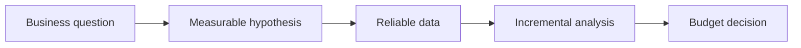

# End-to-end analysis with UTM and campaign parameters

In digital marketing, the value of a report lies in its ability to accurately reflect the user journey. Yet UTM data often suffers from inconsistencies: duplicated sources, campaigns renamed midstream, missing parameters. Before discussing ROAS or KPIs, a disciplined approach is needed to name, normalize, and reconcile traffic.

## Real problem

The concrete challenge is to turn budgets, channels, creatives, and audiences into measurable decisions without confusing volume, attribution, and incrementality. Many analyses fail because the underlying data does not truly represent the behavior under observation. The question is not whether the concept is interesting in theory, but which decision improves when applying it with reliable data and explicit error thresholds.

## Conceptual model

The mental process is sequential: start with a business question, translate it into a measurable hypothesis, assess data quality, and only then decide. Skipping steps leads to elegant but fragile analyses.



| Step | Guiding question | Expected output |
|---|---|---|
| Framing | Which decision needs to change? | A concrete choice, not curiosity |
| Measurement | Which signal represents the phenomenon? | Metric, source, granularity |
| Comparison | Against which baseline do I interpret results? | Benchmark or plausible counterfactual |
| Action | What do I do if the signal crosses the threshold? | Decision, owner, next check |

## Rigorous formalization

End-to-end UTM analysis relates four elements: unit of analysis, signal, baseline, and decision:

| Element | Operational definition |
|---|---|
| Unit | campaign, cohort, touchpoint, or customer segment |
| Signal | incremental margin, CAC payback, corrected conversion rate, lift, or retention |
| Baseline | prior period, holdout group, comparable market, or historical benchmark |
| Decision | reallocate resources, change messaging, stop tactic, scale experiment |
| Risk | confusing correlation, data quality, and causal decision-making |

A measure is useful only if it reduces uncertainty about a specific decision. If it does not change a choice, it is documentation; if it changes a choice without controls, it is risk.

## The 5 UTM parameters and taxonomy

To ensure reliable data, UTM parameters must follow a centralized, standardized taxonomy:

| Parameter | Meaning | Required | Example | Standard values |
|-----------|---------|----------|---------|-----------------|
| utm_source | Platform or origin site | Yes | google, facebook | closed list |
| utm_medium | Marketing channel | Yes | cpc, social, email | closed list |
| utm_campaign | Specific campaign | Yes | black_friday_2024 | format theme_year or quarter_initiative |
| utm_content | Creative variant | No | cta_button_A | for A/B tests |
| utm_term | Keyword (search ads) | No | data+analytics+course | search only |

## Implementation rules

1. Centralized taxonomy in a shared document with allowed values.
2. Mandatory URL builder with automatic validation.
3. Lowercase standardization to avoid duplicates.
4. No personal data in parameters.
5. No spaces; use dashes or underscores.

Example UTM validator in JavaScript:

```javascript
const VALID_SOURCES = ['google', 'facebook', 'instagram', 'linkedin', 'twitter', 'tiktok'];
const VALID_MEDIUMS = ['cpc', 'social', 'email', 'display', 'affiliate', 'referral'];

function validateUTM(url) {
  const params = new URLSearchParams(new URL(url).search);
  const errors = [];
  if (!VALID_SOURCES.includes(params.get('utm_source'))) errors.push('Invalid utm_source');
  if (!VALID_MEDIUMS.includes(params.get('utm_medium'))) errors.push('Invalid utm_medium');
  if (!params.get('utm_campaign')) errors.push('utm_campaign is required');
  return errors;
}
```

## Tracking the first UTM in the customer journey

Saving each user's first UTM in the data warehouse is crucial to correctly attribute CAC and understand acquisition paths, even if the user returns multiple times via direct.

```sql
INSERT INTO customer_acquisition (customer_id, first_source, first_medium, first_campaign, first_touch_date)
SELECT user_pseudo_id AS customer_id,
       FIRST_VALUE(traffic_source.source) OVER (PARTITION BY user_pseudo_id ORDER BY event_timestamp) AS first_source,
       FIRST_VALUE(traffic_source.medium) OVER (PARTITION BY user_pseudo_id ORDER BY event_timestamp) AS first_medium,
       FIRST_VALUE(traffic_source.name) OVER (PARTITION BY user_pseudo_id ORDER BY event_timestamp) AS first_campaign,
       MIN(TIMESTAMP_MICROS(event_timestamp)) OVER (PARTITION BY user_pseudo_id) AS first_touch
FROM `project.analytics.events_*`
WHERE event_name IN ('first_visit', 'session_start')
QUALIFY ROW_NUMBER() OVER (PARTITION BY user_pseudo_id ORDER BY event_timestamp) = 1;
```

## UTM quality dashboard

Monitoring the percentage of traffic with missing or invalid UTMs is essential. The goal is to keep under 5% the traffic without valid UTMs, as each additional percentage point means lost data and blind decisions.

```sql
SELECT DATE_TRUNC('month', session_date) AS month,
       COUNT(*) AS total_sessions,
       SUM(CASE WHEN utm_source IS NULL OR utm_source = '(not set)' THEN 1 ELSE 0 END) AS missing_utm,
       ROUND(SUM(CASE WHEN utm_source IS NULL OR utm_source='(not set)' THEN 1 ELSE 0 END)*100.0/COUNT(*), 1) AS missing_pct
FROM sessions
GROUP BY month
ORDER BY month DESC;
```

## Real case: N26's UTM strategy

N26 found that 34% of paid traffic was untraceable. They implemented an internal Campaign URL Builder enforcing taxonomy compliance and validating each URL. After 6 months, untraceable traffic dropped below 3% and attribution accuracy improved by 40%.

## Quality control

Before making decisions based on end-to-end UTM analysis, check completeness, duplicates, timezones, definition changes, and excluded segments. Many analyses fail because the data measures a different behavior than assumed.

## Segment interpretation

Aggregated averages are only a starting point. Segment by channel, cohort, plan, country, device, and user maturity. Opposing trends in segments can mislead averages and cause wrong decisions.

## Example or case study

A growth team considers increasing budget on a channel with low CPA but weak marginal sales. By separating signal from noise and linking metrics, mental model, and economic decision, they build a three-column reading:

| Evidence | Cautious interpretation | Decision |
|---|---|---|
| Positive but isolated signal | Phenomenon exists but cause uncertain | Seek baseline or holdout |
| Segment with different response | Average effect hides heterogeneity | Analyze cohorts or subgroups |
| Rising operational cost | Evaluate on margin | Apply economic thresholds |

## Lab / exercise

### Basic level

Write five lines: goal, primary metric, baseline, main risk, and planned action for a real decision linked to this analysis.

### Intermediate level

Build a table with at least three segments or scenarios. For each, indicate signal, alternative explanation, and needed control.

### Research-grade level

Design a validation plan: hypothesis, data, exclusion criteria, decision threshold, and post-decision check. Specify what would make you change your mind.

### Recommended datasets and materials

Use campaign exports, media costs, web/app events, CRM, transactions, brand surveys, and consent logs. If no real data, create a synthetic dataset with 200-500 rows, including temporal, segment, outcome metric, and exposure variables.

## Common mistake to avoid

Treating this analysis as a definition to memorize rather than a decision protocol. Presenting metrics without baseline, charts without hypotheses, or recommendations without error cost leads to fragile decisions. Always ask: "If this result were false, what decision would I get wrong?"

## Quiz or checkpoint

1. What concrete decision should this analysis improve?
2. Which baseline makes the result interpretable?
3. Which assumption, if wrong, would change the conclusion?
4. What minimum control would you use before presenting the recommendation?

## Operational summary

End-to-end UTM analysis is useful when it connects concept, data, and decision. Study it starting from a real problem, formalize the signal, find a credible baseline, build an example, and close with a practical check. Only then does it become skill, not just knowledge.

## Practical deepening

Treat it as a work test in a marketing review involving budget, channels, tracking, and margin reconciliation. Produce a memo linking channel, metric, segment, cost, and recommendation. This makes knowledge transferable by separating context, measure, action, and limit.

### Operational example

Start with a concrete question: which choice would improve applying this analysis well? Build an example in three lines: context, data/model used, and decision after risk checks.

### Work checkpoint

- Write the decision this analysis should improve using an action verb.
- Define the main signal and at least one guardrail.
- Add a baseline.
- Explicit the most likely risk.
- Close with a deliverable output (dashboard, query, memo, experiment).

### Mastery summary

You have mastered this analysis when you can explain the concept without jargon, apply it to a small realistic case, and defend a recommendation including limits and next checks. If any is missing, return to the conceptual model and reduce the example's ambition.
