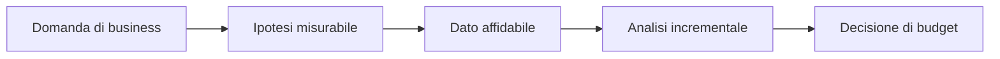

# Analisi end-to-end con UTM e parametri di campagna

Nel marketing digitale, il valore di un report si misura dalla sua capacità di raccontare fedelmente il percorso dell'utente. Spesso però, i dati UTM sono incoerenti: sorgenti duplicate, campagne rinominate a metà percorso, parametri mancanti. Prima di discutere ROAS o altri KPI, serve una disciplina rigorosa per nominare, normalizzare e riconciliare il traffico.

## Problema reale

Il problema concreto è trasformare budget, canali, creatività e audience in decisioni misurabili, senza confondere volume, attribuzione e incrementalità. Molte analisi falliscono perché il dato di partenza non rappresenta realmente il comportamento che si vuole osservare. La domanda non è se il concetto sia interessante in astratto, ma quale decisione migliora applicandolo con dati affidabili e con una soglia di errore esplicita.

## Modello concettuale

Il processo mentale è sequenziale: si formula una domanda di business, la si traduce in un'ipotesi misurabile, si valuta la qualità del dato e solo alla fine si decide. Saltare un passaggio produce analisi eleganti ma fragili.



| Passaggio | Domanda guida | Output atteso |
|---|---|---|
| Framing | Quale decisione deve cambiare? | Una scelta concreta, non una curiosità |
| Misura | Quale segnale rappresenta il fenomeno? | Metrica, fonte e granularità |
| Confronto | Rispetto a quale baseline interpreto il risultato? | Benchmark o controfattuale plausibile |
| Azione | Che cosa faccio se il segnale supera la soglia? | Decisione, owner e prossimo controllo |

## Formalizzazione rigorosa

L'analisi end-to-end con UTM si formalizza come una relazione tra unità di analisi, segnale, baseline e decisione:

| Elemento | Definizione operativa |
|---|---|
| Unità | campagna, coorte, touchpoint o segmento cliente |
| Segnale | margine incrementale, CAC payback, conversion rate corretto, lift o retention |
| Baseline | periodo precedente, gruppo holdout, mercato comparabile o benchmark storico |
| Decisione | spostare risorse, cambiare messaggio, fermare una tattica, scalare un esperimento |
| Rischio | confondere correlazione, qualità del dato e causalità decisionale |

Una misura è utile solo se riduce l'incertezza su una decisione specifica. Se non cambia una scelta, è documentazione; se cambia una scelta senza controlli, è rischio.

## I 5 parametri UTM e la tassonomia

Per garantire dati affidabili, i parametri UTM devono seguire una tassonomia centralizzata e standardizzata:

| Parametro | Significato | Obbligatorio | Esempio | Valori standard |
|-----------|-------------|--------------|---------|-----------------|
| utm_source | Piattaforma o sito origine | Sì | google, facebook | lista chiusa |
| utm_medium | Canale marketing | Sì | cpc, social, email | lista chiusa |
| utm_campaign | Campagna specifica | Sì | black_friday_2024 | formato tema_anno o quarter_iniziativa |
| utm_content | Variante creatività | No | cta_button_A | per A/B test |
| utm_term | Keyword (search ads) | No | data+analytics+course | solo search |

## Regole di implementazione

1. Tassonomia centralizzata in documento condiviso con valori consentiti.
2. URL Builder obbligatorio con validazione automatica.
3. Standardizzazione lowercase per evitare duplicazioni.
4. Mai dati personali nei parametri.
5. Niente spazi, usare trattini o underscore.

Un esempio di validatore UTM in JavaScript:

```javascript
const VALID_SOURCES = ['google', 'facebook', 'instagram', 'linkedin', 'twitter', 'tiktok'];
const VALID_MEDIUMS = ['cpc', 'social', 'email', 'display', 'affiliate', 'referral'];

function validateUTM(url) {
  const params = new URLSearchParams(new URL(url).search);
  const errors = [];
  if (!VALID_SOURCES.includes(params.get('utm_source'))) errors.push('Invalid utm_source');
  if (!VALID_MEDIUMS.includes(params.get('utm_medium'))) errors.push('Invalid utm_medium');
  if (!params.get('utm_campaign')) errors.push('utm_campaign is required');
  return errors;
}
```

## Tracciare il primo UTM nel customer journey

Salvare il primo UTM di ogni utente nel data warehouse è cruciale per attribuire correttamente il CAC e comprendere il percorso di acquisizione, anche se l'utente torna più volte via direct.

```sql
INSERT INTO customer_acquisition (customer_id, first_source, first_medium, first_campaign, first_touch_date)
SELECT user_pseudo_id AS customer_id,
       FIRST_VALUE(traffic_source.source) OVER (PARTITION BY user_pseudo_id ORDER BY event_timestamp) AS first_source,
       FIRST_VALUE(traffic_source.medium) OVER (PARTITION BY user_pseudo_id ORDER BY event_timestamp) AS first_medium,
       FIRST_VALUE(traffic_source.name) OVER (PARTITION BY user_pseudo_id ORDER BY event_timestamp) AS first_campaign,
       MIN(TIMESTAMP_MICROS(event_timestamp)) OVER (PARTITION BY user_pseudo_id) AS first_touch
FROM `project.analytics.events_*`
WHERE event_name IN ('first_visit', 'session_start')
QUALIFY ROW_NUMBER() OVER (PARTITION BY user_pseudo_id ORDER BY event_timestamp) = 1;
```

## Dashboard di qualità UTM

Monitorare la percentuale di traffico con UTM mancanti o invalidi è fondamentale. L'obiettivo è mantenere sotto il 5% il traffico senza UTM validi, perché ogni punto percentuale in più significa dati persi e decisioni al buio.

```sql
SELECT DATE_TRUNC('month', session_date) AS month,
       COUNT(*) AS total_sessions,
       SUM(CASE WHEN utm_source IS NULL OR utm_source = '(not set)' THEN 1 ELSE 0 END) AS missing_utm,
       ROUND(SUM(CASE WHEN utm_source IS NULL OR utm_source='(not set)' THEN 1 ELSE 0 END)*100.0/COUNT(*), 1) AS missing_pct
FROM sessions
GROUP BY month
ORDER BY month DESC;
```

## Caso reale: la strategia UTM di N26

N26 ha scoperto che il 34% del traffico paid non era tracciabile. Hanno implementato un Campaign URL Builder interno che obbliga a seguire la tassonomia e valida ogni URL. Dopo 6 mesi, il traffico non tracciabile è sceso sotto il 3% e l'accuratezza dell'attribuzione è migliorata del 40%.

## Controllo di qualità

Prima di prendere decisioni basate su analisi end-to-end con UTM, verifica completezza, duplicati, timezone, cambi di definizione e segmenti esclusi. Molte analisi falliscono perché il dato misura un comportamento diverso da quello che si pensa.

## Interpretazione per segmenti

La media aggregata è solo un punto di partenza. Segmenta per canale, coorte, piano, paese, device e maturità utente. Se segmenti si muovono in direzioni opposte, la media può fuorviare e portare a decisioni sbagliate.

## Esempio o caso studio

Un team growth valuta se aumentare il budget su un canale con CPA basso ma vendite marginali deboli. Separando segnale e rumore, collegando metrica, modello mentale e decisione economica, costruisce una lettura in tre colonne:

| Evidenza | Interpretazione prudente | Decisione |
|---|---|---|
| Segnale positivo ma non isolato | Fenomeno esiste ma causa incerta | Cercare baseline o holdout |
| Segmento con risposta diversa | Effetto medio nasconde eterogeneità | Analizzare coorti o sottogruppi |
| Costo operativo crescente | Valutare sul margine | Applicare soglie economiche |

## Lab / esercizio

### Livello base

Scrivi in cinque righe: obiettivo, metrica primaria, baseline, rischio principale e azione prevista per una decisione reale collegata a questa analisi.

### Livello intermedio

Costruisci una tabella con almeno tre segmenti o scenari. Per ciascuno indica segnale, possibile spiegazione alternativa e controllo necessario.

### Livello research-grade

Disegna un piano di validazione: ipotesi, dati, criteri di esclusione, soglia decisionale e controllo post-decisione. Specifica cosa ti farebbe cambiare idea.

### Dataset e materiali consigliati

Usa export campagne, costi media, eventi web/app, CRM, transazioni, survey brand e log consenso. Se non hai dati reali, crea un dataset sintetico con 200-500 righe e almeno una colonna temporale, una segmento, una metrica outcome e una variabile esposizione.

## Errore tipico da evitare

Trattare questa analisi come una definizione da ricordare invece che come un protocollo decisionale. Presentare metriche senza baseline, grafici senza ipotesi o raccomandazioni senza costo dell'errore porta a decisioni fragili. Chiediti sempre: "Se questo risultato fosse falso, quale decisione sbaglierei?".

## Quiz o checkpoint

1. Qual è la decisione concreta che questa analisi dovrebbe migliorare?
2. Quale baseline rende interpretabile il risultato?
3. Quale assunzione, se sbagliata, cambierebbe la conclusione?
4. Quale controllo minimo useresti prima di presentare la raccomandazione?

## Riepilogo operativo

L'analisi end-to-end con UTM è utile quando collega concetto, dato e decisione. Studiala partendo da un problema reale, formalizza il segnale, cerca una baseline credibile, costruisci un esempio e chiudi con un controllo pratico. Solo così diventa competenza, non solo conoscenza.

## Approfondimento di pratica

Trattala come una prova di lavoro in una review marketing con budget, canali, tracking e marginalità da riconciliare. Produci un memo che collega canale, metrica, segmento, costo e raccomandazione. Questo rende la conoscenza trasferibile, separando contesto, misura, azione e limite.

### Esempio operativo

Parti da una domanda concreta: quale scelta migliorerebbe applicando bene questa analisi? Costruisci un esempio con tre righe: contesto, dato/modello usato e decisione dopo controllo rischi.

### Checkpoint di lavoro

- Scrivi la decisione che questa analisi dovrebbe migliorare con un verbo operativo.
- Definisci segnale principale e almeno un guardrail.
- Aggiungi una baseline.
- Esplicita il rischio più probabile.
- Chiudi con un output consegnabile (dashboard, query, memo, esperimento).

### Riepilogo di padronanza

Hai assimilato questa analisi quando riesci a spiegare il concetto senza gergo, applicarlo a un caso realistico e difendere una raccomandazione con limiti e controlli. Se manca uno di questi, torna al modello concettuale e riduci l'ambizione dell'esempio.
