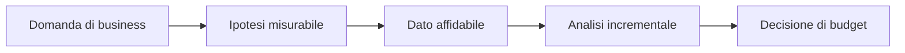

# Caso studio: strategia marketing data-driven

Una società SaaS si trova davanti a una scelta strategica: aumentare il budget paid, ripulire il nurturing o spostare il focus sul brand nel prossimo trimestre. I dati disponibili sono reali ma incompleti: costi, revenue, conversioni, saturazione e qualità dei lead raccontano storie contrastanti. Questo caso studio mette in luce come gestire questi segnali contraddittori in una decisione concreta.

## Problema reale

Nel marketing analytics, il vero problema è trasformare budget, canali, creatività e audience in decisioni misurabili, senza confondere volume, attribuzione e incrementalità. Non si tratta di apprezzare un concetto astratto, ma di capire quale decisione migliora applicando dati affidabili e consapevolezza del margine di errore.

## Modello concettuale

Il processo è sequenziale: prima si definisce la domanda, poi si traduce in un'ipotesi osservabile, si verifica la qualità del dato e infine si decide. Saltare fasi produce analisi eleganti ma fragili.

| Passaggio | Domanda guida | Output atteso |
|---|---|---|
| Framing | Quale decisione deve cambiare? | Una scelta concreta, non una curiosità |
| Misura | Quale segnale rappresenta il fenomeno? | Metrica, fonte e granularità |
| Confronto | Rispetto a quale baseline interpreto il risultato? | Benchmark o controfattuale plausibile |
| Azione | Che cosa faccio se il segnale supera la soglia? | Decisione, owner e prossimo controllo |

## Formalizzazione rigorosa

Formalizziamo il caso come relazione tra unità di analisi, segnale, baseline e decisione:

| Elemento | Definizione operativa |
|---|---|
| Unità | campagna, coorte, touchpoint o segmento cliente |
| Segnale | margine incrementale, CAC payback, conversion rate corretto, lift o retention generata |
| Baseline | periodo precedente, gruppo holdout, mercato comparabile o benchmark storico |
| Decisione | spostare risorse, cambiare messaggio, fermare una tattica o scalare un esperimento |
| Rischio | confondere correlazione, qualità del dato e causalità decisionale |

Una metrica è utile solo se riduce l'incertezza su una decisione specifica. Se non cambia una scelta, è solo documentazione; se cambia una scelta senza controlli, è rischio.

## Esempio o caso studio

Un team growth deve decidere se aumentare il budget su un canale con CPA basso ma vendite marginali deboli. Separiamo segnale utile e rumore collegando metrica, modello mentale e decisione economica.

| Evidenza | Interpretazione prudente | Decisione conseguente |
|---|---|---|
| Segnale positivo ma non isolato | Il fenomeno esiste, ma la causa è incerta | Cercare baseline o holdout |
| Segmento con risposta diversa | L'effetto medio nasconde eterogeneità | Analizzare coorti o sottogruppi |
| Costo operativo crescente | Il risultato va valutato sul margine | Applicare soglie economiche |

## Lab / esercizio

### Livello base

Scrivi in cinque righe una decisione reale collegata al caso: obiettivo, metrica primaria, baseline, rischio principale e azione prevista. Usa una sola metrica primaria.

### Livello intermedio

Costruisci una tabella con almeno tre segmenti o scenari. Per ciascuno indica segnale, possibile spiegazione alternativa e controllo necessario prima di decidere.

### Livello research-grade

Disegna un piano di validazione: ipotesi, dati necessari, criterio di esclusione, soglia decisionale e controllo post-decisione. Specifica cosa ti farebbe cambiare idea.

### Dataset e materiali consigliati

Usa export campagne, costi media, eventi web o app, CRM, transazioni, survey brand e log di consenso. Se non hai dati reali, crea un dataset sintetico con 200-500 righe e almeno una colonna temporale, una colonna segmento, una metrica di outcome e una variabile di esposizione.

## Errori frequenti e come evitarli

**Confondere correlazione e causalità:** due metriche che si muovono insieme non implicano causalità. Solo test A/B o analisi controfattuali stabiliscono causalità. Presenta sempre disclaimer.

**Ignorare la stagionalità:** confrontare novembre con dicembre senza correggere per festività produce insight fuorvianti. Usa confronti anno-su-anno o medie mobili destagionalizzate.

**Non validare il grain della query:** errori come join che duplicano righe o filtri applicati troppo tardi portano a risultati errati. Verifica sempre il conteggio delle righe a ogni step.

## Errore tipico da evitare

L'errore piu comune e trattare il risultato come una verita generale invece che come evidenza condizionata. Prima di agire, controlla baseline, assunzioni e costo dell'errore.

## Quiz o checkpoint

1. Qual è la decisione concreta che questa lezione dovrebbe migliorare?
2. Quale baseline rende interpretabile il risultato?
3. Quale assunzione, se sbagliata, cambierebbe la conclusione?
4. Quale controllo minimo useresti prima di presentare la raccomandazione?

## Riepilogo operativo

Questo caso studio è una competenza utile quando collega concetto, dato e decisione. Studialo partendo da un problema reale, formalizza il segnale, cerca una baseline credibile, costruisci un esempio e chiudi con un controllo pratico. È un laboratorio avanzato, stimato in 28 minuti di studio.
