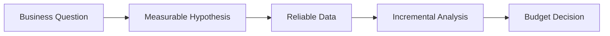

# Cheat Sheet  -  Marketing Analytics

When a campaign is live and the board demands a number, long theories won't help. What matters is knowing which metrics are reliable, which are proxies, and which require caveats. This cheat sheet gathers practical checks, definitions, and questions to use before turning a report into a decision.

## Starting Point

Use this page as your workspace. Return here to verify naming, attribution, funnels, margins, dashboards, or audience activation and avoid clever but unverified answers.

- **Context:** Which metric risks being misinterpreted out of context?
- **Method:** What minimal check do you perform before sharing the number?
- **Application:** What checklist would you use tomorrow before a marketing review?

## Beyond Last-Click: The Complexity of Modern Attribution

For decades, digital marketing has been dominated by the "last-click" attribution model. It assigns all credit for a conversion to the last touchpoint, ignoring the complex journey from brand discovery to purchase. This undervalues awareness and consideration channels and overvalues intent-driven ones.

Rule-based models like first-click, linear, or time decay improve on last-click but remain arbitrary. The real breakthrough is data-driven attribution models that use machine learning to estimate each channel's marginal contribution by analyzing thousands of conversion paths.

The gold standard is applying Shapley values from cooperative game theory. Each channel is a "player," and the model calculates its average contribution across all possible combinations. Though computationally intensive and requiring granular user data, this yields the fairest, most accurate channel value estimate.

**Booking.com** publicly documented its shift from rule-based to data-driven Shapley-based attribution. They found traditional models heavily underestimated display and social channels while overestimating brand search. By reallocating about 18% of their budget from bottom-funnel to mid/upper-funnel channels, they increased ROAS by 7% at constant spend.

## The Value Equation: Decomposing LTV and CAC

LTV (Customer Lifetime Value) and CAC (Customer Acquisition Cost) are pillars for assessing digital business sustainability. CAC is the total cost to acquire a customer - not just ad spend but also salaries, software, commissions, and other operational costs. For example, with €50,000 in ads, €30,000 in salaries, and €5,000 in tools for 1,000 customers, CAC is €85, not €50.

LTV is the total value a customer generates over their lifetime. Predictive models like "Buy 'Til You Die" estimate LTV based on early purchases and RFM behavior (recency, frequency, monetary), enabling early personalization of retention campaigns.

The LTV/CAC ratio measures ROI per customer. Above 3:1 indicates a healthy, scalable model; 1:1 means losing money; 5:1 or higher justifies aggressive growth investments. Segmenting this ratio by channel, cohort, and persona reveals true opportunities.

## Anatomy of a Modern Marketing Data Stack

Sophisticated analysis requires a robust infrastructure - the Modern Data Stack:

1. **Ingestion & Collection:** ETL/ELT tools like Fivetran or Airbyte extract data from Google Ads, Meta Ads, GA4, CRM, and email platforms. CDPs like Segment collect real-time behavioral data, creating unified user profiles.

2. **Warehousing:** Data lands in a Cloud Data Warehouse (Snowflake, BigQuery, Redshift), the single source of truth for cross-channel analysis.

3. **Transformation:** dbt transforms raw data into clean, aggregated models across staging, intermediate, and marts layers optimized for specific use cases.

Example intermediate model `int_marketing_spend_daily` unifies Google Ads and Facebook Ads spend:

- Aggregates cost, impressions, and clicks by day, campaign, and ad group for Google Ads.
- Does the same for Facebook Ads, adapting field names.
- Combines both datasets with UNION ALL into one table.

4. **Consumption & Activation:** BI tools (Looker, Tableau, Power BI) build interactive dashboards connected to the warehouse. Reverse ETL pushes enriched data and audience segments back to operational tools, enabling automation and personalization, closing the loop from analysis to action.

## From Funnel to Flywheel: Incremental Optimization

The traditional marketing funnel (Awareness → Interest → Desire → Action) is linear and transactional, inadequate for digital's ongoing customer relationships. HubSpot's flywheel model creates a virtuous cycle: Attract, Engage, Delight. Happy customers become promoters who attract new prospects.

Optimization shifts from boosting conversion metrics to improving incremental impact: "Did this campaign generate results that wouldn't have happened otherwise?"

Controlled experimentation (A/B tests, lift tests) is key. Comparing treatment and control groups measures true incremental lift.

**Netflix** exemplifies this, testing dozens of thumbnail variants to maximize view-through rates and running geographic lift tests for marketing campaigns. This scientific, data-driven approach boosted engagement by over 20%, saving billions in LTV through churn reduction.

## Practical Applications: Guided Lab

### Exercise 1: Build a Robust UTM Taxonomy

Define consistent, scalable UTM parameters for:

1. A paid Google Search ad for "women's swimsuits."
2. An organic Facebook post promoting "Sunglasses."
3. A link in the weekly newsletter's main banner.

Design logical `utm_source`, `utm_medium`, `utm_campaign`, `utm_content`, and `utm_term` structures.

### Exercise 2: Calculate LTV and CAC from Raw Data

Given a simplified dataset with customers acquired via Google Ads (€10,000 spent) and Facebook Ads (€8,000 spent), calculate CAC per channel, average 12-month LTV, and LTV/CAC ratio. Which channel is more efficient and why?

### Exercise 3: Interpret a Multi-Touch Attribution Report

Compare conversions attributed by Last-Click and Data-Driven (Shapley) models. Identify channels over- and under-valued by Last-Click and suggest preliminary budget reallocation.

| Channel               | Conversions (Last-Click) | Conversions (Data-Driven) |
|-----------------------|--------------------------|---------------------------|
| Brand Search (Paid)   | 1,200                    | 750                       |
| Generic Search (Paid) | 800                      | 950                       |
| Social (Paid)         | 300                      | 650                       |
| Display (Paid)        | 50                       | 250                       |
| Email Marketing       | 450                      | 400                       |
| Direct                | 200                      | 100                       |

## Strategic Summary: Core Principles

This cheat sheet is a strategic framework, not a number list. Attribution is strategic: moving from arbitrary to data-driven models means investing in future demand creation. Business health is measured by LTV/CAC, not traffic or leads. The modern data stack is a strategic asset enabling automation and experimentation. Optimization is a continuous scientific process measuring incremental impact, not just sales volume.

Mastering these principles transforms analysts into strategic partners who guide growth with rigor and method.

## Lab / Exercises

### Basic Level

Write a real decision linked to this cheat sheet: objective, primary metric, baseline, main risk, and planned action.

### Intermediate Level

Build a table with at least three segments or scenarios. For each, note signal, alternative explanation, and control needed before deciding.

### Research-Grade Level

Design a validation plan: hypothesis, needed data, exclusion criteria, decision threshold, post-decision control, and what would change your mind.

### Recommended Datasets and Materials

Use campaign exports, media costs, web/app events, CRM, transactions, brand surveys, and consent logs. If lacking real data, create a synthetic dataset with 200-500 rows, including a time column, segment column, outcome metric, and exposure variable.

## Common Pitfall to Avoid

Don't treat this cheat sheet as a memorized definition but as a decision protocol. Presenting metrics without baseline, charts without hypothesis, or recommendations without error cost leads to fragile decisions.

Always ask: "If this result were false or unstable, what wrong decision would I make?" If you can't answer, you haven't truly applied the lesson.

## Quiz / Checkpoint

1. What concrete decision does this lesson improve?
2. What baseline makes the result interpretable?
3. What assumption, if wrong, would change the conclusion?
4. What minimal check would you use before presenting the recommendation?

## Operational Summary

This cheat sheet is a skill linking concept, data, and decision. Study it starting from a real problem, formalize the signal, find a credible baseline, build an example, and close with a practical check.

---

## Real Problem

Marketing analytics must turn budgets, channels, creativity, and audiences into measurable decisions without confusing volume, attribution, and incrementality. The question is not if the concept is interesting but which decision improves when applying it with reliable data and explicit error thresholds.

## Conceptual Model

The model is sequential: formulate the question, translate it into observable signal, assess data quality, analyze incrementality, then decide. Skipping steps yields fragile analysis.

| Step      | Guiding Question                   | Expected Output                 |
|-----------|----------------------------------|--------------------------------|
| Framing   | What decision must change?        | Concrete choice                 |
| Measurement | What signal represents the phenomenon? | Metric, source, granularity     |
| Comparison | Against which baseline to interpret? | Benchmark or plausible counterfactual |
| Action    | What to do if signal exceeds threshold? | Decision, owner, next check     |

## Rigorous Formalization

| Element  | Definition for this lesson                               |
|----------|---------------------------------------------------------|
| Unit     | campaign, cohort, touchpoint, customer segment           |
| Signal   | incremental margin, CAC payback, corrected conversion rate, lift, retention generated |
| Baseline | previous period, holdout group, comparable market, historical benchmark |
| Decision | reallocate resources, change message, stop tactic, scale experiment |
| Risk     | confusing correlation, data quality, and causal decision-making |

A measure is useful only if it reduces uncertainty about a specific decision. If it doesn't change a choice, it's documentation; if it changes a choice without checks, it's risk.

## Example or Case Study

A growth team must decide whether to increase budget on a channel with low CPA but weak marginal sales. The cheat sheet helps separate useful signal from operational noise by linking metric, mental model, and economic decision.

| Evidence                  | Cautious Interpretation             | Decision                      |
|---------------------------|-----------------------------------|------------------------------|
| Positive but isolated signal | Phenomenon exists, cause uncertain | Seek baseline or holdout     |
| Segment with different response | Average effect hides heterogeneity | Analyze cohorts or subgroups |
| Rising operational cost    | Evaluate on margin                 | Apply economic thresholds    |

## Lab / Exercise

### Basic Level

Write a real decision linked to this cheat sheet: objective, primary metric, baseline, risk, and action.

### Intermediate Level

Build a table with three segments/scenarios: signal, alternative explanation, control needed before deciding.

### Research-Grade Level

Design a validation plan: hypothesis, data needed, exclusion criteria, decision threshold, post-decision control, and what would change your mind.

### Recommended Datasets and Materials

Use campaign exports, media costs, web/app events, CRM, transactions, brand surveys, consent logs. If no real data, create synthetic dataset with 200-500 rows, time column, segment column, outcome metric, exposure variable.

## Common Mistake to Avoid

Treating this cheat sheet as a memorized definition rather than a decision protocol. Presenting metrics without baseline, charts without hypothesis, or recommendations without error cost leads to fragile decisions.

Always ask: "If this result were false or unstable, what wrong decision would I make?" If you can't answer, you haven't truly applied the lesson.

## Quiz / Checkpoint

1. What concrete decision does this lesson improve?
2. What baseline makes the result interpretable?
3. What assumption, if wrong, would change the conclusion?
4. What minimal check would you use before presenting the recommendation?

## Summary

This cheat sheet is a skill linking concept, data, and decision. Study it starting from a real problem, formalize the signal, find a credible baseline, build an example, and close with a practical check.
