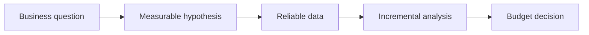

# CRM and Email Marketing Analytics

A series of emails might show high open rates, moderate clicks, and low revenue. The risk is focusing on optimizing the subject line while the real issues could be segmentation, timing, or the commercial offer. **CRM and email marketing analytics** treats the channel as a measurable relationship, not isolated sends.

## Real-world problem

In marketing analytics, CRM and email marketing analytics help transform budgets, channels, creatives, and audiences into measurable decisions, avoiding confusion between volume, attribution, and incrementality. The key question is not whether the concept is interesting in theory, but which decision improves when applying it with reliable data and explicit error thresholds.

This lesson is a practical tool: you must understand the analytical problem and decision context, apply examples, metrics, and controls to real cases. Without linking the concept to a concrete choice, knowledge remains decorative, not skill.

## Conceptual model



The mental model is sequential: formulate the question, translate it into observable units, assess data quality, then decide. Skipping steps yields elegant but fragile analyses.

| Step | Guiding question | Expected output |
|---|---|---|
| Framing | Which decision must change? | A concrete choice, not curiosity |
| Measurement | Which signal represents the phenomenon? | Metric, source, granularity |
| Comparison | Against which baseline do I interpret results? | Benchmark or plausible counterfactual |
| Action | What do I do if the signal exceeds threshold? | Decision, owner, next control |

## Rigorous formalization

Formalize **CRM and email marketing analytics** as a relation among four elements: unit of analysis, signal, baseline, and decision. The main unit can be campaign, cohort, touchpoint, or customer segment. The signal should link to incremental margin, CAC payback, adjusted conversion rate, lift, or generated retention. The baseline can be previous period, holdout group, comparable market, or historical benchmark.

| Element | Operational definition |
|---|---|
| Unit | campaign, cohort, touchpoint, or customer segment |
| Signal | incremental margin, CAC payback, adjusted conversion rate, lift, or generated retention |
| Baseline | previous period, holdout group, comparable market, or historical benchmark |
| Decision | reallocate resources, change message, stop tactic, or scale experiment |
| Risk | confusing correlation, data quality, and causal decision-making |

The practical rule: a measure is useful only if it reduces uncertainty about a specific decision. If it doesn't change a choice, it's documentation; if it changes a choice without controls, it's risk.

## From vanity metrics to business impact: deconstructing the email funnel

Email analysis often relies on "vanity metrics" like Open Rate, which lost reliability after Apple's 2021 Mail Privacy Protection (MPP). MPP preloads email content via proxy servers, inflating recorded opens.

A rigorous analyst focuses on metrics linking campaigns to real economic impact:

1. **Click-Through Rate (CTR):** `(Unique clicks / Emails delivered) * 100`. Indicates explicit intent.
2. **Click-to-Open Rate (CTOR):** `(Unique clicks / Unique opens) * 100`. Proxy for message relevance.
3. **Conversion Rate (CVR):** Percentage completing desired action after click.
4. **Revenue Per Email (RPE):** `Total revenue / Emails sent`. Measures financial impact.

### Practical example

A retailer sends two campaigns to 200,000 subscribers:

| Campaign | Open Rate | CTR | CTOR | Conversion Rate | AOV (€) | Revenue (€) | RPE (€) |
|---|---|---|---|---|---|---|---|
| A ("🔥 50% OFF EVERYTHING! 🔥") | 35% (inflated) | 2% (4,000) | 5.7% | 5% (200 purchases) | 40 | 8,000 | 0.04 |
| B ("New arrivals selected for you, [Name]") | 22% | 4.5% (9,000) | 20.5% | 8% (720 purchases) | 65 | 46,800 | 0.234 |

Superficial analysis favors Campaign A for open rate, but Campaign B generates nearly six times more revenue thanks to higher relevance and conversion. The goal is maximizing value per send, not opens.

## Anatomy of deliverability: beyond the spam folder

Deliverability is the ability of emails to reach the main inbox. If emails land in spam or fail delivery, other metrics lose meaning. Deliverability depends on three pillars:

1. **Technical authentication:**
   - SPF: DNS record authorizing IPs to send for the domain.
   - DKIM: digital signature ensuring integrity.
   - DMARC: policy instructing how to handle unauthenticated emails.

2. **Domain and IP reputation:**
   - Spam complaint rate (critical threshold 0.1%).
   - User engagement (opens, clicks, replies).
   - Spam traps: addresses used to detect poor list hygiene.
   - Consistent sending volume (warm-up needed).

3. **List hygiene and engagement policies:**
   - Immediate removal of hard bounces.
   - Sunset policy for users inactive over 180 days.

### Diagnostic query for list health

Identify users subscribed over 90 days with no engagement in last 180 days:

```sql
SELECT
  u.user_id,
  u.email,
  u.subscription_date,
  MAX(e.event_timestamp) AS last_engagement_date
FROM users u
LEFT JOIN email_events e ON u.user_id = e.user_id AND e.event_type IN ('open', 'click')
WHERE u.is_subscribed = TRUE
  AND u.subscription_date <= CURRENT_DATE - INTERVAL '90 day'
GROUP BY u.user_id, u.email, u.subscription_date
HAVING MAX(e.event_timestamp) IS NULL
   OR MAX(e.event_timestamp) < CURRENT_DATE - INTERVAL '180 day';
```

This query is a strategic tool to protect reputation and inbox reach.

## Behavioral segmentation and lifecycle marketing: the Spotify case

Once deliverability and business metrics are ensured, focus shifts to maximizing relevance through behavioral segmentation and lifecycle marketing.

Spotify exemplifies this by orchestrating emails as a natural extension of the in-app experience:

- **Onboarding and activation:** triggered emails based on first listen or playlist creation, with KPIs on activation and retention.
- **Engagement and retention:** personalized emails on new albums or viral campaigns like "Spotify Wrapped," with CTOR up to 250% higher than generic newsletters.
- **Re-engagement:** targeted emails to users inactive for 30 days, highlighting missed content and personalized playlists, with win-back KPIs.
- **Monetization and upsell:** emails promoting Premium benefits triggered by user behavior, tracking Free-to-Premium conversion.

The most powerful segmentation is behavioral, not demographic, requiring data infrastructure capable of near real-time event capture and action.

## A/B testing and causal inference in email marketing

Optimization demands a scientific approach to establish cause-effect between change and outcome. A valid A/B test is a controlled, randomized experiment with:

1. **Clear, falsifiable hypothesis:** defines variable and success metric.
2. **Randomization and control group:** ensures statistical equivalence.
3. **Statistical significance:** p-value below 0.05 to reject null hypothesis.
4. **Statistical power and sample size:** pre-calculated to avoid type II errors.

Beyond classic A/B testing, multivariate testing (MVT) allows simultaneous testing of multiple changes by comparing all combinations.

## Lab / exercise

### Basic level

Write a five-line statement of a real decision linked to CRM and email marketing analytics: objective, primary metric, baseline, main risk, and planned action. Use only one primary metric.

### Intermediate level

Build a table with at least three segments or scenarios. For each, indicate signal, possible alternative explanation, and necessary control before deciding.

### Research-grade level

Design a validation plan: hypothesis, required data, exclusion criteria, decision threshold, and post-decision control. Specify what would change your mind.

### Recommended datasets and materials

Use campaign exports, media costs, web/app events, CRM, transactions, brand surveys, and consent logs. If no real data, create a synthetic dataset with 200-500 rows including a time column, segment column, outcome metric, and exposure variable.

## Common mistakes and how to avoid them

- **Confusing correlation with causation:** only A/B or counterfactual analyses establish causality.
- **Ignoring seasonality:** unadjusted comparisons yield misleading insights.
- **Not validating query grain:** incorrect joins or filters cause wrong results.

## Quiz or checkpoint

1. What concrete decision should this lesson improve?
2. Which baseline makes the result interpretable?
3. Which assumption, if wrong, would change the conclusion?
4. What minimal control would you use before presenting the recommendation?

## Operational summary

**CRM and email marketing analytics** is useful when it connects concept, data, and decision. Study it starting from a real problem, formalize the signal, find a credible baseline, build an example, and finish with a practical control.

---
