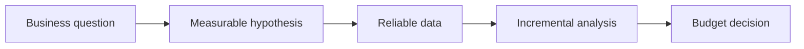

# Customer journey and funnel analytics

In marketing analytics, the concrete challenge is turning budgets, channels, creatives, and audiences into measurable decisions without confusing volume, attribution, and incrementality. Customer journey and funnel analytics helps make user pathways readable to identify where to intervene effectively.

## Real problem

A user might move from a social post to a product page, return via email, check reviews, and finally purchase after a branded search. Looking only at the last channel misses the trust-building work; looking at everything unordered leads to no decisions. We need a method to represent and analyze these journeys so they guide precise decisions.

## Conceptual model

The decision-making process unfolds in four sequential steps:

- Business question: which decision needs to change?
- Measurable hypothesis: which signal represents the phenomenon?
- Reliable data: what is the data quality and granularity?
- Incremental analysis: how to interpret the signal against a baseline?

Only then can we reach a budget or strategy decision grounded in solid data.



| Step | Guiding question | Expected output |
|---|---|---|
| Framing | Which decision must change? | Concrete choice |
| Measurement | Which signal represents the phenomenon? | Metric, source, granularity |
| Comparison | Against which baseline do I interpret results? | Benchmark or counterfactual |
| Action | What do I do if signal crosses threshold? | Decision, owner, next check |

## Rigorous formalization

Customer journey and funnel analytics formalizes as a relation between:

| Element | Operational definition |
|---|---|
| Unit | campaign, cohort, touchpoint, customer segment |
| Signal | incremental margin, CAC payback, corrected conversion rate, lift, retention |
| Baseline | previous period, holdout group, comparable market, historical benchmark |
| Decision | reallocate resources, change message, stop tactic, scale experiment |
| Risk | confusing correlation, data quality, and causal decision-making |

A measure is useful only if it reduces uncertainty about a specific decision.

## Example or case study

A growth team must decide whether to increase budget on a channel with low CPA but weak marginal sales. This lesson helps separate useful signal from noise by linking metric, mental model, and economic decision.

| Evidence | Prudent interpretation | Consequent decision |
|---|---|---|
| Positive but isolated signal | Phenomenon exists, cause uncertain | Seek baseline or holdout |
| Segment with different response | Average effect hides heterogeneity | Analyze cohorts or subgroups |
| Rising operational cost | Evaluate on margin | Apply economic thresholds |

## From map to analysis: modeling the journey with transactional data

Building the customer journey starts by aggregating raw touchpoint data, often fragmented and lacking unified user IDs. Identity stitching reconstructs the single user across devices and sessions using deterministic login or probabilistic methods.

Next is sessionization, grouping events into sessions based on inactivity thresholds (typically 30 minutes), adjusted per context.

The result is an enriched events table with unified `user_id`, `session_id`, timestamp, and contextual attributes. From here, paths are built using SQL window functions like ROW_NUMBER and STRING_AGG.

An example SQL query aggregates marketing channels visited in sequence and calculates conversion rates:

```sql
WITH user_events AS (
  SELECT
    unified_user_id,
    event_timestamp,
    event_name,
    marketing_channel,
    ROW_NUMBER() OVER(PARTITION BY unified_user_id ORDER BY event_timestamp) as event_sequence_number
  FROM clean_events_log
  WHERE event_timestamp >= '2023-01-01'
),
user_conversion AS (
  SELECT unified_user_id,
    MAX(CASE WHEN event_name = 'purchase_completed' THEN 1 ELSE 0 END) as converted
  FROM user_events
  GROUP BY unified_user_id
),
journey_paths AS (
  SELECT e.unified_user_id,
    STRING_AGG(e.marketing_channel, ' > ' ORDER BY e.event_timestamp) as journey_path,
    COUNT(*) as total_touchpoints,
    DATEDIFF('day', MIN(e.event_timestamp), MAX(e.event_timestamp)) as journey_duration_days
  FROM user_events e
  GROUP BY e.unified_user_id
)
SELECT
  jp.journey_path,
  COUNT(DISTINCT jp.unified_user_id) as number_of_users,
  AVG(jp.total_touchpoints) as avg_touchpoints,
  AVG(jp.journey_duration_days) as avg_duration,
  ROUND(SUM(uc.converted) * 100.0 / COUNT(DISTINCT jp.unified_user_id), 2) as conversion_rate
FROM journey_paths jp
JOIN user_conversion uc ON jp.unified_user_id = uc.unified_user_id
GROUP BY jp.journey_path
ORDER BY number_of_users DESC
LIMIT 20;
```

Granularity must match the business question.

## Beyond conversion: funnel analysis for product optimization

Funnel analysis imposes a defined structure, measuring user progression through critical steps. It's valuable beyond marketing, for product, engineering, and design teams to quantify friction.

For example, a fintech app's onboarding funnel might include app download, account creation, identity verification, first deposit, and first transfer. For each step, measure user counts and conversion rates from the previous step.

Segmenting funnels by device, country, or acquisition cohort reveals drop-off causes and improvement opportunities.

Measuring median time per step turns the funnel from a static snapshot into a dynamic video of user experience.

## Case study - Netflix: personalizing the journey to maximize retention

Netflix optimized its post-signup activation journey to reduce churn. They defined an engagement funnel with steps like profile completion, initial taste selection, first significant playback, active exploration, and multiple sessions in the first week.

Analysis of millions of users showed completing all steps increased retention probability by over 50%. Binge-watching was an exceptional retention predictor.

These insights guided UI optimization, content strategy, and email marketing, making journey analysis a continuous personalization engine that boosted customer lifetime value.

## Identifying friction and opportunities with path analysis

Path analysis explores all real user paths, revealing loops, unexpected exits, and shortcuts. Sankey diagrams visualize flows between states, highlighting friction and opportunities.

A Python example shows how to transform event logs into a transition matrix:

- Sort by user and timestamp
- Use shift() to get next page
- Count transitions

This answers operational questions: most common pages after homepage, pages with highest exit rates, and virtuous paths.

## Case study - Revolut: optimizing cross-device onboarding funnel

Revolut faced high dropout during identity verification via camera. Segmenting by device model, network conditions, and document type revealed causes.

Targeted interventions like dynamic fallback, adaptive compression, and contextual guidance increased funnel completion by 18 percentage points, reducing CAC and accelerating growth.

## Lab / exercise

### Basic level

Write in five lines a real decision linked to customer journey and funnel analytics: objective, primary metric, baseline, main risk, and planned action.

### Intermediate level

Build a table with at least three segments or scenarios, indicating signal, possible alternative explanation, and control needed.

### Research-grade level

Design a validation plan: hypothesis, needed data, exclusion criteria, decision threshold, post-decision control. Specify what would make you change your mind.

### Recommended datasets and materials

Use campaign exports, media costs, web/app events, CRM, transactions, brand surveys, and consent logs. If no real data, create a synthetic dataset with at least 200 rows, one temporal column, one segment column, one outcome metric, and one exposure variable.

## Common mistake to avoid

Treating customer journey and funnel analytics as a definition to memorize rather than a decision protocol. Presenting metrics without baseline, charts without hypothesis, or recommendations without error cost leads to fragile decisions.

A useful check is asking: "If this result were false or unstable, what decision would I get wrong?" If unclear, the lesson hasn't been truly applied.

## Quiz or checkpoint

1. What concrete decision should this lesson improve?
2. Which baseline makes the result interpretable?
3. Which assumption, if wrong, would change the conclusion?
4. What minimal check would you use before presenting the recommendation?

## Operational summary

Customer journey and funnel analytics is a skill that connects concept, data, and decision. Study it starting from a real problem, formalize the signal, find a credible baseline, build an example, and close with a practical check.
