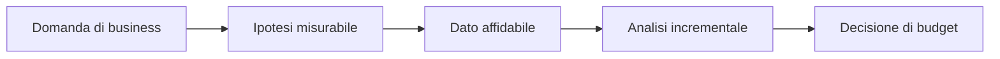

# Customer journey e funnel analytics

Nel marketing analytics, il problema concreto è trasformare budget, canali, creatività e audience in decisioni misurabili, senza confondere volume, attribuzione e incrementalità. Customer journey e funnel analytics serve proprio a questo: rendere leggibili i passaggi che un utente compie, per capire dove intervenire efficacemente.

## Problema reale

Un utente può passare da un post social a una pagina prodotto, tornare da email, consultare recensioni e comprare dopo una ricerca branded. Se guardi solo l'ultimo canale, perdi il lavoro che ha creato fiducia; se guardi tutto senza ordine, non decidi nulla. Serve quindi un metodo per rappresentare e analizzare questi percorsi in modo che guidino decisioni precise.

## Modello concettuale

Il processo decisionale si articola in quattro passaggi sequenziali:

- Domanda di business: quale decisione deve cambiare?
- Ipotesi misurabile: quale segnale rappresenta il fenomeno?
- Dato affidabile: qual è la qualità e granularità del dato?
- Analisi incrementale: come interpretare il segnale rispetto a una baseline?

Solo così si arriva a una decisione di budget o strategia fondata su dati robusti.



| Passaggio | Domanda guida | Output atteso |
|---|---|---|
| Framing | Quale decisione deve cambiare? | Scelta concreta |
| Misura | Quale segnale rappresenta il fenomeno? | Metrica, fonte, granularità |
| Confronto | Rispetto a quale baseline interpreto il risultato? | Benchmark o controfattuale |
| Azione | Che cosa faccio se il segnale supera la soglia? | Decisione, owner, prossimo controllo |

## Formalizzazione rigorosa

Customer journey e funnel analytics si formalizza come relazione tra:

| Elemento | Definizione operativa |
|---|---|
| Unità | campagna, coorte, touchpoint, segmento cliente |
| Segnale | margine incrementale, CAC payback, conversion rate corretto, lift, retention |
| Baseline | periodo precedente, gruppo holdout, mercato comparabile, benchmark storico |
| Decisione | spostare risorse, cambiare messaggio, fermare tattica, scalare esperimento |
| Rischio | confondere correlazione, qualità dato e causalità decisionale |

Una misura è utile solo se riduce l'incertezza su una decisione specifica.

## Esempio o caso studio

Un team growth deve decidere se aumentare il budget su un canale con CPA basso ma vendite marginali deboli. La lezione aiuta a separare segnale utile da rumore, collegando metrica, modello mentale e decisione economica.

| Evidenza | Interpretazione prudente | Decisione conseguente |
|---|---|---|
| Segnale positivo ma non isolato | Fenomeno esiste, causa incerta | Cercare baseline o holdout |
| Segmento con risposta diversa | Effetto medio nasconde eterogeneità | Analizzare coorti o sottogruppi |
| Costo operativo crescente | Valutare sul margine | Applicare soglie economiche |

## Dalla Mappa all'Analisi: Modellare il Journey con i Dati Transazionali

La costruzione del customer journey parte dall'aggregazione di dati grezzi di touchpoint, spesso frammentati e senza identificatore unificato. L'identity stitching ricostruisce l'utente unico attraverso dispositivi e sessioni diverse, usando login deterministico o metodi probabilistici.

Segue la sessionizzazione, che raggruppa eventi in sessioni basate su soglie di inattività (tipicamente 30 minuti), da adattare al contesto.

Il risultato è una tabella di eventi con `user_id` unificato, `session_id`, timestamp e attributi contestuali. Da qui si costruiscono i percorsi con funzioni SQL come ROW_NUMBER e STRING_AGG.

Un esempio SQL mostra come aggregare i canali visitati in sequenza e calcolare tassi di conversione:

```sql
WITH user_events AS (
  SELECT
    unified_user_id,
    event_timestamp,
    event_name,
    marketing_channel,
    ROW_NUMBER() OVER(PARTITION BY unified_user_id ORDER BY event_timestamp) as event_sequence_number
  FROM clean_events_log
  WHERE event_timestamp >= '2023-01-01'
),
user_conversion AS (
  SELECT unified_user_id,
    MAX(CASE WHEN event_name = 'purchase_completed' THEN 1 ELSE 0 END) as converted
  FROM user_events
  GROUP BY unified_user_id
),
journey_paths AS (
  SELECT e.unified_user_id,
    STRING_AGG(e.marketing_channel, ' > ' ORDER BY e.event_timestamp) as journey_path,
    COUNT(*) as total_touchpoints,
    DATEDIFF('day', MIN(e.event_timestamp), MAX(e.event_timestamp)) as journey_duration_days
  FROM user_events e
  GROUP BY e.unified_user_id
)
SELECT
  jp.journey_path,
  COUNT(DISTINCT jp.unified_user_id) as number_of_users,
  AVG(jp.total_touchpoints) as avg_touchpoints,
  AVG(jp.journey_duration_days) as avg_duration,
  ROUND(SUM(uc.converted) * 100.0 / COUNT(DISTINCT jp.unified_user_id), 2) as conversion_rate
FROM journey_paths jp
JOIN user_conversion uc ON jp.unified_user_id = uc.unified_user_id
GROUP BY jp.journey_path
ORDER BY number_of_users DESC
LIMIT 20;
```

La granularità deve essere adattata alla domanda di business.

## Oltre la Conversione: Analisi di Funnel per l'Ottimizzazione del Prodotto

L'analisi di funnel impone una struttura definita, misurando la progressione degli utenti attraverso passaggi critici. Non serve solo a marketing ma anche a prodotto, ingegneria e design per quantificare l'attrito.

Ad esempio, il funnel di onboarding di un'app fintech come Wise include passaggi da download a primo trasferimento. Per ogni step si misura il numero di utenti e il tasso di conversione rispetto al precedente.

Segmentare il funnel per dispositivo, paese o coorte permette di scoprire cause di drop-off e opportunità di miglioramento.

Misurare il tempo mediano per completare ogni passo trasforma il funnel da fotografia statica a video dinamico dell'esperienza utente.

## Caso Studio - Netflix: Personalizzazione del Journey per Massimizzare la Retention

Netflix ha ottimizzato il journey di attivazione post-iscrizione per ridurre il churn. Hanno definito un funnel di engagement con passaggi come completamento profilo, selezione gusti, prima riproduzione significativa e sessioni multiple nella prima settimana.

Analisi di milioni di utenti ha mostrato che completare tutti i passaggi aumenta la probabilità di retention di oltre il 50%. Il binge-watching è un predittore eccezionale di retention.

Questi insight hanno guidato ottimizzazioni di UI, content strategy e email marketing, trasformando l'analisi del journey in un motore continuo di personalizzazione e aumento della customer lifetime value.

## Identificare Attrito e Opportunità con la Path Analysis

La path analysis esplora tutti i percorsi reali degli utenti, rivelando loop, uscite inaspettate e scorciatoie. Il diagramma di Sankey visualizza i flussi tra stati, evidenziando attriti e opportunità.

Un esempio Python mostra come trasformare un log eventi in matrice di transizione:

- Si ordina per utente e timestamp
- Si usa shift() per ottenere la pagina successiva
- Si calcolano i conteggi di transizione

Questo permette di rispondere a domande operative su pagine più visitate, abbandoni e percorsi virtuosi.

## Caso Studio - Revolut: Ottimizzazione del Funnel di Onboarding Cross-Device

Revolut ha affrontato un alto tasso di abbandono nella verifica dell'identità tramite fotocamera, analizzando segmenti per modello dispositivo, condizioni di rete e tipo documento.

Interventi mirati come fallback dinamico, compressione adattiva e guida contestuale hanno aumentato il tasso di completamento del funnel di 18 punti percentuali, riducendo il CAC e accelerando la crescita.

## Lab / esercizio

### Livello base

Scrivi in cinque righe una decisione reale collegata a customer journey e funnel analytics: obiettivo, metrica primaria, baseline, rischio e azione.

### Livello intermedio

Costruisci una tabella con almeno tre segmenti o scenari, indicando segnale, possibile spiegazione alternativa e controllo necessario.

### Livello research-grade

Disegna un piano di validazione con ipotesi, dati necessari, criteri di esclusione, soglia decisionale e controllo post-decisione. Specifica cosa ti farebbe cambiare idea.

### Dataset e materiali consigliati

Usa export campagne, costi media, eventi web/app, CRM, transazioni, survey brand e log consenso. Se non hai dati reali, crea un dataset sintetico con almeno 200 righe, una colonna temporale, una colonna segmento, una metrica di outcome e una variabile di esposizione.

## Errore tipico da evitare

Trattare customer journey e funnel analytics come una definizione da ricordare invece che come protocollo decisionale. Presentare metriche senza baseline, grafici senza ipotesi o raccomandazioni senza costo dell'errore porta a decisioni fragili.

Un controllo utile è chiedersi: "Se questo risultato fosse falso o instabile, quale decisione sbaglierei?". Se la risposta non è chiara, la lezione non è stata applicata davvero.

## Quiz o checkpoint

1. Qual è la decisione concreta che questa lezione dovrebbe migliorare?
2. Quale baseline rende interpretabile il risultato?
3. Quale assunzione, se sbagliata, cambierebbe la conclusione?
4. Quale controllo minimo useresti prima di presentare la raccomandazione?

## Riepilogo operativo

Customer journey e funnel analytics è una competenza utile quando collega concetto, dato e decisione. Studiala partendo da un problema reale, formalizza il segnale, cerca una baseline credibile, costruisci un esempio e chiudi con un controllo pratico.
