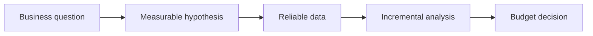

# Brand analytics and measuring effectiveness

In marketing, brand awareness can rise in surveys, but the key question is whether this translates into real choices, price shifts, or conversions. A brand cannot be measured like a simple click, yet it cannot be excluded from analytics. Brand analytics operates in this intermediate space, turning slow signals into fast decisions.

## Real problem

The challenge is to turn budgets, channels, creativity, and audiences into measurable decisions, avoiding confusion between volume, attribution, and incrementality. The concept must improve a real decision, based on reliable data and explicit error thresholds.

## Conceptual model

The process is sequential: start with a business question, formulate a measurable hypothesis, verify data quality, and reach a budget decision.



| Step | Guiding question | Expected output |
|---|---|---|
| Framing | Which decision should change? | Concrete choice, not curiosity |
| Measurement | Which signal represents the phenomenon? | Metric, source, granularity |
| Comparison | Against which baseline do I interpret results? | Benchmark or counterfactual |
| Action | What do I do if signal crosses threshold? | Decision, owner, next check |

## Rigorous formalization

Brand analytics is a relation among four elements:

| Element | Operational definition |
|---|---|
| Unit | campaign, cohort, touchpoint, or customer segment |
| Signal | incremental margin, CAC payback, adjusted conversion rate, lift, or retention generated |
| Baseline | prior period, holdout group, comparable market, or historical benchmark |
| Decision | reallocate resources, change message, stop tactic, or scale experiment |
| Risk | confusing correlation, data quality, and causal inference |

A metric is useful only if it reduces uncertainty about a specific decision. If it does not change a choice, it is documentation; if it changes a choice without controls, it is risk.

## The brand funnel and metrics by stage

The brand funnel describes the consumer journey:

```
Awareness → Consideration → Preference → Purchase → Loyalty → Advocacy
```

| Stage | Metric | How to measure | Frequency |
|-------|--------|----------------|-----------|
| Awareness | % target aware of brand | Surveys (aided/unaided recall), Google Trends | Quarterly, continuous |
| Consideration | % considering brand | Surveys, Share of Search | Quarterly |
| Preference | % preferring brand | Surveys, Conjoint analysis | Annual |
| Purchase | Market share, trial rate | Internal data, panels | Monthly |
| Loyalty | Repeat rate, NPS, share of wallet | Transactional data, surveys | Continuous |
| Advocacy | Referral rate, UGC volume | Referral programs, social listening | Continuous |

## Brand lift studies: measuring advertising impact

The gold standard for brand marketing impact is the brand lift study:

1. Exposed group
2. Control group not exposed
3. Calculate lift: relative difference between groups

Example: TV campaign UK vs Ireland

- Awareness UK: 45% → 58% (+13pp)
- Awareness Ireland: 42% → 44% (+2pp)
- Attributable lift: +11pp

A quick proxy is Google Trends, comparing search volumes during and before the campaign.

## Real-time brand health proxy metrics

Surveys are slow and costly, so continuous proxies are used:

- Brand Search Volume: Google searches for brand name
- Direct Traffic: direct visits to site
- Brand CPC discount: lower cost-per-click for brand keywords
- Social Mention Velocity: speed of social mentions
- Backlink growth: new links from other sites

## Real case: Nike's brand tracking

Nike invests heavily in brand marketing and measures a composite Brand Power Index (Google Trends, social sentiment, direct traffic, NPS, surveys). A 10-point increase in the index corresponds to a 3-4% revenue increase over the next four quarters, with a 12-18 month lag and strong correlation (R²=0.72). This justifies brand investments without immediate returns.

## Brand vs Performance: budget allocation by stage

| Business stage | % Brand | % Performance | Rationale |
|----------------|---------|---------------|-----------|
| Early stage (<$5M) | 10-20% | 80-90% | Survival, focus on ROAS |
| Scale-up ($5-50M) | 30-40% | 60-70% | Build awareness, start brand lift studies |
| Growth ($50-500M) | 40-50% | 50-60% | Brand as competitive moat |
| Mature (>$500M) | 50-60% | 40-50% | Maintain share and premium pricing |

## Quality control and segmentation

Before using brand analytics for decisions, check completeness, duplicates, timezones, definitions, and excluded segments. Aggregate averages are a starting point: segment by channel, cohort, country, device, and user maturity. Diverging segment trends can hide decision errors.

## Example or case study

A growth team considers increasing budget on a channel with low CPA but weak marginal sales. The lesson helps separate useful signals from noise, linking metrics, mental model, and economic decision.

The analysis is organized in three columns:

| Evidence | Cautious interpretation | Decision |
|----------|------------------------|----------|
| Positive but isolated signal | Phenomenon exists, cause uncertain | Seek baseline or holdout |
| Segment with differing response | Average effect hides heterogeneity | Analyze cohorts or subgroups |
| Rising operational cost | Evaluate margin impact | Apply economic thresholds |

## Lab / exercise

### Basic level

Describe a real decision linked to brand analytics in five lines: objective, primary metric, baseline, main risk, and planned action.

### Intermediate level

Build a table with at least three segments/scenarios indicating signal, alternative explanation, and necessary control.

### Research-grade level

Design a validation plan: hypothesis, required data, exclusion criteria, decision threshold, and post-decision check. Specify what would change your mind.

### Recommended datasets and materials

Use campaign exports, media costs, web/app events, CRM, transactions, brand surveys, and consent logs. If no real data, create a synthetic dataset with 200-500 rows, including a time column, segment column, outcome metric, and exposure variable.

## Common mistake to avoid

Treating brand analytics as a definition to memorize rather than a decision protocol. Presenting metrics without baseline, charts without hypothesis, or recommendations without error cost leads to wrong decisions.

Always ask: "If this result were false, which decision would I get wrong?" If unclear, the lesson hasn't been truly applied.

## Quiz or checkpoint

1. What concrete decision does this lesson improve?
2. Which baseline makes the result interpretable?
3. Which assumption, if wrong, would change the conclusion?
4. What minimum control would you use before recommending?

## Operational summary

Brand analytics and measuring effectiveness is a skill linking concept, data, and decision. Study it starting from a real problem, formalize the signal, find a credible baseline, build an example, and finish with practical checks. Only then does it become an operational tool, not decorative knowledge.
