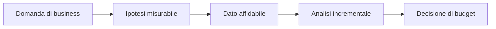

# Brand analytics e misurazione dell'efficacia

Nel marketing, la notorietà di un brand può crescere nei sondaggi, ma il vero nodo è capire se questo si traduce in scelte concrete, variazioni di prezzo o conversioni. Il brand non si misura come un semplice click, ma non può nemmeno essere escluso dalla disciplina analitica. La brand analytics si colloca in questa zona intermedia, dove si traducono segnali lenti in decisioni rapide.

## Problema reale

Il compito è trasformare budget, canali, creatività e audience in decisioni misurabili, evitando di confondere volume, attribuzione e incrementalità. Non basta che il concetto sia interessante in astratto: deve migliorare una decisione reale, basandosi su dati affidabili e con una soglia di errore esplicita.

## Modello concettuale

Il processo è sequenziale: si parte da una domanda di business, si formula un'ipotesi misurabile, si verifica la qualità del dato e si arriva alla decisione di budget.



| Passaggio | Domanda guida | Output atteso |
|---|---|---|
| Framing | Quale decisione deve cambiare? | Scelta concreta, non curiosità |
| Misura | Quale segnale rappresenta il fenomeno? | Metrica, fonte, granularità |
| Confronto | Rispetto a quale baseline interpreto il risultato? | Benchmark o controfattuale |
| Azione | Che cosa faccio se il segnale supera la soglia? | Decisione, owner, prossimo controllo |

## Formalizzazione rigorosa

Brand analytics si formalizza come relazione tra quattro elementi:

| Elemento | Definizione operativa |
|---|---|
| Unità | campagna, coorte, touchpoint o segmento cliente |
| Segnale | margine incrementale, CAC payback, conversion rate corretto, lift o retention generata |
| Baseline | periodo precedente, gruppo holdout, mercato comparabile o benchmark storico |
| Decisione | spostare risorse, cambiare messaggio, fermare tattica o scalare esperimento |
| Rischio | confondere correlazione, qualità del dato e causalità decisionale |

Una metrica è utile solo se riduce l'incertezza su una decisione specifica. Se non cambia una scelta, è solo documentazione; se cambia una scelta senza controlli, è rischio.

## La brand funnel e le metriche per livello

La brand funnel descrive il percorso del consumatore:

```
Awareness → Consideration → Preference → Purchase → Loyalty → Advocacy
```

| Livello | Metrica | Come misurarla | Frequenza |
|---------|---------|----------------|-----------|
| Awareness | % target che conosce il brand | Survey (aided/unaided recall), Google Trends | Trimestrale, continuo |
| Consideration | % che considera il brand | Survey, Share of Search | Trimestrale |
| Preference | % che preferisce il brand | Survey, Conjoint analysis | Annuale |
| Purchase | Quota di mercato, trial rate | Dati interni, panel | Mensile |
| Loyalty | Repeat rate, NPS, share of wallet | Dati transazionali, survey | Continuo |
| Advocacy | Referral rate, UGC volume | Programma referral, social listening | Continuo |

## Brand lift studies: misurare l'impatto della pubblicità

Il gold standard per valutare il brand marketing è il brand lift study:

1. Gruppo esposto alla campagna
2. Gruppo di controllo simile non esposto
3. Calcolo del lift: differenza relativa tra i due gruppi

Esempio: campagna TV UK vs Irlanda

- Awareness UK: 45% → 58% (+13pp)
- Awareness Irlanda: 42% → 44% (+2pp)
- Lift attribuibile: +11pp

Un proxy rapido può essere Google Trends, confrontando i volumi di ricerca durante e prima della campagna.

## Metriche proxy per il brand health in tempo reale

Le survey sono lente e costose, perciò si usano proxy continui:

- Brand Search Volume: ricerche Google sul brand
- Direct Traffic: traffico diretto al sito
- Brand CPC discount: costo per click più basso per brand name
- Social Mention Velocity: velocità di menzioni social
- Backlink growth: crescita dei link da altri siti

## Caso reale: il brand tracking di Nike

Nike investe principalmente in brand marketing e misura un Brand Power Index composito (Google Trends, social sentiment, direct traffic, NPS, survey). Un aumento di 10 punti nell'indice corrisponde a un +3-4% di revenue nei 4 trimestri successivi, con un lag di 12-18 mesi e una correlazione robusta (R²=0.72). Questo giustifica investimenti brand senza ritorno immediato.

## Brand vs Performance: allocazione del budget per stadio

| Stadio aziendale | % Brand | % Performance | Motivazione |
|-----------------|---------|---------------|-------------|
| Early stage (<$5M) | 10-20% | 80-90% | Sopravvivenza, focus su ROAS |
| Scale-up ($5-50M) | 30-40% | 60-70% | Costruzione awareness, inizio brand lift |
| Growth ($50-500M) | 40-50% | 50-60% | Brand come fossato competitivo |
| Mature (>$500M) | 50-60% | 40-50% | Mantenimento quota e premium pricing |

## Controllo di qualità e segmentazione

Prima di usare brand analytics in decisioni, verifica completezza, duplicati, timezone, definizioni e segmenti esclusi. La media aggregata è solo un punto di partenza: segmenta per canale, coorte, paese, device e maturità utente. Differenze tra segmenti possono nascondere errori decisionali.

## Esempio o caso studio

Un team growth valuta se aumentare budget su un canale con CPA basso ma vendite marginali deboli. La lezione aiuta a distinguere segnale utile da rumore, collegando metrica, modello mentale e decisione economica.

La lettura si organizza in tre colonne:

| Evidenza | Interpretazione prudente | Decisione |
|---|---|---|
| Segnale positivo ma non isolato | Fenomeno esiste, causa incerta | Cercare baseline o holdout |
| Segmento con risposta diversa | Effetto medio nasconde eterogeneità | Analizzare coorti o sottogruppi |
| Costo operativo crescente | Valutare margine | Applicare soglie economiche |

## Lab / esercizio

### Livello base

Descrivi una decisione reale legata a brand analytics in cinque righe: obiettivo, metrica primaria, baseline, rischio e azione.

### Livello intermedio

Costruisci una tabella con almeno tre segmenti/scenari indicando segnale, spiegazione alternativa e controllo necessario.

### Livello research-grade

Progetta un piano di validazione: ipotesi, dati, criteri di esclusione, soglia decisionale e controllo post-decisione. Indica cosa ti farebbe cambiare idea.

### Dataset e materiali consigliati

Usa export campagne, costi media, eventi web/app, CRM, transazioni, survey brand e log consenso. Se non hai dati reali, crea un dataset sintetico con 200-500 righe e almeno una colonna temporale, una segmento, una metrica outcome e una variabile esposizione.

## Errore tipico da evitare

Trattare brand analytics come una definizione da ricordare invece che un protocollo decisionale. Presentare metriche senza baseline, grafici senza ipotesi o raccomandazioni senza costo dell'errore porta a decisioni sbagliate.

Chiediti sempre: "Se questo risultato fosse falso, quale decisione sbaglierei?". Se non sai rispondere, la lezione non è stata applicata davvero.

## Quiz o checkpoint

1. Quale decisione concreta migliora questa lezione?
2. Quale baseline rende interpretabile il risultato?
3. Quale assunzione, se errata, cambia la conclusione?
4. Quale controllo minimo useresti prima di raccomandare?

## Riepilogo operativo

Brand analytics e misurazione dell'efficacia è una competenza che collega concetto, dato e decisione. Studiala partendo da un problema reale, formalizza il segnale, cerca una baseline credibile, costruisci un esempio e chiudi con un controllo pratico. Solo così diventa strumento operativo e non conoscenza decorativa.
