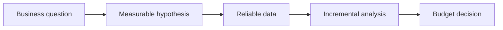

# Marketing Funnel and Unit Economics

A campaign might generate many low-cost leads, but without connecting conversions, customer value, and acquisition cost, the funnel can appear efficient only superficially. **Marketing funnel and unit economics** merges volume, quality, and economic sustainability into a single actionable analysis.

## Real-World Problem

In marketing analytics, the core challenge is turning budgets, channels, creatives, and audiences into measurable decisions, avoiding confusion between volume, attribution, and incremental impact. Interesting metrics alone are not enough: you must understand which decision improves by applying them with reliable data and explicit error thresholds. This lesson is an operational tool to grasp the analytical problem, apply concrete examples and metrics to real cases. Without linking concepts to concrete choices, knowledge remains decorative.

## Conceptual Model

The process is sequential: start with a question, translate it into an observable hypothesis, assess data quality, perform incremental analysis, and only then decide. Skipping steps yields elegant but fragile analyses.

| Step | Guiding Question | Expected Output |
|---|---|---|
| Framing | Which decision needs to change? | A concrete choice, not curiosity |
| Measurement | Which signal represents the phenomenon? | Metric, source, and granularity |
| Comparison | Against which baseline do I interpret results? | Benchmark or plausible counterfactual |
| Action | What do I do if the signal crosses threshold? | Decision, owner, and next check |

## Rigorous Formalization

We formalize **marketing funnel and unit economics** as a relation among four key elements:

| Element | Operational Definition |
|---|---|
| Unit | campaign, cohort, touchpoint, or customer segment |
| Signal | incremental margin, CAC payback, corrected conversion rate, lift, or retention generated |
| Baseline | previous period, holdout group, comparable market, or historical benchmark |
| Decision | reallocate resources, change messaging, stop tactic, or scale experiment |
| Risk | confusing correlation, data quality, and causal decision-making |

The practical rule is simple: a metric is useful only if it reduces uncertainty about a specific decision. If it does not change a choice, it is documentation; if it changes a choice without controls, it is risk.

## Example or Case Study

A growth team must decide whether to increase budget on a channel with low CPA but weak marginal sales. Applying the model, they build a three-column reading: what we know, what we assume, and what decision we take. This prevents presenting a number as a self-sufficient conclusion.

| Evidence | Cautious Interpretation | Consequent Decision |
|---|---|---|
| Positive but isolated signal | Phenomenon exists but cause uncertain | Seek baseline or holdout |
| Segment with different response | Average effect hides heterogeneity | Analyze cohorts or subgroups |
| Rising operational cost | Evaluate on margin | Apply economic thresholds |

## The Math of Growth: Acquisition Funnel Decomposition

A marketing funnel is a mathematical model describing the journey from unknown user to profitable customer. It breaks down into discrete stages with intermediate conversion rates; the final output is the product of these rates.

For example, a typical SaaS funnel includes impressions, clicks, visits, leads, MQLs, SQLs, and customers. Each step has a specific conversion rate (CTR, CVR, Win Rate).

Investing €10,000 at €20 CPM yields 500,000 impressions. With 1.5% CTR, 7,500 clicks; 95% click-to-visit, 7,125 visits; 4% CVR, 285 leads; 70% lead-to-MQL, 199 MQLs; 40% MQL-to-SQL, 80 opportunities; 25% Win Rate, 20 customers.

A CVR increase from 4% to 5% raises customers by 25% without extra ad spend.

## Unit Economics in Action: From CAC to LTV:CAC Ratio

The average Customer Acquisition Cost (CAC) is €500 (€10,000/20). But a fully loaded CAC includes marketing spend, personnel, technology, and operational costs. If these add €8,000, the real CAC is €900.

Lifetime Value (LTV) is calculated as:

LTV = (Average Revenue Per Account per month × Gross Margin %) ÷ Monthly Churn Rate

With €150/month, 80% margin, and 2% churn, LTV = (€150 × 0.8) ÷ 0.02 = €6,000.

The LTV:CAC ratio = 6,000 ÷ 900 ≈ 6.7, an excellent indicator suggesting scaling investment.

### Case Study: Spotify and the Freemium Lever

Spotify uses a bifurcated funnel: Free users and conversion to Premium. The free, ad-supported product is a low-cost acquisition channel for paying customers.

With €1.4 billion in marketing and 489 million users, the CAC for a Free user is about €2. If 10% convert to Premium, the effective CAC for Premium via Free is about €20.

With €4.50 ARPU/month, 25% margin, and 1.5% churn, Premium LTV is about €75. The LTV:CAC ratio is 3.75, sustainable and scalable.

## Funnel Diagnostics via SQL: Identifying Bottlenecks

To find where the funnel breaks, granular analysis is needed. A SQL query on a `user_events` table recording events like 'view_ad', 'click_ad', 'visit_landing_page', 'submit_form' segmented by channel helps calculate intermediate conversion rates.

The query uses CTEs to count unique users per stage and channel, computing CTR, click-to-visit, and visit-to-lead rates. Comparing channels reveals critical points: e.g., Google with high CTR but low visit-to-lead suggests mismatch between ad and landing page.

## Advanced Optimization Strategies and the Netflix Case

Funnel optimization is a scientific process based on A/B testing at every stage:

- Top of Funnel: test creatives, copy, audiences, CTAs to maximize CTR
- Middle of Funnel: test landing page elements, headlines, forms, offers to maximize CVR
- Bottom of Funnel: test email nurturing, sales scripts, pricing to maximize Win Rate

A common mistake is treating the funnel as monolithic. Segment by channel, device, geography, and cohort to uncover hidden patterns.

### Case Study: Netflix and Its Obsession with the Signup Funnel

Netflix continuously tested every homepage variable for non-subscribers, measuring not only sign-ups but also first-month retention. In 2020, it removed free trials in many markets, reducing sign-ups but increasing quality and LTV, optimizing LTV:CAC. This shows adding friction can improve funnel health by filtering low-intent users.

## From Model to Practice: Funnel Analysis Lab

Imagine you are a Data Analyst in an EdTech startup with user event data. Your task is to diagnose the sales funnel and propose actions.

**Exercise 1: Basic Funnel Mapping**

Calculate unique users at each stage (`view_course_page`, `add_to_cart`, `start_checkout`, `purchase`) and sequential conversion rates using Python and pandas. An example shows a steep drop from page view to add-to-cart (12%), while checkout steps are more efficient.

**Exercise 2: Segmented Analysis by Channel and Device**

Repeat analysis grouped by `utm_source` and `device_type`. Find that Facebook on mobile has high add-to-cart but low final conversion, while organic desktop traffic has lower initial conversion but efficient checkout.

**Exercise 3: Hypothesis and Recommendations**

Hypothesis: mobile checkout flow has usability issues or non-optimized payment methods causing abandonment among Facebook mobile users.

Recommendation: conduct specific UX analysis and run A/B tests with simplified mobile checkout, measuring purchase completion impact.

## Common Pitfall to Avoid

Treating **marketing funnel and unit economics** as a memorized definition rather than a decision-making protocol. Presenting metrics without baseline, charts without hypothesis, or recommendations without error cost leads to fragile analysis. A useful check is asking: "If this result were false, which decision would I get wrong?" If unclear, the lesson is not truly applied.

## Quiz or Checkpoint

1. What concrete decision should this lesson improve?
2. Which baseline makes the result interpretable?
3. Which assumption, if wrong, would change the conclusion?
4. What minimum control would you use before presenting the recommendation?

## Summary

Combining funnel analysis with unit economics transforms marketing from a cost center into a scientifically measurable growth engine. Breaking down the user journey into measurable stages isolates operational levers and links investment to value. The discipline lies in rigorously and operationally connecting concept, data, and decision.

## Lab and Exercises

### Basic Level

Write in five lines a real decision linked to **marketing funnel and unit economics**: objective, primary metric, baseline, main risk, and planned action. Use only one primary metric.

### Intermediate Level

Build a table with at least three segments or scenarios. For each, indicate signal, possible alternative explanation, and necessary control before deciding.

### Research-Grade Level

Design a validation plan: hypothesis, required data, exclusion criteria, decision threshold, and post-decision control. Specify what would make you change your mind.

### Recommended Datasets and Materials

Use campaign exports, media costs, web/app events, CRM, transactions, brand surveys, and consent logs. If no real data, create a synthetic dataset with 200-500 rows, including at least one temporal column, one segment column, one outcome metric, and one exposure variable.
