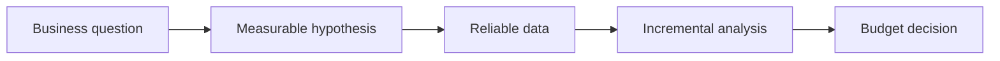

# GTM DataLayer and Marketing Tracking QA

A deployment can alter the dataLayer, a pixel might lose the `purchase_id`, and the next day's dashboard can show inconsistent data. Before analyzing performance, you must verify that tracking still reflects real user behavior. This lesson bridges technical governance and budget decisions, showing how marketing tracking QA is essential for making decisions under uncertainty.

## Real-world problem

In marketing analytics, the concrete challenge is turning budgets, channels, creatives, and audiences into measurable decisions without confusing volume, attribution, and incrementality. The key question is not whether the concept is interesting in theory, but which decision improves when applied with reliable data and explicit error thresholds.

## Conceptual model

The mental process is sequential:

- Formulate the business question
- Translate it into a measurable hypothesis
- Assess data quality
- Perform incremental analysis
- Make a budget decision



| Step | Guiding question | Expected output |
|---|---|---|
| Framing | Which decision needs to change? | A concrete choice, not curiosity |
| Measurement | Which signal represents the phenomenon? | Metric, source, granularity |
| Comparison | Against which baseline do I interpret results? | Benchmark or plausible counterfactual |
| Action | What do I do if the signal crosses the threshold? | Decision, owner, next check |

## Rigorous formalization

We formalize marketing tracking QA as a relation among four elements:

| Element | Operational definition |
|---|---|
| Unit | campaign, cohort, touchpoint, or customer segment |
| Signal | incremental margin, CAC payback, corrected conversion rate, lift, or generated retention |
| Baseline | previous period, holdout group, comparable market, or historical benchmark |
| Decision | reallocate resources, change message, stop tactic, or scale experiment |
| Risk | confusing correlation, data quality, and causal decision-making |

A measure is useful only if it reduces uncertainty about a specific decision. If it does not change a choice, it is documentation; if it changes a choice without controls, it is risk.

## The DataLayer: single source of truth

The dataLayer is the primary source of tracking events and must follow strict rules:

1. Consistent event names: choose snake_case or camelCase and stick to it.
2. Consistent property typing: `value` always a number, `currency` always an ISO 4217 string.
3. Never include personally identifiable information (PII) to comply with GDPR.
4. Auto-generate documentation from code, not manual maintenance.

Example of standardized ecommerce event push:

```javascript
// Standardized ecommerce event push
dataLayer.push({
  'event': 'purchase_completed',
  'ecommerce': {
    'transaction_id': 'TXN-2024-0456',
    'affiliation': 'Online Store',
    'value': 149.99,
    'tax': 24.99,
    'shipping': 5.00,
    'currency': 'EUR',
    'coupon': 'SUMMER10',
    'items': [{
      'item_id': 'SKU-789',
      'item_name': 'Felpa Premium Cotton',
      'item_brand': 'GreenWear',
      'item_category': 'Apparel',
      'item_variant': 'Black - L',
      'price': 49.99,
      'quantity': 2
    }]
  },
  'customer_type': 'returning',
  'acquisition_channel': 'google_ads'
});
```

## Tracking QA: a 4-level checklist

### Level 1: DataLayer testing (development)

Check the dataLayer structure in the console and use tools like DataLayer Inspector+ to monitor real-time events. Verify event types, required properties, and data types.

### Level 2: Network request testing

In DevTools → Network, filter requests to Google Analytics and Facebook. Confirm requests are sent correctly without 4xx or 5xx errors.

### Level 3: End-to-end validation

Simulate a test user and run the full funnel on staging, verifying all events appear correctly in GA4 Realtime and Facebook Test Events.

### Level 4: Production monitoring

Set up automatic alerts for event volume drops greater than 50% compared to baseline, for example with this BigQuery SQL:

```sql
WITH current AS (
  SELECT event_name, COUNT(*) AS cnt
  FROM `project.analytics.events_*`
  WHERE _TABLE_SUFFIX = FORMAT_DATE('%Y%m%d', CURRENT_DATE())
  GROUP BY event_name
),
baseline AS (
  SELECT event_name, AVG(cnt) AS avg_cnt, STDDEV(cnt) AS stddev_cnt
  FROM daily_event_counts
  WHERE day BETWEEN DATE_SUB(CURRENT_DATE(), INTERVAL 14 DAY)
                AND DATE_SUB(CURRENT_DATE(), INTERVAL 1 DAY)
  GROUP BY event_name
)
SELECT c.event_name, c.cnt, b.avg_cnt,
       ROUND((c.cnt - b.avg_cnt) / b.avg_cnt * 100, 1) AS pct_change
FROM current c JOIN baseline b ON c.event_name = b.event_name
WHERE c.cnt < b.avg_cnt * 0.5;
```

## Automated regression testing

Integrate tests in CI/CD pipelines with Cypress or Puppeteer that simulate a user journey and verify expected events in the dataLayer:

```javascript
it('should fire purchase event with correct properties', () => {
  cy.visit('/checkout');
  cy.get('[data-cy=place-order]').click();
  cy.window().then((win) => {
    const purchaseEvent = win.dataLayer.find(e => e.event === 'purchase_completed');
    expect(purchaseEvent.ecommerce.transaction_id).to.be.a('string');
    expect(purchaseEvent.ecommerce.value).to.be.a('number');
    expect(purchaseEvent.ecommerce.currency).to.equal('EUR');
  });
});
```

## Real case: Wise's tracking QA framework

Wise built an internal tracking QA framework based on JSON Schema definitions for each event and a CI pipeline validating every dataLayer push. In production, BigQuery alerts monitor event volume and freshness. This reduced tracking incidents from 3-4 per month to zero over 18 months, increasing marketing's trust in data.

## Segment interpretation

Aggregate averages are just a starting point. Segment by channel, cohort, plan, country, device, and user maturity. Opposite trends in segments can make averages misleading and lead to wrong decisions.

## Operational decision

Every analysis must end with a concrete choice: continue, stop, iterate, invest, remove, or investigate. If tracking QA does not influence a decision, the link between metric and action is missing.

## Example or case study

A growth team must decide whether to increase budget on a channel showing low CPA but weak marginal sales. Applying tracking QA, they build a table with evidence, cautious interpretation, and consequent decision:

| Evidence | Cautious interpretation | Consequent decision |
|---|---|---|
| Positive but isolated signal | Phenomenon exists but cause uncertain | Seek baseline or holdout |
| Segment with different response | Average effect hides heterogeneity | Analyze cohorts or subgroups |
| Rising operational cost | Evaluate on margin | Apply economic thresholds |

## Lab / exercise

### Basic level

Write a real decision linked to tracking QA in five lines: objective, primary metric, baseline, main risk, and planned action.

### Intermediate level

Build a table with at least three segments or scenarios, indicating for each signal, possible alternative explanation, and required control.

### Research-grade level

Design a validation plan with hypothesis, required data, exclusion criteria, decision threshold, and post-decision control. Specify what would make you change your mind.

### Recommended datasets and materials

Use campaign exports, media costs, web/app events, CRM, transactions, brand surveys, and consent logs. If no real data, create a synthetic dataset with 200-500 rows including timestamp, segment, outcome metric, and exposure variable.

## Common mistake to avoid

Treating tracking QA as a definition to memorize rather than a decision protocol. Presenting metrics without baselines, charts without hypotheses, or recommendations without error costs leads to fragile decisions.

Always ask: "If this result were false or unstable, which decision would I get wrong?" If you cannot answer, the lesson has not been truly applied.

## Quiz or checkpoint

1. What concrete decision should this lesson improve?
2. Which baseline makes the result interpretable?
3. Which assumption, if wrong, would change the conclusion?
4. What minimum control would you use before presenting the recommendation?

## Operational summary

Marketing tracking QA is a skill linking concept, data, and decision. Study it starting from a real problem, formalize the signal, find a credible baseline, build an example, and close with a practical check. Without this approach, even sophisticated data can mislead.

## Practice deepening

Treat this lesson as a work test in a marketing review: link channel, metric, segment, cost, and recommendation. This makes knowledge transferable by separating context, measurement, action, and limitation.

### Operational example

Start with a simple question: which choice would improve by applying this lesson well? Build an example in three lines: context, data or model used, decision after risk checks.

### Work checkpoint

- Write the decision this lesson should improve using an action verb.
- Define the main signal and at least one guardrail.
- Add a baseline.
- State the most probable risk.
- Close with a deliverable output (dashboard, query, memo, experiment, checklist).

### Mastery summary

You have mastered this lesson when you can explain the concept without jargon, apply it to a small realistic case, and defend a recommendation including limits and next checks. If any is missing, revisit the conceptual model and scale down the example ambition.
