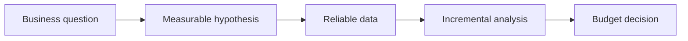

# Multichannel Lifecycle Orchestration

In modern marketing, a customer might receive a welcome email, a push notification, an SMS, and retargeting ads all in the same afternoon. Each channel optimizes its own goal, but the overall experience risks becoming noisy and overwhelming. **Multichannel lifecycle orchestration** exists to coordinate messages, priorities, and pauses throughout the customer lifecycle, turning this chaos into a coherent, personalized journey.

## Real-world problem

The concrete challenge is turning budgets, channels, creatives, and audiences into measurable decisions without confusing volume, attribution, and incremental impact. This is not an abstract concept but an operational tool: understanding which decision improves when applying reliable data with explicit error thresholds. Without this link, knowledge remains decorative, not competency.

## Conceptual model

The mental model is sequential: first formulate the question, then translate it into observable units, evaluate data quality, and only then decide. Skipping steps yields elegant but fragile analyses.

| Step | Guiding question | Expected output |
|---|---|---|
| Framing | Which decision must change? | A concrete choice, not curiosity |
| Measurement | Which signal represents the phenomenon? | Metric, source, granularity |
| Comparison | Against which baseline do I interpret results? | Benchmark or plausible counterfactual |
| Action | What do I do if the signal crosses threshold? | Decision, owner, next check |

## Rigorous formalization

Multichannel lifecycle orchestration formalizes as a relation among four elements: unit of analysis, signal, baseline, and decision.

| Element | Operational definition |
|---|---|
| Unit | campaign, cohort, touchpoint, or customer segment |
| Signal | incremental margin, CAC payback, corrected conversion rate, lift, or retention generated |
| Baseline | previous period, holdout group, comparable market, or historical benchmark |
| Decision | reallocate resources, change message, stop tactic, or scale experiment |
| Risk | confusing correlation, data quality, and causal decision-making |

The practical rule is simple: a measure is useful only if it reduces uncertainty about a specific decision. If it does not change a choice, it is documentation; if it changes a choice without controls, it is risk.

## From silos to symphony: the orchestration paradigm

For years, marketing organizations were structured by separate channels, each with its own KPIs and tools. This "siloed" approach creates inconsistent experiences: a customer who just purchased might keep seeing ads for the same products, or a user who reported an issue might receive inappropriate emails.

Orchestration moves decision intelligence from individual channels to a centralized "brain," typically in the Data Warehouse. Here, a single source of truth about the customer and actions to take is defined, with complex, contextual logic that avoids overlaps and saturation.

The difference between automation and orchestration is like that between a solo musician and a conductor: automation plays individual cues, orchestration coordinates timing, pauses, and dynamics to create a harmonious, coherent experience.

## Architecture of a centralized decision engine

An effective orchestration system relies on a modern data stack and unfolds in four phases:

1. **Behavioral data collection**: tools like Segment or Snowplow capture real-time events from all touchpoints, complemented by transactional and third-party data.

2. **Centralization and modeling in the Data Warehouse**: raw data is transformed and modeled into a `customer_360` table offering a comprehensive, dynamic view of the customer.

3. **Decision engine (logic layer)**: a SQL view centralizes business logic to decide the best action for each customer, using `CASE WHEN` structures defining priorities and channels.

Example decision logic:

| Priority | Condition | Action | Channel | Offer |
|---|---|---|---|---|
| 1 | High churn risk | Winback | Email | 25% discount |
| 2 | Recent cart abandonment >50€ | Cart reminder | Push | Free shipping |
| 3 | New user without purchase | Onboarding nudge | Email | Guided tour |
| 4 | High recent NPS | Ask for review | In-App | - |
| 5 | Loyal customer recent | Exclusive preview | Email | New collection |

4. **Activation via Reverse ETL**: tools like Hightouch sync audiences and actions to operational platforms, closing the loop from data to action.

## Example or case study

A growth team must decide whether to increase budget on a channel with low CPA but weak marginal sales. Applying lifecycle orchestration, they build a three-column reading: evidence, cautious interpretation, and consequent decision.

| Evidence | Cautious interpretation | Decision |
|---|---|---|
| Positive but isolated signal | Phenomenon exists but cause uncertain | Seek baseline or holdout |
| Segment with varied response | Average effect hides heterogeneity | Analyze subgroups |
| Rising operational cost | Evaluate on margin | Apply economic thresholds |

## Lab / exercise

### Basic level

Write in five lines a real decision linked to lifecycle orchestration: objective, primary metric, baseline, main risk, and planned action.

### Intermediate level

Build a table with at least three segments or scenarios, indicating for each signal, possible alternative explanation, and necessary control.

### Research-grade level

Design a validation plan: hypothesis, required data, exclusion criteria, decision threshold, and post-decision control. Specify what would make you change your mind.

### Recommended datasets and materials

Use campaign exports, media costs, web/app events, CRM, transactions, brand surveys, and consent logs. If no real data is available, create a synthetic dataset with at least 200 rows, one temporal column, one segment column, one outcome metric, and one exposure variable.

## Common mistakes to avoid

The most frequent mistake is treating lifecycle orchestration as a definition to memorize rather than a decision protocol. This happens when metrics lack baselines, charts lack hypotheses, or recommendations lack error cost.

A useful check is asking: "If this result were false or unstable, which decision would I get wrong?" If the answer is unclear, the lesson has not been truly applied.

## Quiz or checkpoint

1. What concrete decision should this lesson improve?
2. Which baseline makes the result interpretable?
3. Which assumption, if wrong, would change the conclusion?
4. What minimum control would you use before presenting the recommendation?

## Summary

Multichannel lifecycle orchestration marks a paradigm shift from traditional siloed automation. By moving decision intelligence into a centralized engine within the data warehouse, companies create consistent, contextual, and personalized experiences at scale. Modern technology combining event collection, data modeling, and Reverse ETL activation provides the foundation, but success depends on sophisticated business logic and rigorous measurement of incremental impact using control groups. Cases like Stripe and Revolut show this discipline is essential for making effective decisions under uncertainty.
