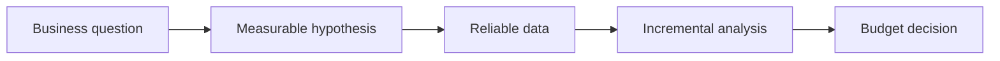

# Martech dashboards and operational analytics

In marketing operations, dashboards cluttered with dozens of KPIs often become visual noise unless designed to support clear decisions. A useful dashboard does not show everything but separates system health, anomalies, priorities, and recurring actions. This is the essence of **Martech dashboards and operational analytics**: organizing the workspace to reduce uncertainty in daily choices.

## Real-world problem

The core challenge is turning scattered data from budgets, channels, creatives, and audiences into measurable decisions. It is not enough to know if a number went up or down; the key is understanding which decision changes because of that information. Without explicit error thresholds and a comparison baseline, data remain decorative rather than operational.

## Conceptual model

The mental process is sequential:

- Start with a concrete business question;
- Translate it into a measurable hypothesis;
- Verify data quality and reliability;
- Conduct incremental analysis;
- Arrive at a budget or strategic decision.

| Step | Guiding question | Expected output |
|---|---|---|
| Framing | What decision needs to change? | Concrete choice, not curiosity |
| Measurement | What signal represents the phenomenon? | Metric, source, granularity |
| Comparison | Against which baseline do I interpret results? | Benchmark or counterfactual |
| Action | What do I do if the signal crosses the threshold? | Decision, owner, next check |

## Rigorous formalization

Operational dashboards and analytics rely on four elements:

| Element | Operational definition |
|---|---|
| Unit of analysis | Campaign, cohort, touchpoint, or customer segment |
| Signal | Incremental margin, CAC payback, adjusted conversion rate, lift, or generated retention |
| Baseline | Previous period, holdout group, comparable market, or historical benchmark |
| Decision | Reallocate resources, change messaging, stop tactic, or scale experiment |

A metric is useful only if it reduces uncertainty about a specific decision. Without this link, it is documentation or risk.

## Example or case study

A growth team must decide whether to increase budget on a channel with low CPA but weak marginal sales. Applying this framework, they build a structured interpretation:

| Evidence | Cautious interpretation | Decision |
|---|---|---|
| Positive but isolated signal | Phenomenon exists but cause uncertain | Seek baseline or holdout |
| Segment-specific response | Average effect hides heterogeneity | Analyze cohorts or subgroups |
| Rising operational cost | Evaluate on margin, not just volume | Apply economic thresholds |

This format prevents presenting a number as a self-sufficient conclusion.

## Lab / exercise

### Basic level

Write five lines describing a real decision linked to Martech dashboards: objective, primary metric, baseline, main risk, and planned action.

### Intermediate level

Build a table with at least three segments or scenarios, indicating signal, possible alternative explanation, and necessary control for each.

### Research-grade level

Design a validation plan with hypothesis, required data, exclusion criteria, decision threshold, and post-decision checks. Specify what would make you change your mind.

### Recommended datasets and materials

Use campaign exports, media costs, web/app events, CRM, transactions, brand surveys, and consent logs. If real data are unavailable, create a synthetic dataset with at least 200 rows, including a time column, a segment column, an outcome metric, and an exposure variable.

## Common mistakes to avoid

- Aggregating data too early, hiding segments moving in opposite directions.
- Neglecting data quality checks: duplicates, incomplete tracking, inconsistent timezones.
- Confusing correlation with causation: association does not imply a feature causes conversion.

A practical check: ask "If this result were false, which decision would I get wrong?" If the answer is unclear, the analysis is incomplete.

## Summary

Martech dashboards and operational analytics are decision tools linking problem, data, metric, segmentation, and action. Observing a number rising or falling is not enough; a clear operational recommendation with confidence level and a metric to evaluate the decision over time is essential.

## Quiz or checkpoint

1. Which concrete decision does this lesson improve?
2. Which baseline makes the result interpretable?
3. Which assumption, if wrong, would change the conclusion?
4. What minimum control would you use before recommending an action?
