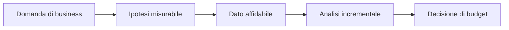

# Martech dashboard e analytics operativi

Nel marketing operativo, un dashboard con decine di KPI rischia di diventare solo rumore visivo se non è progettato per supportare decisioni concrete. Un buon dashboard non deve mostrare tutto, ma deve distinguere tra salute del sistema, anomalie, priorità e azioni ricorrenti. Questo è il cuore di **Martech dashboard e analytics operativi**: organizzare la superficie di lavoro per ridurre l'incertezza nelle scelte quotidiane.

## Problema reale

Il problema centrale è trasformare dati sparsi tra budget, canali, creatività e audience in decisioni misurabili. Non basta sapere se un numero è salito o sceso, ma capire quale decisione cambia grazie a quell'informazione. Senza una soglia esplicita di errore e una baseline di confronto, i dati restano decorativi, non operativi.

## Modello concettuale

Il processo mentale è sequenziale:

- Partire da una domanda di business concreta;
- Tradurla in un'ipotesi misurabile;
- Verificare la qualità e affidabilità del dato;
- Condurre un'analisi incrementale;
- Arrivare a una decisione di budget o strategica.

| Passaggio | Domanda guida | Output atteso |
|---|---|---|
| Framing | Quale decisione deve cambiare? | Scelta concreta, non curiosità |
| Misura | Quale segnale rappresenta il fenomeno? | Metrica, fonte, granularità |
| Confronto | Rispetto a quale baseline interpreto il risultato? | Benchmark o controfattuale |
| Azione | Che cosa faccio se il segnale supera la soglia? | Decisione, owner, prossimo controllo |

## Formalizzazione rigorosa

La dashboard e l'analisi operativa si basano su quattro elementi:

| Elemento | Definizione operativa |
|---|---|
| Unità di analisi | Campagna, coorte, touchpoint o segmento cliente |
| Segnale | Margine incrementale, CAC payback, conversion rate corretto, lift o retention generata |
| Baseline | Periodo precedente, gruppo holdout, mercato comparabile o benchmark storico |
| Decisione | Spostare risorse, cambiare messaggio, fermare tattica o scalare esperimento |

Una metrica è utile solo se riduce l'incertezza su una decisione specifica. Senza questo legame, è solo documentazione o rischio.

## Esempio o caso studio

Un team growth valuta se aumentare il budget su un canale con CPA basso ma vendite marginali deboli. Usando questo approccio, costruisce una lettura articolata:

| Evidenza | Interpretazione prudente | Decisione |
|---|---|---|
| Segnale positivo ma isolato | Fenomeno reale ma causa incerta | Cercare baseline o holdout |
| Risposta segmentata | Effetto medio nasconde eterogeneità | Analizzare coorti o sottogruppi |
| Costo operativo crescente | Valutare sul margine, non solo volume | Applicare soglie economiche |

Questo formato evita di presentare un numero come conclusione definitiva.

## Lab / esercizio

### Livello base

Scrivi in cinque righe una decisione reale legata a Martech dashboard: obiettivo, metrica primaria, baseline, rischio e azione prevista.

### Livello intermedio

Costruisci una tabella con almeno tre segmenti o scenari, indicando per ciascuno segnale, possibile spiegazione alternativa e controllo necessario.

### Livello research-grade

Progetta un piano di validazione con ipotesi, dati necessari, criteri di esclusione, soglia decisionale e controlli post-decisione. Specifica cosa ti farebbe cambiare idea.

### Dataset e materiali consigliati

Usa dati da campagne, costi media, eventi web/app, CRM, transazioni, survey brand e log di consenso. Se non disponibili, crea un dataset sintetico con almeno 200 righe, una colonna temporale, una segmento, una metrica outcome e una variabile di esposizione.

## Errori tipici da evitare

- Aggregare dati troppo presto, nascondendo segmenti con comportamenti opposti.
- Non controllare la qualità del dato: duplicati, tracking incompleto, timezone incoerenti.
- Confondere correlazione con causalità: un'associazione non implica che una feature causi conversione.

Un controllo pratico: chiedersi "se questo risultato fosse falso, quale decisione sbaglierei?" Se la risposta non è chiara, l'analisi è incompleta.

## Riepilogo

Martech dashboard e analytics operativi sono strumenti decisionali che collegano problema, dati, metrica, segmentazione e azione. Non basta osservare un numero che sale o scende: serve una raccomandazione operativa chiara, con livello di confidenza e metrica per valutare la decisione nel tempo.

## Errore tipico da evitare

L'errore piu comune e trattare il risultato come una verita generale invece che come evidenza condizionata. Prima di agire, controlla baseline, assunzioni e costo dell'errore.

## Quiz o checkpoint

1. Quale decisione concreta migliora questa lezione?
2. Quale baseline rende interpretabile il risultato?
3. Quale assunzione, se errata, cambia la conclusione?
4. Quale controllo minimo useresti prima di raccomandare un'azione?
