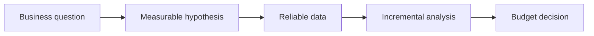

# Server-side tracking and GTM Server

Reliable measurement in digital marketing is increasingly challenging. Blocked cookies, consent modes, ad blockers, and redirects cause event loss in browsers. Server-side tracking and GTM Server are not hacks to track more but tools to better control data, respect privacy, and reduce errors like duplicate conversions.

## Real problem

Marketing needs stable data to turn budgets, channels, and creatives into measurable decisions. Moving to server-side tracking aims to improve data quality and governance, avoiding confusion between volume, attribution, and incrementality. Knowledge remains decorative if not linked to real decisions.

## Conceptual model



The process is sequential: formulate the question, translate it into observable units, assess data quality, then decide. Skipping steps leads to fragile analysis.

| Step | Guiding question | Expected output |
|---|---|---|
| Framing | Which decision must change? | A concrete choice |
| Measurement | Which signal represents the phenomenon? | Metric, source, granularity |
| Comparison | Against which baseline do I interpret results? | Benchmark or counterfactual |
| Action | What do I do if the signal passes threshold? | Decision and follow-up control |

## Rigorous formalization

Server-side tracking and GTM Server relate analysis unit, signal, baseline, and decision:

| Element | Operational definition |
|---|---|
| Unit | campaign, cohort, touchpoint, or customer segment |
| Signal | incremental margin, CAC payback, corrected conversion rate, lift, or retention |
| Baseline | previous period, holdout group, comparable market, historical benchmark |
| Decision | reallocate resources, change message, stop or scale tactic |
| Risk | confusing correlation, data quality, and causal decision-making |

A measure is useful only if it reduces uncertainty about a specific decision.

## The decline of client-side ecosystem

For nearly two decades, client-side tracking dominated, relying on JavaScript in browsers to send data to third parties. Three forces undermined this model:

- **Active user defense:** over 40% of desktop users employ ad blockers that block tracking requests.
- **Browser privacy war:** Safari and Firefox limit or block third-party and even first-party cookies, reducing duration and long-term analysis.
- **Regulatory framework:** GDPR and CCPA impose strict consent requirements, increasing compliance risk.

These factors turned client-side tracking into a source of incomplete and risky data.

## Architecture and mechanics of server-side tracking

Server-side tracking inserts a company-controlled server between browser and marketing platforms. Event flow for `add_to_cart`:

1. Event generated in browser, captured by GTM Web.
2. GA4 tag sends data to a first-party endpoint like `metrics.mysite.com`, bypassing ad blockers.
3. GTM Server Container receives and standardizes the event.
4. Server enriches or filters data (e.g., removes PII, adds margins or categories).
5. Server-to-server tags send data to GA4, Facebook CAPI, data warehouse, etc.

Benefits:
- Resilience to ad blockers and cookie restrictions
- Persistent first-party cookies for longitudinal analysis
- Improved site performance
- Centralized governance and data security

## Facebook Conversions API (CAPI): Adoption driver

CAPI responded to iOS 14.5's cross-app tracking limits by sending events directly from company servers to Facebook, improving match rate and attribution quality.

To avoid duplicates, each event sends a unique `event_id`. Emails and other identifiers are SHA-256 hashed for privacy.

Python example sending a `Purchase` event to CAPI:

```python
import requests
import hashlib
import time

def send_facebook_capi_purchase(pixel_id, access_token, order_id, order_value, user_email, user_ip, user_agent):
    normalized_email = user_email.strip().lower()
    hashed_email = hashlib.sha256(normalized_email.encode('utf-8')).hexdigest()
    event_time = int(time.time())
    payload = {
        "data": [{
            "event_name": "Purchase",
            "event_time": event_time,
            "event_id": order_id,
            "action_source": "website",
            "user_data": {
                "em": [hashed_email],
                "client_ip_address": user_ip,
                "client_user_agent": user_agent,
            },
            "custom_data": {
                "currency": "EUR",
                "value": order_value,
            }
        }]
    }
    url = f"https://graph.facebook.com/v18.0/{pixel_id}/events"
    params = {'access_token': access_token}
    try:
        response = requests.post(url, json=payload, params=params)
        response.raise_for_status()
        return response.json()
    except requests.exceptions.RequestException as e:
        print(f"Error sending event: {e}")
        return None
```

## Case study: ASOS

ASOS migrated from client-side to server-side tracking with GTM Server Container on Google Cloud Run. Facebook event match rates rose from 40-70% to 92%.

This enabled a 25% CPA reduction on dynamic retargeting campaigns and improved site speed by 200 ms. ROI was achieved in under three months from Facebook efficiency gains alone.

## Example or case study

A growth team debates increasing budget on a channel with low CPA but weak marginal sales. Using server-side tracking, they build a table with evidence, cautious interpretation, and decision:

| Evidence | Cautious interpretation | Decision |
|---|---|---|
| Positive but isolated signal | Phenomenon exists, cause uncertain | Seek baseline or holdout |
| Segment with varied response | Average effect hides heterogeneity | Analyze cohorts or subgroups |
| Rising operational cost | Evaluate on margin | Apply economic thresholds |

## Lab / exercise

### Basic level

Describe in five lines a real decision linked to server-side tracking: objective, primary metric, baseline, risk, and action.

### Intermediate level

Build a table with at least three segments, indicating signal, possible explanation, and required control.

### Research-grade level

Design a validation plan with hypothesis, data, exclusion criteria, decision threshold, and post-decision control. Specify what would change your mind.

### Recommended datasets and materials

Use campaign exports, media costs, web/app events, CRM, transactions, brand surveys, and consent logs. If no real data, create a synthetic dataset with at least 200 rows, a time column, a segment column, an outcome metric, and an exposure variable.

## Common mistake to avoid

Treating server-side tracking as a definition to memorize rather than a decision protocol. Presenting metrics without baseline, charts without hypotheses, or recommendations without error cost is a mistake.

Always ask: "If this result were false, what decision would I get wrong?" If unclear, the lesson is not yet applied.

## Quiz or checkpoint

1. What concrete decision does this lesson improve?
2. Which baseline makes results interpretable?
3. Which assumption, if wrong, would change the conclusion?
4. What minimal check would you use before recommending?

## Operational summary

Server-side tracking and GTM Server are valuable skills when linking concept, data, and decision. Study them starting from a real problem, formalize the signal, find a credible baseline, build examples, and close with practical checks.
