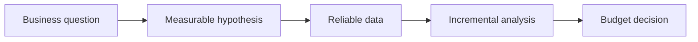

# Social media analytics

Social media value is not in raw likes or views but in turning data into strategic decisions amid uncertainty. One post may have many comments, another fewer but with better sentiment and more qualified traffic. Focusing only on reach or likes risks rewarding noise; focusing only on conversions misses signals of future demand. The challenge is to interpret visibility, conversation, and impact with consistent, contextual metrics.

## Real problem

In marketing analytics, social media analytics turns budgets, channels, creatives, and audiences into measurable decisions, avoiding confusion between volume, attribution, and incrementality. The key question is: which decision improves when you apply reliable data with explicit error thresholds? This lesson is an operational tool to understand the analytic problem and decision context through concrete examples. Without linking concepts to real choices, knowledge remains decorative.

## Conceptual model



The process is sequential: first formulate the question, then translate it into observable units, assess data quality, and finally decide. Skipping steps yields fragile analysis.

| Step | Guiding question | Expected output |
|---|---|---|
| Framing | Which decision must change? | Concrete choice |
| Measurement | Which signal represents the phenomenon? | Metric, source, granularity |
| Comparison | Against which baseline to interpret? | Benchmark or counterfactual |
| Action | What to do if signal exceeds threshold? | Decision, owner, next check |

## Rigorous formalization

Social media analytics formalizes as a relation among analysis unit, signal, baseline, and decision. Units can be campaign, cohort, touchpoint, or customer segment. The signal must link to incremental margin, CAC payback, corrected conversion rate, lift, or retention. Baselines include prior period, holdout group, comparable market, or historical benchmark.

| Element | Definition |
|---|---|
| Unit | campaign, cohort, touchpoint, customer segment |
| Signal | incremental margin, CAC payback, corrected conversion rate, lift, retention |
| Baseline | prior period, holdout group, comparable market, historical benchmark |
| Decision | reallocate resources, change message, stop tactic, scale experiment |
| Risk | confusing correlation, data quality, and causality |

A measure is useful only if it reduces uncertainty on a specific decision. If it does not change a choice, it is documentation; if it changes one without controls, it is risk.

## Example or case study

A growth team must decide whether to increase budget on a channel with low CPA but weak marginal sales. Social media analytics helps separate signal from noise by linking metrics, mental models, and economic decisions.

| Evidence | Cautious interpretation | Decision |
|---|---|---|
| Positive but isolated signal | Phenomenon exists, cause uncertain | Seek baseline or holdout |
| Segment with different response | Average effect hides heterogeneity | Analyze cohorts or subgroups |
| Rising operational cost | Evaluate on margin | Apply economic thresholds |

## Lab / exercise

### Basic level

Define a real decision linked to social media analytics: objective, primary metric, baseline, main risk, and planned action. Use only one primary metric.

### Intermediate level

Build a table with three segments/scenarios. For each, indicate signal, possible alternative explanation, and control needed before deciding.

### Research-grade level

Design a validation plan: hypothesis, required data, exclusion criteria, decision threshold, and post-decision control. Specify what would change your mind.

### Recommended datasets and materials

Use campaign exports, media costs, web/app events, CRM, transactions, brand surveys, consent logs. If no real data, create synthetic dataset with 200-500 rows, temporal column, segment column, outcome metric, and exposure variable.

## Common mistake to avoid

Treating social media analytics as a definition to memorize rather than a decision protocol. Presenting a metric without baseline, a chart without hypothesis, or a recommendation without error cost. Ask yourself: "If this result were false, what wrong decision would I make?" If unclear, the lesson is not truly applied.

## Quiz or checkpoint

1. Which concrete decision does this lesson improve?
2. Which baseline makes the result interpretable?
3. Which assumption, if wrong, would change the conclusion?
4. What minimum control would you use before recommending?

## Operational summary

Social media analytics is useful when it links concept, data, and decision. Study it starting from a real problem, formalize the signal, find a credible baseline, build an example, and close with a practical check.

---

## Beyond Vanity: A Hierarchical Measurement Framework

Not all social metrics carry equal weight. A like on an awareness post differs from a click on a retargeting ad. A framework mapping metrics to business goals, typically a marketing funnel, is essential:

1. Awareness: measure reach, impressions, frequency, and share of voice to understand audience size and market presence.
2. Engagement: measure engagement rate by reach, comment quality, and save rate to assess interaction quality.
3. Conversion: measure CTR, social channel conversion rate, and assisted conversions to link social to economic results.

Adopting this framework shifts analysis from isolated numbers to actionable insights.

## Paid Social Analytics: Data Integration and ROAS Optimization

Paid campaigns require unified data infrastructure and granular analysis. Moving beyond native platform reports by centralizing spend, performance, and audience data in a warehouse enables cross-channel analysis and optimization.

A dbt model example unifies Facebook and TikTok data, facilitating creative fatigue analysis and automated alerts to replace less effective ads.

### Case Study: Zalando

Zalando optimizes ROAS at SKU and customer LTV level. They found Instagram Stories with street style content yield 18% higher ROAS and 12% higher AOV. Redirecting budget to these creatives increased overall ROAS by 7% and reduced CPA for high-value customers.

## The Influencer Economy: From Reach to ROI

Influencer marketing is more than reach and likes. Measuring direct conversions with UTM links and unique discount codes is necessary, but also indirect effects via quasi-experimental methods like geo-lift and cohort analysis.

### Case Study: Airbnb

Airbnb shifted focus from reach to qualified engagement, measuring Wishlist Add Rate (WAR). Niche micro-influencers generated double WAR compared to mega-influencers, prompting budget reallocation and attracting users with higher travel intent.

## Social Listening and Content Analysis: The Market's Voice

Social listening monitors brand mentions, competitors, and topics for brand health, competitive intelligence, and product insights. For example, sentiment analysis with Python's TextBlob converts unstructured text into quantitative metrics.

```python
from textblob import TextBlob

comments = [
    "This product is absolutely fantastic, changed my routine!",
    "Shipping was a disaster, three weeks late and damaged package.",
    "Not bad, does its job. Maybe a bit pricey.",
    "Love it! Will buy again for sure. Highly recommended.",
    "Terrible customer service, never respond.",
    "Product is okay, but website description was unclear."
]

positive_count = 0
neutral_count = 0
negative_count = 0

print("Sentiment Analysis of Comments:")
for comment in comments:
    polarity = TextBlob(comment).sentiment.polarity
    if polarity > 0.1:
        sentiment = "Positive"
        positive_count += 1
    elif polarity < -0.1:
        sentiment = "Negative"
        negative_count += 1
    else:
        sentiment = "Neutral"
        neutral_count += 1
    print(f"- '{comment[:50]}...' -> Sentiment: {sentiment} (Polarity: {polarity:.2f})")

sentiment_score = (positive_count - negative_count) / max(1, positive_count + negative_count)
print(f"\nOverall Sentiment Score: {sentiment_score:.2f}")
print(f"Summary: {positive_count} Positive, {neutral_count} Neutral, {negative_count} Negative")
```

## Practical Exercise: From Insight to Action

Imagine you are a data analyst for a D2C coffee capsule brand with Instagram data from the last 90 days.

**Exercise 1:** Calculate, for each content type (Video, Carousel, Image), number of posts, average reach, and average Engagement Rate by Reach (ERR), ordering by descending ERR.

**Exercise 2:** Identify the 5 posts with highest website clicks but ERR below overall average. Analyze most frequent content pillars and types, and formulate strategic hypotheses.

**Exercise 3:** Using provided 5 real comments, apply the Python code to analyze sentiment and compute overall sentiment score. Reflect on how this informs community management and future promotions.

---

This lesson integrates the discipline of decision-making under uncertainty with concrete tools to turn social data into effective, measurable actions.
