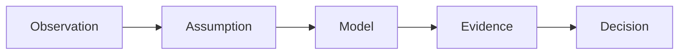

# Aristotle's Four Causes: A Framework for Decision-Making Under Uncertainty

In data analysis, teams often interpret a metric without clearly distinguishing what it measures, the data it's based on, the process that generated it, and its intended purpose. Aristotle's theory of the four causes provides a crucial framework to avoid hasty and flawed decisions, especially when operating under uncertainty.

## Real-World Problem

Imagine a dashboard reporting a sales decline. The team risks conflating different questions: Are we measuring the right phenomenon? Are the data reliable? What process produced this data? What is the goal of this metric? Without clarifying these, decisions risk being based on partial or mistaken interpretations.

## Conceptual Model

This sequential model emphasizes that solid decisions require starting from a clear observation, making explicit assumptions, building a model, evaluating evidence, and finally deciding. Skipping any step leads to fragile analyses, often the source of errors under uncertainty.

| Step | Guiding Question | Expected Output |
|---|---|---|
| Framing | Which decision needs to change? | A concrete choice, not mere curiosity |
| Measurement | Which signal represents the phenomenon? | Metric, source, and granularity |
| Comparison | Against which baseline do I interpret the result? | Plausible benchmark or counterfactual |
| Action | What will I do if the signal crosses the threshold? | Decision, owner, and next check |

## Rigorous Formalization

Aristotle's four causes translate into four key elements in data analysis:

| Element | Operational Definition |
|---|---|
| Unit | Observation, hypothesis, variable, causal mechanism, or evidence criterion |
| Signal | Strength of evidence, causal coherence, robustness of assumptions, cost of decision error |
| Baseline | Alternative explanation, counterfactual, comparable group, or no-intervention scenario |
| Decision | Accept, reject, or reformulate an explanation before applying it in business |

The practical rule is simple: a measure is useful only if it reduces uncertainty about a specific decision. If it doesn't change a choice, it's documentation; if it changes a choice without checks, it's risk.

## Aristotle's Four Causes Applied to Data Analysis

| Cause | Question | Meaning |
|-------|----------|---------|
| Material | What is it made of? | The substrate, raw data |
| Formal | What is its form or structure? | Design, algorithm, model |
| Efficient | What produced it? | Agent or process causing change |
| Final | For what purpose? | Strategic objective, telos |

None alone suffices. Only integrating all four yields a complete, robust explanation essential for decision-making under uncertainty.

## Example Case: Rising Churn in a SaaS Service

A SaaS service observes monthly churn rising from 4% to 7%. Let's analyze through the four causes:

### Material Cause

**Question:** What constitutes the churn we measure?

**Analysis:** Data quality check. 30% of customers marked as churned may be errors (e.g., billing system bugs).

**Action:** Conduct a data quality audit before further analysis.

### Formal Cause

**Question:** What is the churn pattern?

**Analysis:** Segment by cohort, plan, acquisition channel. Churn concentrates among Facebook Ads customers on the basic plan, mostly after month three.

**Action:** Investigate what happens at month three.

### Efficient Cause

**Question:** What change caused the increase?

**Analysis:** The increase coincides with (1) a 15% price hike, (2) a competitor launch at half price, (3) a five-day onboarding bug.

**Action:** Model the relative impact of these factors.

### Final Cause

**Question:** What is the purpose or meaning of churn?

**Analysis:** Churned customers had low feature usage and high support costs. Churn may be a natural cleansing mechanism.

**Action:** Focus on profitable customers; avoid indiscriminate churn fighting.

Only by combining these analyses can a balanced, informed strategy emerge.

## Real Case: Netflix and DVD Service Separation

In 2011, Netflix announced Qwikster, splitting DVD and streaming services. The backlash led to 800,000 cancellations and a 77% stock drop. Post-mortem analysis revealed all four causes at play:

- Material: Confusing communication made many think DVD service was eliminated.
- Formal: Different service structures created customer friction.
- Efficient: Announcement perceived as a 60% price hike for dual users.
- Final: Strategic shift to streaming was inevitable but poorly executed.

Two years later, Netflix launched *House of Cards* explaining all four causes clearly, minimizing cancellations.

## Lab / Exercise

### Basic Level

Write a five-line description of a real decision using Aristotle's four causes: objective, primary metric, baseline, main risk, planned action.

### Intermediate Level

Build a table with at least three segments or scenarios, indicating for each signal, possible alternative explanation, and necessary control.

### Research-Grade Level

Design a validation plan: hypothesis, required data, exclusion criteria, decision threshold, post-decision control, and conditions that would change your mind.

### Recommended Datasets and Materials

Use decision case studies, product metrics, experiment results, simple DAGs, analytic reports, and simulated time series. If no real data, create a synthetic dataset with at least 200 rows, including a time column, segment column, outcome metric, and exposure variable.

## Common Pitfall to Avoid

Treating the four causes as a memorized definition rather than a decision protocol. Presenting metrics without baselines, charts without hypotheses, or recommendations without error cost leads to poor decisions.

A useful check is asking: "If this result were false or unstable, what wrong decision would I make?" If unclear, the lesson hasn't been truly applied.

## Quiz or Checkpoint

1. What concrete decision should this lesson improve?
2. Which baseline makes the result interpretable?
3. Which assumption, if wrong, would change the conclusion?
4. What minimum control would you use before presenting the recommendation?

## Operational Summary

Aristotle's four causes are a vital skill linking concept, data, and decision, especially under uncertainty. Study them starting from a real problem, formalize the signal, seek a credible baseline, build concrete examples, and conclude with practical controls. This transforms knowledge into competence, guiding more prudent and effective decisions.

---

*References:*  
- Aristotle. *Physics*, Book II, Chapter 3. (c. 350 BC)  
- Aristotle. *Metaphysics*, Book V, Chapter 2. (c. 350 BC)  
- Falcon, A. (2019). "Aristotle on Causality." *Stanford Encyclopedia of Philosophy.*  
- Randolph, M. (2019). *That Will Never Work: The Birth of Netflix.* Little, Brown and Company.
