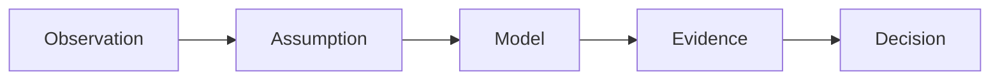

# Case Study: Philosophical Thinking and Business Decision-Making

## Real-World Problem

A committee must decide whether to cut prices, change onboarding, or increase the marketing budget. Each department presents plausible numbers, but no one clarifies what counts as valid evidence, which hypotheses are falsifiable, or which consequences fall outside the model. This case study helps determine when data truly supports a decision versus when it hides assumptions, biases, or fragile causality. The goal is to turn data into a concrete, informed choice rather than just an elegant discussion.

## Conceptual Model

The decision-making process starts by framing the question, translates it into observable units, assesses data quality, and ends with a decision. Skipping any step leads to fragile analyses, however elegant.

| Step | Guiding Question | Expected Output |
|---|---|---|
| Framing | What decision needs to change? | A concrete choice, not curiosity |
| Measurement | What signal represents the phenomenon? | Metric, source, granularity |
| Comparison | Against what baseline do I interpret the result? | Benchmark or plausible counterfactual |
| Action | What do I do if the signal crosses the threshold? | Decision, owner, next check |

## Rigorous Formalization

We formalize the case as a relation among four key elements:

| Element | Operational Definition |
|---|---|
| Unit | Observation, hypothesis, variable, causal mechanism, or evidence criterion |
| Signal | Strength of evidence, causal coherence, robustness of assumptions, cost of decision error |
| Baseline | Alternative explanation, counterfactual, comparable group, or no-intervention scenario |
| Decision | Accept, reject, or reformulate an explanation before applying it in business |

A measure is useful only if it reduces uncertainty about a specific decision. If it does not change a choice, document it; if it changes a choice without controls, risk is introduced.

## Example or Case Study

QuickBite, with 3 million active users across 12 European cities, considers a loyalty program to boost retention. The CEO pushes for immediate investment, the CFO is skeptical, and the Head of Product demands more rigorous testing.

Applying the philosophical framework:

- **Aristotle**: examines four causes (material, formal, efficient, final) to evaluate data quality, effect distribution, causality, and true objectives.
- **Hume**: warns about induction's limits; a small pilot doesn't guarantee large-scale success.
- **Popper**: insists hypotheses must be falsifiable with larger, controlled tests.
- **Pearl**: uses a DAG to identify confounders like novelty effect and city-specific factors.
- **Kuhn**: recognizes differing paradigms among decision-makers and proposes pragmatic mediation.

The recommendation is to invest 5 million in a larger test with clear criteria to scale or abandon.

## Lab / Exercise

### Basic Level

Write a five-line summary of a real decision linked to the case: objective, primary metric, baseline, main risk, and planned action.

### Intermediate Level

Build a table with at least three segments or scenarios. For each, indicate the signal, possible alternative explanation, and required control before deciding.

### Research-Grade Level

Design a validation plan: hypothesis, required data, exclusion criteria, decision threshold, and post-decision control. Specify what would make you change your mind.

### Recommended Datasets and Materials

Use decision case studies, product metrics, experiment results, simple DAGs, analytical reports, and simulated time series. If lacking real data, create a synthetic dataset with at least 200 rows, including temporal, segment, outcome metric, and exposure variables.

## Common Pitfall to Avoid

Treating the case as a definition to memorize rather than a decision protocol. Presenting metrics without baselines, charts without hypotheses, or recommendations without error-cost considerations leads to fragile decisions.

A useful check is asking: "If this result were false or unstable, what decision would I get wrong?" If the answer is unclear, the lesson has not been truly applied.

## Quiz or Checkpoint

1. What concrete decision should this lesson improve?
2. What baseline makes the result interpretable?
3. Which assumption, if wrong, would change the conclusion?
4. What minimal control would you use before presenting the recommendation?

## Operational Summary

This case study connects concept, data, and decision in an operational way. Study it starting from a real problem, formalize the signal, seek a credible baseline, build an example, and conclude with a practical check. Only then does knowledge become competence and guide decisions under uncertainty.
