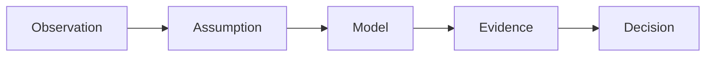

# Correlation, Causation, and Counterfactuals

Making decisions under uncertainty demands a clear understanding of the difference between correlation and causation. This lesson, **Correlation, Causation, and Counterfactuals**, highlights how grasping counterfactual reasoning is crucial to attributing effects to causes reliably.

## Real-world problem

Imagine a team observing a spike in conversions during a campaign and wanting to credit the campaign for the success. However, price, organic traffic, and user composition also changed during that period. How can we determine if the increase was truly caused by the campaign? This is where distinguishing correlation, causation, and counterfactuals matters: to say "it caused" you must ask what would have happened without the intervention.

## Conceptual model

Decision-making unfolds through clear steps:

Each phase is critical: framing the question, translating it into observable data, assessing data quality, and finally deciding. Skipping any step leads to fragile conclusions.

| Step | Guiding question | Expected output |
|---|---|---|
| Framing | What decision should change? | A concrete choice, not a curiosity |
| Measurement | What signal represents the phenomenon? | Metric, source, and granularity |
| Comparison | Against which baseline do I interpret the result? | Benchmark or plausible counterfactual |
| Action | What do I do if the signal crosses the threshold? | Decision, owner, and next check |

## Rigorous formalization

Causality can be formalized as a relationship among four elements:

| Element | Operational definition |
|---|---|
| Unit | observation, hypothesis, variable, causal mechanism, or evidence criterion |
| Signal | strength of evidence, causal coherence, robustness of assumptions, and cost of decision error |
| Baseline | alternative explanation, counterfactual, comparable group, or no-intervention scenario |
| Decision | accept, reject, or reformulate an explanation before applying it in a business context |

A measure is useful only if it reduces uncertainty about a specific decision. If it does not change a choice, it is documentation; if it changes a choice without controls, it is risk.

## Example or case study

A team interprets a retention increase as proof their new initiative worked. Applying the correlation, causation, and counterfactual framework, they build a table distinguishing evidence, cautious interpretation, and consequent decision:

| Evidence | Cautious interpretation | Consequent decision |
|---|---|---|
| Positive but isolated signal | The phenomenon exists, but the cause is uncertain | Seek baseline or holdout |
| Segment with differing response | The average effect hides heterogeneity | Analyze cohorts or subgroups |
| Rising operational cost | Evaluate the result on the margin | Apply economic thresholds |

## Lab / exercise

### Basic level

Write in five lines a real decision linked to correlation, causation, and counterfactuals: objective, primary metric, baseline, main risk, and planned action.

### Intermediate level

Build a table with at least three segments or scenarios, indicating for each the signal, possible alternative explanation, and control needed before deciding.

### Research-grade level

Design a validation plan with hypothesis, required data, exclusion criteria, decision threshold, and post-decision control. Specify what would make you change your mind.

### Recommended datasets and materials

Use decision case studies, product metrics, experiment results, simple DAGs, analytical reports, and simulated time series. If real data is unavailable, create a synthetic dataset with at least 200 rows, including temporal columns, segments, outcome metrics, and exposure variables.

## Common pitfall to avoid

The most frequent error is treating correlation, causation, and counterfactuals as abstract definitions to memorize rather than as decision protocols. Presenting metrics without baselines, charts without hypotheses, or recommendations without considering error costs leads to fragile decisions.

A useful check is asking: "If this result were false or unstable, what wrong decision would I make?" If the answer is unclear, the concept has not been properly applied.

## Quiz or checkpoint

1. What concrete decision should this lesson improve?
2. Which baseline makes the result interpretable?
3. Which assumption, if wrong, would change the conclusion?
4. What minimal control would you use before presenting the recommendation?

## Operational summary

Mastering correlation, causation, and counterfactuals is essential to connect concept, data, and decision. Study it starting from a real problem, formalize the signal, seek a credible baseline, build an example, and conclude with a practical check. Only then does knowledge become actionable expertise.
