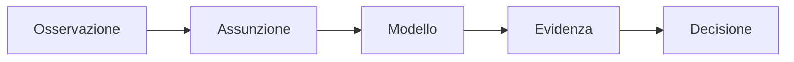

# Correlazione, causalità e controfattuali

Nel processo decisionale basato sui dati, distinguere tra correlazione e causalità è fondamentale per evitare conclusioni errate. La lezione **Correlazione, causalità e controfattuali** si concentra sulla disciplina di prendere decisioni sotto incertezza, mostrando come la comprensione del controfattuale sia essenziale per attribuire un effetto a una causa.

## Problema reale

Immagina un team che osserva un aumento delle conversioni durante una campagna e vuole attribuirne il merito all'iniziativa. Tuttavia, nello stesso periodo sono cambiati prezzo, traffico organico e composizione degli utenti. Come capire se l'aumento è davvero causato dalla campagna? Qui entra in gioco la distinzione tra correlazione, causalità e controfattuali: per affermare "ha causato", bisogna chiedersi cosa sarebbe successo senza l'intervento.

## Modello concettuale

Il processo decisionale si articola in passaggi chiari:

Ogni fase è cruciale: formulare la domanda, tradurla in dati osservabili, valutare la qualità del dato e infine decidere. Saltare uno di questi passaggi porta a conclusioni fragili.

| Passaggio | Domanda guida | Output atteso |
|---|---|---|
| Framing | Quale decisione deve cambiare? | Una scelta concreta, non una curiosità |
| Misura | Quale segnale rappresenta il fenomeno? | Metrica, fonte e granularità |
| Confronto | Rispetto a quale baseline interpreto il risultato? | Benchmark o controfattuale plausibile |
| Azione | Che cosa faccio se il segnale supera la soglia? | Decisione, owner e prossimo controllo |

## Formalizzazione rigorosa

La causalità può essere formalizzata come una relazione tra quattro elementi:

| Elemento | Definizione operativa |
|---|---|
| Unità | osservazione, ipotesi, variabile, meccanismo causale o criterio di evidenza |
| Segnale | forza dell'evidenza, coerenza causale, robustezza delle assunzioni e costo dell'errore decisionale |
| Baseline | spiegazione alternativa, controfattuale, gruppo comparabile o scenario senza intervento |
| Decisione | accettare, rifiutare o riformulare una spiegazione prima di usarla in un contesto aziendale |

Una misura è utile solo se riduce l'incertezza su una decisione specifica. Se non cambia una scelta, è solo documentazione; se cambia una scelta senza controlli, è rischio.

## Esempio o caso studio

Un team interpreta una crescita di retention come prova che una nuova iniziativa ha funzionato. Applicando il framework di correlazione, causalità e controfattuali, costruisce una tabella che distingue evidenza, interpretazione prudente e decisione conseguente:

| Evidenza | Interpretazione prudente | Decisione conseguente |
|---|---|---|
| Segnale positivo ma non isolato | Il fenomeno esiste, ma la causa è incerta | Cercare baseline o holdout |
| Segmento con risposta diversa | L'effetto medio nasconde eterogeneità | Analizzare coorti o sottogruppi |
| Costo operativo crescente | Il risultato va valutato sul margine | Applicare soglie economiche |

## Lab / esercizio

### Livello base

Scrivi in cinque righe una decisione reale collegata a correlazione, causalità e controfattuali: obiettivo, metrica primaria, baseline, rischio principale e azione prevista.

### Livello intermedio

Costruisci una tabella con almeno tre segmenti o scenari, indicando per ciascuno segnale, possibile spiegazione alternativa e controllo necessario prima di decidere.

### Livello research-grade

Disegna un piano di validazione con ipotesi, dati necessari, criteri di esclusione, soglia decisionale e controllo post-decisione. Specifica cosa ti farebbe cambiare idea.

### Dataset e materiali consigliati

Utilizza case study decisionali, metriche prodotto, risultati di esperimenti, DAG semplici, report analitici e serie storiche simulate. In assenza di dati reali, crea un dataset sintetico con almeno 200 righe, includendo colonne temporali, segmenti, metriche di outcome e variabili di esposizione.

## Errore tipico da evitare

Il rischio più comune è trattare correlazione, causalità e controfattuali come concetti astratti da memorizzare anziché come protocolli decisionali. Presentare metriche senza baseline, grafici senza ipotesi o raccomandazioni senza considerare il costo dell'errore porta a decisioni fragili.

Un controllo utile è chiedersi: "Se questo risultato fosse falso o instabile, quale decisione sbaglierei?". Se la risposta non è chiara, il concetto non è stato applicato correttamente.

## Quiz o checkpoint

1. Qual è la decisione concreta che questa lezione dovrebbe migliorare?
2. Quale baseline rende interpretabile il risultato?
3. Quale assunzione, se sbagliata, cambierebbe la conclusione?
4. Quale controllo minimo useresti prima di presentare la raccomandazione?

## Riepilogo operativo

La competenza su correlazione, causalità e controfattuali è essenziale per collegare concetto, dato e decisione. Studiala partendo da un problema reale, formalizza il segnale, cerca una baseline credibile, costruisci un esempio e chiudi con un controllo pratico. Solo così la conoscenza diventa competenza operativa.
