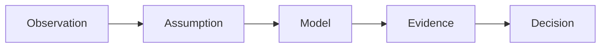

# Models, Assumptions, and Misspecification

In decision-making under uncertainty, recognizing the limits of models is essential. A regression might appear to predict average sales well but fail systematically on weekends, promotions, or new customers - this is misspecification: the model answers a narrower question than the business actually poses. This lesson equips you to identify and manage such gaps.

## Real-World Problem

The core challenge is distinguishing when data or a model truly supports a decision versus when it hides fragile assumptions, biases, or a poorly framed question. In business contexts, knowledge is valuable only if it reduces uncertainty about a concrete choice, explicitly acknowledging error risks.

## Conceptual Model



The mental path is sequential: formulate the question, translate concepts into observable units, assess data quality, then decide. Skipping steps leads to fragile analyses.

| Step | Guiding Question | Expected Output |
|---|---|---|
| Framing | Which decision must change? | Concrete choice, not curiosity |
| Measurement | What signal represents the phenomenon? | Metric, source, granularity |
| Comparison | Against which baseline do I interpret results? | Benchmark or counterfactual |
| Action | What do I do if the signal crosses the threshold? | Decision, owner, next check |

## Rigorous Formalization

| Element | Operational Definition |
|---|---|
| Unit | observation, hypothesis, variable, causal mechanism, or evidence criterion |
| Signal | strength of evidence, causal coherence, assumption robustness, decision error cost |
| Baseline | alternative explanation, counterfactual, comparable group, no-intervention scenario |
| Decision | accept, reject, or reformulate explanation before business use |
| Risk | confusing correlation, data quality, and causal decision-making |

A measure is useful only if it reduces uncertainty about a specific decision. If it does not change a choice, it is decorative; if it changes a choice without checks, it is risky.

## The Hidden Architecture of Every Model: Core Assumptions

Every model simplifies reality based on implicit or explicit assumptions. For example, OLS linear regression relies on four key assumptions (BLUE): linearity, error independence, homoscedasticity, and error normality. Violating these leads to bias and flawed inference.

In machine learning, the IID assumption (independent and identically distributed) and stationarity are foundational but often violated in practice, causing issues like model drift.

## Diagnosing Misspecification: Spotting Symptoms Before Damage

Misspecification rarely fails dramatically. Common signs include:

- Discrepancy between fit metrics and new data performance (overfitting).
- Coefficient instability due to multicollinearity.
- Residual patterns violating white noise assumptions.
- Divergence between offline and online performance, signaling violated assumptions.

## Example or Case Study

### Netflix and the Challenge of Non-Stationary Tastes

Netflix tackles non-stationarity by:

- Applying time decay to weigh recent data more heavily.
- Using ensembles of specialized models for different aspects.
- Employing active exploration via contextual bandits to adapt to taste changes.

This approach sustains recommendation quality and reduces churn.

### Stripe Radar and Combating Multicollinearity in Fraud Detection

Stripe leverages robust models like Gradient Boosting and sophisticated feature engineering to handle multicollinearity among predictors, improving fraud prevention and minimizing false positives.

## From Theory to Practice: Robust Validation and Monitoring

Validation goes beyond train/test splits: for time series, time-series splits prevent "seeing the future." In production, continuous monitoring detects data drift and concept drift using statistical tests (e.g., Kolmogorov-Smirnov).

Python example for data drift detection:

```python
from scipy.stats import ks_2samp

def detect_data_drift(train_feature, production_feature, alpha=0.05):
    statistic, p_value = ks_2samp(train_feature, production_feature)
    is_drift_detected = p_value < alpha
    return {'statistic': statistic, 'p_value': p_value, 'is_drift_detected': is_drift_detected}
```

## Lab / Exercise

### Basic Level

Write a five-line description of a real decision related to models and assumptions: objective, primary metric, baseline, main risk, and planned action.

### Intermediate Level

Create a table with at least three segments/scenarios indicating signal, alternative explanation, and necessary control.

### Research-Grade Level

Design a validation plan: hypotheses, data, exclusion criteria, decision threshold, and post-decision control. Specify what would make you change your mind.

### Recommended Datasets and Materials

Use decision case studies, product metrics, experiments, DAGs, analytical reports, and simulated time series. If lacking real data, create a synthetic dataset with at least one temporal column, one segment column, one outcome metric, and one exposure variable.

## Common Pitfall to Avoid

Treating models and assumptions as abstract definitions rather than decision protocols. Presenting metrics without baselines or recommendations without error cost considerations is a frequent mistake. Always ask: "If this result were false, which decision would I get wrong?"

## Quiz or Checkpoint

1. What concrete decision should this lesson improve?
2. Which baseline makes the result interpretable?
3. Which assumption, if wrong, would change the conclusion?
4. What minimum check would you use before presenting the recommendation?

## Operational Summary

Connecting concept, data, and decision is key to managing models, assumptions, and misspecification. Start from a real problem, formalize the signal, choose a credible baseline, build examples, and finish with practical checks. This skill is fundamental for reliable decision-making under uncertainty.
