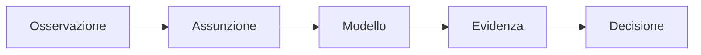

# Modelli, assunzioni e misspecification

Nel processo decisionale sotto incertezza, riconoscere i limiti dei modelli è cruciale. Una regressione può sembrare efficace nel prevedere le vendite medie, ma fallire sistematicamente su weekend, promozioni o clienti nuovi indica una misspecification: il modello risponde a una domanda più ristretta rispetto a quella reale del business. Questa lezione offre gli strumenti per identificare e gestire questi scarti.

## Problema reale

Il problema centrale è distinguere quando un dato o un modello supporta davvero una decisione e quando invece nasconde assunzioni fragili, bias o una domanda mal formulata. In un contesto di decisioni aziendali, la conoscenza diventa utile solo se riduce l'incertezza su una scelta concreta, esplicitando i rischi di errore.

## Modello concettuale



Il percorso mentale è sequenziale: si formula la domanda, si traducono i concetti in unità osservabili, si valuta la qualità del dato e solo alla fine si decide. Saltare passaggi produce analisi fragili.

| Passaggio | Domanda guida | Output atteso |
|---|---|---|
| Framing | Quale decisione deve cambiare? | Scelta concreta, non curiosità |
| Misura | Quale segnale rappresenta il fenomeno? | Metrica, fonte, granularità |
| Confronto | Rispetto a quale baseline interpreto il risultato? | Benchmark o controfattuale |
| Azione | Che cosa faccio se il segnale supera la soglia? | Decisione, owner, prossimo controllo |

## Formalizzazione rigorosa

| Elemento | Definizione operativa |
|---|---|
| Unità | osservazione, ipotesi, variabile, meccanismo causale o criterio di evidenza |
| Segnale | forza dell'evidenza, coerenza causale, robustezza delle assunzioni, costo dell'errore decisionale |
| Baseline | spiegazione alternativa, controfattuale, gruppo comparabile, scenario senza intervento |
| Decisione | accettare, rifiutare o riformulare una spiegazione prima dell'uso aziendale |
| Rischio | confondere correlazione, qualità del dato e causalità decisionale |

Una misura è utile solo se riduce l'incertezza su una decisione specifica. Se non cambia una scelta, è decorativa; se cambia una scelta senza controlli, è rischiosa.

## L'Architettura Nascosta di Ogni Modello: Le Assunzioni Fondamentali

Ogni modello è una semplificazione della realtà basata su assunzioni implicite o esplicite. Per esempio, la regressione lineare OLS si fonda su quattro assunzioni chiave (BLUE): linearità, indipendenza degli errori, omoschedasticità e normalità degli errori. Violazioni di queste portano a bias e inferenze errate.

Nel machine learning, l'assunzione IID (indipendenti e identicamente distribuiti) e la stazionarietà sono fondamentali ma spesso violate nel mondo reale, causando fenomeni come il model drift.

## La Diagnosi della Misspecification: Riconoscere i Sintomi Prima del Danno

Misspecification non sempre si manifesta con fallimenti evidenti. Segnali comuni includono:

- Discrepanza tra metriche di fit e performance su dati nuovi (overfitting).
- Instabilità dei coefficienti dovuta a multicollinearità.
- Pattern nei residui che violano le assunzioni di rumore bianco.
- Divergenza tra performance offline e online, segnale che assunzioni chiave sono violate.

## Esempio o caso studio

### Netflix e la Sfida della Non-Stazionarietà dei Gusti

Netflix affronta la non-stazionarietà con:

- Decadimento temporale per pesare di più dati recenti.
- Ensemble di modelli specializzati per diversi aspetti.
- Esplorazione attiva tramite contextual bandits per adattarsi ai cambiamenti dei gusti.

Questo approccio ha permesso di mantenere alta la qualità delle raccomandazioni e ridurre il churn.

### Stripe Radar e la Lotta alla Multicollinearità nelle Frodi

Stripe usa modelli robusti come Gradient Boosting e feature engineering sofisticato per gestire la multicollinearità nelle variabili predittive, migliorando l'efficacia nella prevenzione delle frodi e riducendo falsi positivi.

## Dalla Teoria alla Pratica: Validazione e Monitoraggio Robusto

La validazione va oltre training/test split: per serie temporali serve time-series split per evitare "vedere il futuro". In produzione, il monitoraggio continuo rileva data drift e concept drift tramite test statistici (es. Kolmogorov-Smirnov).

Esempio di codice Python per rilevare data drift:

```python
from scipy.stats import ks_2samp

def detect_data_drift(train_feature, production_feature, alpha=0.05):
    statistic, p_value = ks_2samp(train_feature, production_feature)
    is_drift_detected = p_value < alpha
    return {'statistic': statistic, 'p_value': p_value, 'is_drift_detected': is_drift_detected}
```

## Lab / esercizio

### Livello base

Scrivi in cinque righe una decisione reale legata a modelli e assunzioni: obiettivo, metrica primaria, baseline, rischio e azione.

### Livello intermedio

Costruisci una tabella con almeno tre segmenti/scenari indicando segnale, spiegazione alternativa e controllo necessario.

### Livello research-grade

Disegna un piano di validazione: ipotesi, dati, criteri di esclusione, soglia decisionale e controllo post-decisione. Specifica cosa ti farebbe cambiare idea.

### Dataset e materiali consigliati

Usa case study decisionali, metriche prodotto, esperimenti, DAG, report analitici e serie storiche simulate. Se non hai dati reali, crea un dataset sintetico con almeno una colonna temporale, una di segmento, una metrica di outcome e una variabile di esposizione.

## Errore tipico da evitare

Trattare modelli e assunzioni come definizioni astratte anziché protocolli decisionali. Presentare metriche senza baseline o raccomandazioni senza considerare il costo dell'errore è un errore comune. Chiediti sempre: "Se questo risultato fosse falso, quale decisione sbaglierei?".

## Quiz o checkpoint

1. Qual è la decisione concreta che questa lezione dovrebbe migliorare?
2. Quale baseline rende interpretabile il risultato?
3. Quale assunzione, se sbagliata, cambierebbe la conclusione?
4. Quale controllo minimo useresti prima di presentare la raccomandazione?

## Riepilogo operativo

Collegare concetto, dato e decisione è la chiave per gestire modelli, assunzioni e misspecification. Parti da un problema reale, formalizza il segnale, scegli una baseline credibile, costruisci esempi e chiudi con controlli pratici. Questa competenza è fondamentale per decisioni affidabili sotto incertezza.
