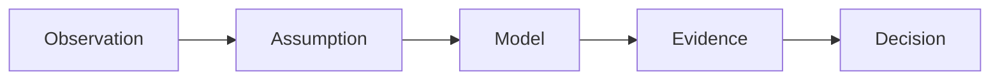

# Measurement Theory: What It Means to Measure Well

In data work, measuring is not just counting but capturing the right concept. For example, a team might want to measure "engagement" by time spent in an app, but confused users may stay longer than satisfied ones. The metric is precise but not valid. This distinction lies at the heart of **measurement theory: what it means to measure well**.

## Real-World Problem

The concrete challenge is to understand when data truly supports a decision and when it hides assumptions, biases, or a poorly framed question. The data must improve a real choice, with reliable measurements and explicit error thresholds.

## Conceptual Model

The process is sequential: first formulate the question, then translate it into observable units, evaluate data quality, and finally decide. Skipping steps leads to fragile analyses.

| Step | Guiding Question | Expected Output |
|---|---|---|
| Framing | What decision should change? | A concrete choice |
| Measurement | What signal represents the phenomenon? | Metric, source, granularity |
| Comparison | Against which baseline do I interpret the result? | Benchmark or counterfactual |
| Action | What do I do if the signal crosses the threshold? | Decision and next check |

## Rigorous Formalization

Measurement theory formalizes as a relation among four elements:

| Element | Operational Definition |
|---|---|
| Unit | observation, hypothesis, variable, causal mechanism, or evidence criterion |
| Signal | strength of evidence, causal coherence, robustness of assumptions, cost of decision error |
| Baseline | alternative explanation, counterfactual, comparable group, or no-intervention scenario |
| Decision | accept, reject, or reformulate an explanation before use |

A measure is useful only if it reduces uncertainty about a specific decision. If it does not change a choice, document it; if it changes a choice without checks, risk arises.

## Example or Case Study

A committee interprets retention growth as proof a new initiative worked. Applying measurement theory, they clearly separate evidence, interpretation, and decision:

| Evidence | Prudent Interpretation | Resulting Decision |
|---|---|---|
| Positive but isolated signal | Phenomenon exists, cause uncertain | Seek baseline or holdout |
| Segment with different response | Average effect hides heterogeneity | Analyze cohorts or subgroups |
| Rising operational cost | Evaluate result on margin | Apply economic thresholds |

This prevents presenting a number as a self-sufficient conclusion.

## Lab / Exercise

### Basic Level

Write five lines: objective, primary metric, baseline, main risk, and planned action for a real decision linked to measurement theory.

### Intermediate Level

Build a table with at least three segments or scenarios. For each, indicate signal, possible alternative explanation, and necessary control before deciding.

### Research-Grade Level

Design a validation plan: hypothesis, required data, exclusion criteria, decision threshold, and post-decision control. Specify what would make you change your mind.

### Recommended Datasets and Materials

Use decision case studies, product metrics, experiment results, simple DAGs, analytical reports, and simulated time series. If no real data, create a synthetic dataset with 200-500 rows, including a time column, segment column, outcome metric, and exposure variable.

## Common Pitfall to Avoid

Treating measurement theory as a definition to memorize rather than a decision protocol. This happens when presenting a metric without baseline, a chart without hypothesis, or a recommendation without error cost. Always ask: "If this result were false or unstable, what decision would I get wrong?" If unclear, the lesson hasn't been truly applied.

## Quiz or Checkpoint

1. What concrete decision should this lesson improve?
2. Which baseline makes the result interpretable?
3. Which assumption, if wrong, would change the conclusion?
4. What minimal control would you use before presenting the recommendation?

## Operational Summary

Measurement theory connects concept, data, and decision. Study it starting from a real problem, formalize the signal, seek a credible baseline, build an example, and close with a practical check. Only then does knowledge become useful competence for decision-making under uncertainty.
