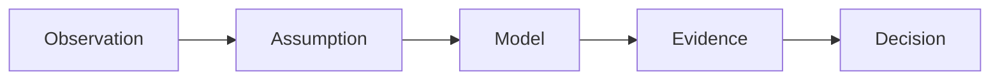

# From Classical Causality to the Future of Data Analysis

Experiments, DAGs, predictive models, and AI systems promise faster decisions, yet the fundamental question remains: what link can we truly defend between intervention and outcome? This module demonstrates that modern tools do not eliminate the need for rigorous causal thinking.

## Real-World Problem

In foundational philosophy of data analysis, **From Classical Causality to the Future of Data Analysis** tackles a concrete challenge: understanding when data genuinely supports a decision and when it conceals assumptions, biases, fragile causality, or a poorly framed question. The goal is not abstract appreciation but improving real decisions using reliable data and explicit error thresholds.

This lesson is an operational tool: by the end, you should be able to grasp the analytical problem and decision context, apply examples, metrics, and checks to real cases. Without linking concepts to concrete choices, knowledge remains decorative, not skill.

## Conceptual Model

The mental model is sequential: first formulate the question, then translate it into observable units, evaluate data quality, and only then decide. Skipping steps leads to elegant but fragile analyses.

| Step | Guiding Question | Expected Output |
|---|---|---|
| Framing | What decision must change? | A concrete choice, not curiosity |
| Measurement | What signal represents the phenomenon? | Metric, source, and granularity |
| Comparison | Against which baseline do I interpret results? | Benchmark or plausible counterfactual |
| Action | What do I do if the signal crosses the threshold? | Decision, owner, and next check |

## Rigorous Formalization

We formalize **From Classical Causality to the Future of Data Analysis** as a relationship among four elements: unit of analysis, signal, baseline, and decision. The main unit can be observation, hypothesis, variable, causal mechanism, or evidence criterion. The signal should reflect evidence strength, causal coherence, assumption robustness, and cost of decision error. The baseline is an alternative explanation, counterfactual, comparable group, or no-intervention scenario.

| Element | Operational Definition |
|---|---|
| Unit | observation, hypothesis, variable, causal mechanism, or evidence criterion |
| Signal | evidence strength, causal coherence, assumption robustness, and cost of decision error |
| Baseline | alternative explanation, counterfactual, comparable group, or no-intervention scenario |
| Decision | accept, reject, or reformulate explanation before business use |
| Risk | confusing correlation, data quality, and decision causality |

The practical rule is simple: a measure is useful only if it reduces uncertainty about a specific decision. If it does not change a choice, it is documentation; if it changes a choice without checks, it is risk.

## Example or Case Study

A committee interprets retention growth as proof a new initiative worked. The lesson requires distinguishing observation, explanation, assumption, and decision before turning data into action.

Applying **From Classical Causality to the Future of Data Analysis**, the team creates a three-column reading: what we know, what we assume, and what decision we make. This format prevents presenting a number as a self-sufficient conclusion.

| Evidence | Cautious Interpretation | Resulting Decision |
|---|---|---|
| Positive but isolated signal | Phenomenon exists, cause uncertain | Seek baseline or holdout |
| Segment with different response | Average effect hides heterogeneity | Analyze cohorts or subgroups |
| Rising operational cost | Evaluate result on margin | Apply economic thresholds |

## Lab / Exercise

### Basic Level

Write five lines describing a real decision linked to **From Classical Causality to the Future of Data Analysis**: objective, primary metric, baseline, main risk, and planned action. Use only one primary metric.

### Intermediate Level

Build a table with at least three segments or scenarios. For each, indicate signal, possible alternative explanation, and necessary check before deciding.

### Research-Grade Level

Design a validation plan: hypothesis, required data, exclusion criteria, decision threshold, and post-decision check. Specify what would make you change your mind.

### Recommended Datasets and Materials

Use decision case studies, product metrics, experiment results, simple DAGs, analytical reports, and simulated time series. If lacking real data, create a synthetic dataset with 200-500 rows, including a time column, a segment column, an outcome metric, and an exposure variable.

## Common Mistake to Avoid

The most frequent error is treating **From Classical Causality to the Future of Data Analysis** as a definition to memorize rather than a decision protocol. This happens when presenting a metric without baseline, a chart without hypothesis, or a recommendation without considering error cost.

A useful check is asking: "If this result were false or unstable, what decision would I get wrong?" If unclear, the lesson has not been truly applied.

## Quiz or Checkpoint

1. What concrete decision should this lesson improve?
2. Which baseline makes the result interpretable?
3. Which assumption, if wrong, would change the conclusion?
4. What minimum check would you use before presenting the recommendation?

## Operational Summary

**From Classical Causality to the Future of Data Analysis** is a vital skill when connecting concept, data, and decision. Study it starting from a real problem, formalize the signal, find a credible baseline, build an example, and close with a practical check. Only then does analysis become a tool for informed decisions, not an academic exercise.
