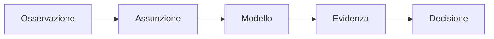

# Dalla causalità classica al futuro dell'analisi dati

Esperimenti, DAG, modelli predittivi e sistemi AI promettono decisioni più rapide, ma la questione fondamentale resta invariata: quale legame possiamo davvero sostenere tra intervento e risultato? Questo modulo mostra che la modernità degli strumenti non elimina la necessità di pensare con rigore alle cause.

## Problema reale

Nel lavoro sui fondamenti filosofici dell'analisi dati, **Dalla causalità classica al futuro dell'analisi dati** affronta un problema concreto: capire quando un dato supporta veramente una decisione e quando invece nasconde assunzioni, bias, causalità fragile o una domanda mal formulata. Non si tratta di apprezzare il concetto in astratto, ma di migliorare decisioni reali applicando dati affidabili e soglie di errore esplicite.

Questa lezione va studiata come uno strumento operativo: entro la fine devi saper comprendere il problema analitico e il contesto decisionale, applicare esempi, metriche e controlli a casi reali. Se non riesci a collegare il concetto a una scelta concreta, la conoscenza resta decorativa e non diventa competenza.

## Modello concettuale

Il modello mentale è sequenziale: prima si formula la domanda, poi si traduce in unità osservabili, si valuta la qualità del dato e solo alla fine si decide. Saltare un passaggio produce analisi eleganti ma fragili.

| Passaggio | Domanda guida | Output atteso |
|---|---|---|
| Framing | Quale decisione deve cambiare? | Una scelta concreta, non una curiosità |
| Misura | Quale segnale rappresenta il fenomeno? | Metrica, fonte e granularità |
| Confronto | Rispetto a quale baseline interpreto il risultato? | Benchmark o controfattuale plausibile |
| Azione | Che cosa faccio se il segnale supera la soglia? | Decisione, owner e prossimo controllo |

## Formalizzazione rigorosa

Formalizziamo **Dalla causalità classica al futuro dell'analisi dati** come relazione tra quattro elementi: unità di analisi, segnale, baseline e decisione. L'unità principale può essere osservazione, ipotesi, variabile, meccanismo causale o criterio di evidenza. Il segnale deve riflettere forza dell'evidenza, coerenza causale, robustezza delle assunzioni e costo dell'errore decisionale. La baseline è una spiegazione alternativa, un controfattuale, un gruppo comparabile o uno scenario senza intervento.

| Elemento | Definizione operativa |
|---|---|
| Unità | osservazione, ipotesi, variabile, meccanismo causale o criterio di evidenza |
| Segnale | forza dell'evidenza, coerenza causale, robustezza delle assunzioni e costo dell'errore decisionale |
| Baseline | spiegazione alternativa, controfattuale, gruppo comparabile o scenario senza intervento |
| Decisione | accettare, rifiutare o riformulare una spiegazione prima di usarla in azienda |
| Rischio | confondere correlazione, qualità del dato e causalità decisionale |

La regola pratica è semplice: una misura è utile solo se riduce l'incertezza su una decisione specifica. Se non cambia una scelta, è documentazione; se cambia una scelta senza controlli, è rischio.

## Esempio o caso studio

Un comitato interpreta una crescita di retention come prova che una nuova iniziativa abbia funzionato. La lezione impone di distinguere osservazione, spiegazione, assunzione e decisione prima di trasformare il dato in azione.

Applicando **Dalla causalità classica al futuro dell'analisi dati**, il team costruisce una lettura in tre colonne: cosa sappiamo, cosa assumiamo e quale decisione prendiamo. Questo formato impedisce di presentare un numero come conclusione autosufficiente.

| Evidenza | Interpretazione prudente | Decisione conseguente |
|---|---|---|
| Segnale positivo ma non isolato | Il fenomeno esiste, ma la causa è incerta | Cercare baseline o holdout |
| Segmento con risposta diversa | L'effetto medio nasconde eterogeneità | Analizzare coorti o sottogruppi |
| Costo operativo crescente | Il risultato va valutato sul margine | Applicare soglie economiche |

## Lab / esercizio

### Livello base

Scrivi in cinque righe una decisione reale collegata a **Dalla causalità classica al futuro dell'analisi dati**: obiettivo, metrica primaria, baseline, rischio principale e azione prevista. Usa una sola metrica primaria.

### Livello intermedio

Costruisci una tabella con almeno tre segmenti o scenari. Per ciascuno indica segnale, possibile spiegazione alternativa e controllo necessario prima di decidere.

### Livello research-grade

Disegna un piano di validazione: ipotesi, dati necessari, criterio di esclusione, soglia decisionale e controllo post-decisione. Specifica cosa ti farebbe cambiare idea.

### Dataset e materiali consigliati

Usa case study decisionali, metriche prodotto, risultati di esperimenti, DAG semplici, report analitici e serie storiche simulate. Se non hai dati reali, crea un dataset sintetico con 200-500 righe, una colonna temporale, una colonna segmento, una metrica di outcome e una variabile di esposizione.

## Errore tipico da evitare

Il più comune è trattare **Dalla causalità classica al futuro dell'analisi dati** come una definizione da memorizzare invece che come un protocollo decisionale. Succede quando si presenta una metrica senza baseline, un grafico senza ipotesi o una raccomandazione senza considerare il costo dell'errore.

Un controllo utile è chiedersi: "Se questo risultato fosse falso o instabile, quale decisione sbaglierei?". Se la risposta non è chiara, la lezione non è stata applicata davvero.

## Quiz o checkpoint

1. Qual è la decisione concreta che questa lezione dovrebbe migliorare?
2. Quale baseline rende interpretabile il risultato?
3. Quale assunzione, se sbagliata, cambierebbe la conclusione?
4. Quale controllo minimo useresti prima di presentare la raccomandazione?

## Riepilogo operativo

**Dalla causalità classica al futuro dell'analisi dati** è una competenza fondamentale quando collega concetto, dato e decisione. Studiala partendo da un problema reale, formalizza il segnale, cerca una baseline credibile, costruisci un esempio e chiudi con un controllo pratico. Solo così l'analisi diventa uno strumento per decisioni consapevoli e non un esercizio accademico.
