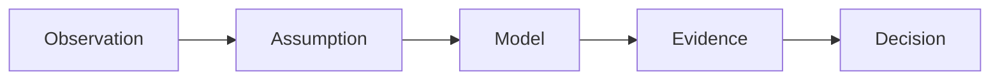

# David Hume: Experience, Mental Habit, and Skepticism

## Real-world Problem

In data analysis, it's common to assume that observed relationships in historical data are universal laws. For example, if every time a discount increases sales go up, teams tend to treat this as a certainty. But David Hume challenges us to ask: are we seeing a real necessity or just a mental habit formed by experience? This question is crucial to avoid decisions based on fragile assumptions and to understand the limits of induction.

## Conceptual Model

The proper mental process starts by framing the question, translating it into observable units, assessing data quality, and only then making a decision. Skipping any step leads to fragile and potentially misleading conclusions.

| Step | Guiding Question | Expected Output |
|---|---|---|
| Framing | Which decision needs to change? | A concrete choice, not a curiosity |
| Measurement | Which signal represents the phenomenon? | Metric, source, and granularity |
| Comparison | Against which baseline do I interpret the result? | Benchmark or plausible counterfactual |
| Action | What do I do if the signal crosses the threshold? | Decision, owner, and next check |

## Rigorous Formalization

Hume teaches us to see the relationship among four fundamental elements:

| Element | Operational Definition |
|---|---|
| Unit | Observation, hypothesis, variable, causal mechanism, or evidence criterion |
| Signal | Strength of evidence, causal coherence, robustness of assumptions, and cost of decision error |
| Baseline | Alternative explanation, counterfactual, comparable group, or no-intervention scenario |
| Decision | Accept, reject, or reformulate an explanation before applying it in a business context |

The practical rule is simple: a measure is useful only if it reduces uncertainty about a specific decision. If it doesn't change a choice, it's just documentation; if it changes a choice without checks, it's risk.

## Example or Case Study

During the 2008 financial crisis, many quantitative models based on historical data failed because they assumed the future would resemble the past. Goldman Sachs and other funds witnessed events their models predicted as extremely rare happening repeatedly. This classic example shows how induction, without solid justification, can lead to catastrophic errors.

A committee interpreting retention growth as proof of a new initiative's success must distinguish observation, explanation, assumption, and decision. Applying Hume, the team builds a table separating what is known, assumed, and the resulting decisions:

| Evidence | Cautious Interpretation | Resulting Decision |
|---|---|---|
| Positive but isolated signal | The phenomenon exists, but the cause is uncertain | Seek baseline or holdout group |
| Segment with different response | Average effect hides heterogeneity | Analyze cohorts or subgroups |
| Increasing operational cost | Evaluate result on margin | Apply economic thresholds |

## Lab / Exercise

### Basic Level

Write a brief description of a real decision applying Hume's concept: state objective, primary metric, baseline, main risk, and planned action.

### Intermediate Level

Build a table with at least three segments or scenarios, indicating for each signal, possible alternative explanation, and necessary control before deciding.

### Research-grade Level

Design a validation plan with hypothesis, required data, exclusion criteria, decision threshold, and post-decision control. Specify what would make you change your mind.

### Recommended Datasets and Materials

Use decision case studies, product metrics, experiment results, simple DAGs, analytic reports, and simulated time series. If no real data is available, create a synthetic dataset with at least 200 rows including temporal columns, segments, outcome metrics, and exposure variables.

## Common Pitfall to Avoid

The most frequent mistake is treating Hume as an abstract concept to memorize rather than a decision protocol. Presenting metrics without baselines, charts without hypotheses, or recommendations without considering error costs leads to fragile decisions. Always ask: "If this result were false or unstable, what wrong decision would I make?" If you can't answer, you haven't truly applied the lesson.

## Quiz or Checkpoint

1. What concrete decision should this lesson improve?
2. Which baseline makes the result interpretable?
3. Which assumption, if wrong, would change the conclusion?
4. What minimum control would you use before presenting the recommendation?

## Operational Summary

David Hume reminds us that experience and mental habit alone do not guarantee the truth of our predictions. In data work, this means recognizing that every model is a provisional bet, backtesting does not guarantee future performance, and replicability is only a clue, not definitive proof. Applying this skepticism means building useful, updatable models subjected to rigorous checks, always aiming to improve real, concrete decisions.
