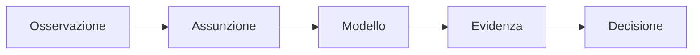

# David Hume: esperienza, abitudine mentale e scetticismo

## Problema reale

Nel mondo dell'analisi dati, spesso si dà per scontato che una relazione osservata nei dati storici sia una legge universale. Per esempio, se ogni volta che lo sconto aumenta le vendite salgono, il team tende a trattare questa relazione come certa. Ma David Hume ci invita a fermarci e a chiederci: stiamo osservando una necessità reale o solo un'abitudine mentale creata dall'esperienza? Questa domanda è cruciale per evitare decisioni basate su assunzioni fragili e per riconoscere i limiti dell'induzione.

## Modello concettuale

Il processo mentale corretto parte dalla formulazione della domanda, passa per la traduzione in unità osservabili, valuta la qualità del dato e solo alla fine arriva alla decisione. Saltare uno di questi passaggi porta a risultati fragili e potenzialmente fuorvianti.

| Passaggio | Domanda guida | Output atteso |
|---|---|---|
| Framing | Quale decisione deve cambiare? | Una scelta concreta, non una curiosità |
| Misura | Quale segnale rappresenta il fenomeno? | Metrica, fonte e granularità |
| Confronto | Rispetto a quale baseline interpreto il risultato? | Benchmark o controfattuale plausibile |
| Azione | Che cosa faccio se il segnale supera la soglia? | Decisione, owner e prossimo controllo |

## Formalizzazione rigorosa

David Hume ci insegna a vedere la relazione tra quattro elementi fondamentali:

| Elemento | Definizione operativa |
|---|---|
| Unità | Osservazione, ipotesi, variabile, meccanismo causale o criterio di evidenza |
| Segnale | Forza dell'evidenza, coerenza causale, robustezza delle assunzioni e costo dell'errore decisionale |
| Baseline | Spiegazione alternativa, controfattuale, gruppo comparabile o scenario senza intervento |
| Decisione | Accettare, rifiutare o riformulare una spiegazione prima di usarla in un contesto aziendale |

La regola pratica è semplice: una misura è utile solo se riduce l'incertezza su una decisione specifica. Se non cambia una scelta, è solo documentazione; se cambia una scelta senza controlli, è rischio.

## Esempio o caso studio

Durante la crisi finanziaria del 2008, molti modelli quantitativi basati su dati storici fallirono perché assunsero che il futuro sarebbe stato simile al passato. Goldman Sachs e altri fondi videro eventi che i loro modelli prevedevano come estremamente rari accadere ripetutamente. Questo è un classico esempio di come l'induzione, senza una giustificazione solida, può portare a errori catastrofici.

Un comitato che interpreta una crescita di retention come prova del successo di una nuova iniziativa deve distinguere tra osservazione, spiegazione, assunzione e decisione. Applicando Hume, il team costruisce una tabella che separa ciò che si sa da ciò che si assume e dalle decisioni conseguenti:

| Evidenza | Interpretazione prudente | Decisione conseguente |
|---|---|---|
| Segnale positivo ma non isolato | Il fenomeno esiste, ma la causa è ancora incerta | Cercare baseline o holdout |
| Segmento con risposta diversa | L'effetto medio nasconde eterogeneità | Analizzare coorti o sottogruppi |
| Costo operativo crescente | Il risultato va valutato sul margine | Applicare soglie economiche |

## Lab / esercizio

### Livello base

Scrivi una breve descrizione di una decisione reale in cui applichi il concetto di Hume: indica obiettivo, metrica primaria, baseline, rischio principale e azione prevista.

### Livello intermedio

Costruisci una tabella con almeno tre segmenti o scenari, indicando per ciascuno segnale, possibile spiegazione alternativa e controllo necessario prima di decidere.

### Livello research-grade

Progetta un piano di validazione con ipotesi, dati necessari, criteri di esclusione, soglia decisionale e controllo post-decisione. Specifica cosa ti farebbe cambiare idea.

### Dataset e materiali consigliati

Utilizza case study decisionali, metriche prodotto, risultati di esperimenti, DAG semplici, report analitici e serie storiche simulate. Se non hai dati reali, crea un dataset sintetico con almeno 200 righe, includendo colonne temporali, segmenti, metriche di outcome e variabili di esposizione.

## Errore tipico da evitare

Il più comune è trattare Hume come un concetto astratto da ricordare, invece che come un protocollo decisionale. Presentare metriche senza baseline, grafici senza ipotesi o raccomandazioni senza considerare il costo dell'errore porta a decisioni fragili. Chiediti sempre: "Se questo risultato fosse falso o instabile, quale decisione sbaglierei?" Se non sai rispondere, non hai applicato davvero la lezione.

## Quiz o checkpoint

1. Qual è la decisione concreta che questa lezione dovrebbe migliorare?
2. Quale baseline rende interpretabile il risultato?
3. Quale assunzione, se sbagliata, cambierebbe la conclusione?
4. Quale controllo minimo useresti prima di presentare la raccomandazione?

## Riepilogo operativo

David Hume ci ricorda che l'esperienza e l'abitudine mentale non bastano a garantire la verità delle nostre previsioni. Nel lavoro con i dati, questo si traduce nel riconoscere che ogni modello è una scommessa provvisoria, che il backtesting non garantisce il futuro e che la replicabilità è solo un indizio, non una prova definitiva. Applicare questo scetticismo significa costruire modelli utili, aggiornabili e sottoposti a controlli rigorosi, sempre con l'obiettivo di migliorare decisioni reali e concrete.
