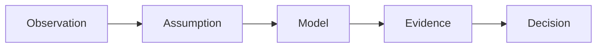

# Uncertainty, Risk, and Ignorance

A forecast might assign a 72% probability to a scenario, but decision-making must always consider what the model does not know: external shocks, missing data, behavioral changes. Distinguishing between **uncertainty, risk, and ignorance** is key to separating what we can estimate from what we must still manage.

## Real-World Problem

In foundational data analysis, understanding **uncertainty, risk, and ignorance** helps solve a concrete problem: knowing when data truly supports a decision and when it hides assumptions, biases, or fragile causality. This is not an abstract concept but an operational tool to improve data-driven choices.

## Conceptual Model

The mental process is sequential: first formulate the question, then translate it into observable units, assess data quality, and finally decide. Skipping steps leads to elegant but fragile analyses.

| Step | Guiding Question | Expected Output |
|---|---|---|
| Framing | Which decision must change? | A concrete choice |
| Measurement | Which signal represents the phenomenon? | Metric, source, granularity |
| Comparison | Against which baseline do I interpret the result? | Benchmark or counterfactual |
| Action | What do I do if the signal crosses the threshold? | Decision, owner, next check |

## Rigorous Formalization

We formalize **uncertainty, risk, and ignorance** as a relationship among four elements: unit of analysis, signal, baseline, and decision.

| Element | Operational Definition |
|---|---|
| Unit | observation, hypothesis, variable, causal mechanism |
| Signal | strength of evidence, causal coherence, robustness of assumptions, cost of decision error |
| Baseline | alternative explanation, counterfactual, comparable group, no-intervention scenario |
| Decision | accept, reject, or reformulate an explanation before business use |

A practical rule: a measure is useful only if it reduces uncertainty about a specific decision. If it does not change a choice, it is documentation; if it changes a choice without controls, it is risk.

## Example or Case Study

A committee interprets increased retention as proof that a new initiative worked. This lesson teaches distinguishing observation, explanation, assumption, and decision before acting.

| Evidence | Cautious Interpretation | Decision |
|---|---|---|
| Positive but isolated signal | Phenomenon exists, but cause uncertain | Seek baseline or holdout |
| Segment with different response | Average effect hides heterogeneity | Analyze cohorts or subgroups |
| Rising operational cost | Evaluate on margin | Apply economic thresholds |

## Lab / Exercise

### Basic Level

Write a real decision linked to **uncertainty, risk, and ignorance**: objective, primary metric, baseline, main risk, and planned action.

### Intermediate Level

Build a table with at least three segments or scenarios. For each, indicate signal, possible alternative explanation, and necessary control.

### Research-Grade Level

Design a validation plan: hypothesis, required data, exclusion criteria, decision threshold, and post-decision control. Specify what would make you change your mind.

### Recommended Datasets and Materials

Use decision case studies, product metrics, experiments, simple DAGs, analytic reports, and simulated time series. If no real data is available, create a synthetic dataset with at least 200 rows including temporal, segment, outcome metric, and exposure variable columns.

## Common Pitfall to Avoid

The most frequent mistake is treating **uncertainty, risk, and ignorance** as definitions to memorize rather than as a decision-making protocol. This happens when metrics are presented without baselines, charts without hypotheses, or recommendations without error cost.

A useful check is to ask: "If this result were false or unstable, which decision would I get wrong?" If the answer is unclear, the lesson has not been truly applied.

## Quiz or Checkpoint

1. What concrete decision should this lesson improve?
2. Which baseline makes the result interpretable?
3. Which assumption, if wrong, would change the conclusion?
4. What minimum control would you use before presenting the recommendation?

## Operational Summary

**Uncertainty, risk, and ignorance** is a skill that links concept, data, and decision. Study it starting from a real problem, formalize the signal, find a credible baseline, build an example, and close with a practical check. Category: Foundations. Difficulty: advanced. Estimated time: 18 minutes.
