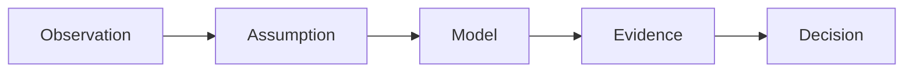

# Data Epistemology: What Can You Really Know?

In a world flooded with numbers from logs, sensors, pipelines, and cleaning models, data may appear objective on dashboards. Yet, every data point results from choices in collection, definition, and transformation. **Data epistemology** teaches us to treat data as constructed evidence, not a direct window into reality.

## Real-World Problem

The key question in daily data work is: when does data genuinely support a decision, and when does it mask assumptions, biases, fragile causality, or a poorly framed question? This is not an abstract concept but a practical tool to improve concrete decisions through reliable data with explicit error thresholds. Without this link, knowledge remains decorative, not actionable.

## Conceptual Model

This sequential model emphasizes that you first formulate the question, then translate it into observable units, evaluate data quality, and only then decide. Skipping steps leads to elegant but fragile analyses.

| Step | Guiding Question | Expected Output |
|---|---|---|
| Framing | Which decision needs to change? | A concrete choice, not curiosity |
| Measurement | Which signal represents the phenomenon? | Metric, source, and granularity |
| Comparison | Against which baseline do I interpret the result? | Benchmark or plausible counterfactual |
| Action | What do I do if the signal crosses the threshold? | Decision, owner, and next check |

## Rigorous Formalization

We formalize data epistemology as a relationship among four key elements:

| Element | Operational Definition |
|---|---|
| Unit | observation, hypothesis, variable, causal mechanism, or evidence criterion |
| Signal | strength of evidence, causal coherence, assumption robustness, cost of decision error |
| Baseline | alternative explanation, counterfactual, comparable group, or no-intervention scenario |
| Decision | accept, reject, or reformulate an explanation before business use |

The practical rule is simple: a measure is useful only if it reduces uncertainty about a specific decision. If it does not change a choice, it is documentation; if it changes a choice without checks, it is risk.

## Example or Case Study

A committee interprets increased retention as proof that a new initiative succeeded. Applying data epistemology, the team clearly separates observation, explanation, assumption, and decision, avoiding presenting a number as a self-sufficient conclusion.

| Evidence | Cautious Interpretation | Consequent Decision |
|---|---|---|
| Positive but isolated signal | The phenomenon exists, but the cause is uncertain | Seek baseline or holdout |
| Segment with different response | Average effect hides heterogeneity | Analyze cohorts or subgroups |
| Rising operational cost | Evaluate result on margin | Apply economic thresholds |

## Lab / Exercise

### Basic Level

Write in five lines a real decision linked to data epistemology: objective, primary metric, baseline, main risk, and planned action. Use only one primary metric.

### Intermediate Level

Build a table with at least three segments or scenarios. For each, indicate signal, possible alternative explanation, and necessary control before deciding.

### Research-Grade Level

Design a validation plan: hypothesis, required data, exclusion criteria, decision threshold, and post-decision control. Specify what would make you change your mind.

### Recommended Datasets and Materials

Use decision case studies, product metrics, experiment results, simple DAGs, analytical reports, and simulated time series. If real data is unavailable, create a synthetic dataset with 200-500 rows including at least one time column, one segment column, one outcome metric, and one exposure variable.

## Common Mistake to Avoid

The most frequent error is treating data epistemology as a definition to memorize rather than a decision protocol. This happens when metrics lack baselines, charts lack hypotheses, or recommendations omit error cost evaluation.

A useful check is asking: "If this result were false or unstable, what wrong decision would I make?" If the answer is unclear, the lesson has not been truly applied.

## Quiz or Checkpoint

1. What concrete decision should this lesson improve?
2. Which baseline makes the result interpretable?
3. Which assumption, if wrong, would change the conclusion?
4. What minimum control would you use before presenting the recommendation?

## Operational Summary

**Data epistemology** is an essential skill linking concept, data, and decision. Study it starting from a real problem, formalize the signal, find a credible baseline, build an example, and conclude with a practical check. Only then does knowledge become a tool for conscious, robust decisions.
