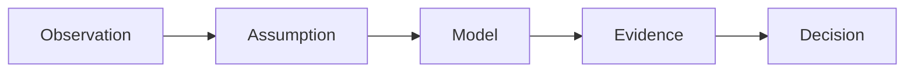

# Algorithmic Ethics and Analytical Responsibility

Within the discipline of making decisions under uncertainty, **algorithmic ethics and analytical responsibility** are essential to turn data and models into informed choices. Improving a metric is not enough; we must understand who benefits, who pays, and who can challenge the outcome.

## Real-world problem

Every operational model impacts people, processes, and opportunities. The challenge is to discern when data truly supports a decision and when it conceals assumptions, biases, or fragile causality. The key question is: which decision improves when applying this concept with reliable data and explicit error thresholds?

## Conceptual model

The process is sequential: formulate the question, translate it into observable units, evaluate data quality, then decide. Skipping steps leads to fragile analyses.

| Step | Guiding question | Expected output |
|---|---|---|
| Framing | Which decision must change? | A concrete choice, not mere curiosity |
| Measurement | Which signal represents the phenomenon? | Metric, source, and granularity |
| Comparison | Against which baseline do I interpret the result? | Benchmark or plausible counterfactual |
| Action | What do I do if the signal crosses the threshold? | Decision, owner, and next check |

## Rigorous formalization

We formalize algorithmic ethics as a relationship among four elements:

| Element | Operational definition |
|---|---|
| Unit | observation, hypothesis, variable, causal mechanism, or evidence criterion |
| Signal | strength of evidence, causal coherence, robustness of assumptions, cost of decision error |
| Baseline | alternative explanation, counterfactual, comparable group, or no-intervention scenario |
| Decision | accept, reject, or reformulate an explanation before use |

The practical rule: a measure is useful only if it reduces uncertainty about a specific decision. If it does not change a choice, document it; if it changes a choice without checks, risk error.

## Example or case study

A Dutch bank was investigated because its credit scoring algorithm approved 73% of applicants with Dutch names but only 58% with foreign names, despite equal income. The algorithm did not use nationality but residence area, strongly correlated with ethnicity.

This case shows how an apparently objective model can perpetuate historical discrimination. Regulators required the bank to document its fairness definition, test the model across multiple metrics, and provide understandable explanations to rejected customers.

## Lab / exercise

### Basic level

Write five lines describing a real decision related to algorithmic ethics: objective, primary metric, baseline, main risk, and planned action.

### Intermediate level

Create a table with at least three segments or scenarios. For each, indicate the signal, possible alternative explanation, and necessary control before deciding.

### Research-grade level

Design a validation plan: hypothesis, required data, exclusion criteria, decision threshold, and post-decision control. Specify what would make you change your mind.

### Recommended datasets and materials

Use decision case studies, product metrics, experiment results, simple DAGs, analytical reports, and simulated time series. If no real data is available, create a synthetic dataset with at least 200 rows and columns for time, segment, outcome metric, and exposure variable.

## Common mistake to avoid

The most frequent error is treating algorithmic ethics as a definition to memorize rather than a decision protocol. This happens when metrics lack baselines, charts lack hypotheses, or recommendations ignore error costs.

A useful check is to ask: "If this result were false or unstable, what wrong decision would I make?" If unclear, the lesson has not been truly applied.

## Quiz or checkpoint

1. What concrete decision should this lesson improve?
2. Which baseline makes the result interpretable?
3. Which assumption, if wrong, would change the conclusion?
4. What minimum control would you use before presenting the recommendation?

## Operational summary

Algorithmic ethics and analytical responsibility are key skills to connect concept, data, and decision. Study them starting from a real problem, formalize the signal, find a credible baseline, build an example, and finish with a practical check. Only then does knowledge become operational expertise.
