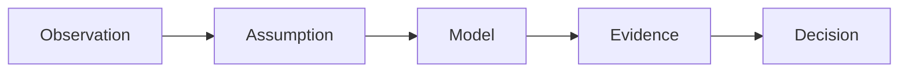

# The Scientific Method Applied to Data Work

In data analysis, attractive hypotheses like "active users buy more because they love the product" often arise. Before turning such intuitions into strategies, a rigorous method is needed to clearly distinguish observation, explanation, prediction, and testing. The **scientific method applied to data work** is the discipline that prevents plausible stories from becoming unsubstantiated proof.

## Real-world Problem

The concrete challenge is to understand when data truly supports a decision and when it hides implicit assumptions, cognitive biases, fragile causality, or poorly formulated questions. The goal is not to debate the abstract value of the concept but to improve real decisions by applying reliable data with an explicit error threshold.

## Conceptual Model

The mental model is sequential and rigorous: start with a concrete question, translate concepts into observable units, evaluate data quality, and only then decide. Skipping steps leads to elegant but fragile analyses.

| Step | Guiding Question | Expected Output |
|---|---|---|
| Framing | What decision needs to change? | A concrete choice, not curiosity |
| Measurement | What signal represents the phenomenon? | Metric, source, and granularity |
| Comparison | Against which baseline do I interpret the result? | Benchmark or plausible counterfactual |
| Action | What do I do if the signal crosses the threshold? | Decision, owner, and next check |

## Rigorous Formalization

We formalize the method as a relationship among four core elements:

| Element | Operational Definition |
|---|---|
| Unit | Observation, hypothesis, variable, causal mechanism, or evidence criterion |
| Signal | Strength of evidence, causal coherence, robustness of assumptions, cost of decision error |
| Baseline | Alternative explanation, counterfactual, comparable group, or no-intervention scenario |
| Decision | Accept, reject, or reformulate an explanation before applying it in business |

The practical rule is simple: a measure is useful only if it reduces uncertainty about a specific decision. If it doesn't change a choice, document it; if it changes a choice without checks, risk arises.

## The 5 Steps of the Scientific Method for Analysts

### Step 1: Observation → "What do I see?"
Start from concrete data, not opinion. For example, "Conversion rate dropped 5% last week" is valid; "I feel the site got worse" is vague.

### Step 2: Hypothesis → "What could explain it?"
Formulate falsifiable hypotheses, not vague narratives. "The drop is caused by a bug in the payment form introduced Monday" is testable; "Maybe users are less interested" is too broad.

### Step 3: Prediction → "If the hypothesis is true, what should I see?"
This is the most important and often skipped step. For example, "If it's the form bug, the drop should be concentrated on checkout pages and disappear for users paying with PayPal (which bypasses the form)."

### Step 4: Experiment / Verification → "What do I actually see?"
Run queries, segment data, check the prediction. If the drop is 12% for form users and 0% for PayPal, the bug is confirmed.

### Step 5: Iteration → "What do I do with this knowledge?"
Fix the bug, monitor the metric, and document learning. For example, "Next time we deploy a form change, activate an automatic alert on conversion rate."

## Real Case: The Scientific Method at Spotify

Spotify applies the scientific method through the "DIBBs" framework (Data, Insight, Belief, Bet). Each decision follows four phases:

1. **Data**  -  What data do we have?
2. **Insight**  -  What do the data suggest?
3. **Belief**  -  What is our hypothesis about how the world works?
4. **Bet**  -  What action do we take to test the hypothesis?

The key difference is that every "bet" is linked to a falsifiable "belief." Failure is not personal error but scientific progress.

## Checklist to Apply the Scientific Method in Your Analyses

1. Before starting, write the hypothesis to test, not just the general goal.
2. Define what would confirm or refute the hypothesis before looking at data.
3. After analysis, compare results with initial prediction and learn from mistakes.

## Quality Control

Always check completeness, duplicates, time zones, changed definitions, and excluded segments. Many analyses fail because data measure behavior different from what the team believes.

## Segment Interpretation

Aggregate averages are just a starting point. Segment by channel, cohort, plan, country, device, and user maturity. Opposite trends in segments can mislead and cause wrong decisions.

## Operational Decision

Every analysis must end with a concrete choice: continue, stop, iterate, invest, remove, or deepen. If the scientific method doesn't change a decision, the link between metric and action is missing.

## Verification Metrics

After intervention, define a primary metric and two guardrails. The primary metric measures expected improvement; guardrails prevent achieving it at the cost of retention, trust, data quality, or sustainability.

## Example or Case Study

A committee interprets retention growth as proof a new initiative worked. Applying the scientific method, they distinguish evidence, assumptions, and decisions, avoiding hasty conclusions.

| Evidence | Prudent Interpretation | Resulting Decision |
|---|---|---|
| Positive but isolated signal | Phenomenon exists, cause uncertain | Seek baseline or holdout |
| Segment with different response | Average effect hides heterogeneity | Analyze cohorts or subgroups |
| Increasing operational cost | Evaluate on margin | Apply economic thresholds |

## Lab / Exercise

### Basic Level

Write in five lines: objective, primary metric, baseline, main risk, and planned action for a real decision.

### Intermediate Level

Build a table with at least three segments or scenarios, indicating signal, alternative explanation, and necessary control.

### Research-grade Level

Design a validation plan: hypothesis, required data, exclusion criteria, decision threshold, and post-decision control. Specify what would change your mind.

### Recommended Datasets and Materials

Use decision case studies, product metrics, experiments, simple DAGs, analytical reports, and simulated time series. If no real data, create a synthetic dataset with at least 200 rows.

## Common Mistake to Avoid

Treating the scientific method as a definition to memorize rather than a decision protocol. Presenting metrics without baseline, charts without hypotheses, or recommendations without considering error cost is a frequent error.

A useful check is asking: "If this result were false or unstable, what wrong decision would I make?" If unclear, the method has not been truly applied.

## Quiz or Checkpoint

1. What concrete decision should this lesson improve?
2. What baseline makes the result interpretable?
3. What assumption, if wrong, would change the conclusion?
4. What minimum control would you use before presenting the recommendation?

## Operational Summary

The **scientific method applied to data work** is a skill connecting concept, data, and decision. Study it starting from a real problem, formalize the signal, find a credible baseline, build an example, and close with a practical check. Only then does knowledge become operational expertise.
