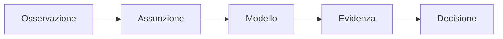

# Metodo scientifico applicato al lavoro sui dati

Nel lavoro analitico, spesso ci si imbatte in ipotesi attraenti ma non verificate, come l'idea che "gli utenti attivi comprano di più perché amano il prodotto". Prima di trasformare queste intuizioni in strategie operative, serve un metodo rigoroso che distingua chiaramente tra osservazione, spiegazione, predizione e verifica. Il **metodo scientifico applicato al lavoro sui dati** è la disciplina che impedisce alle storie plausibili di diventare prove senza fondamento.

## Problema reale

Il problema concreto è capire quando un dato sostiene davvero una decisione e quando invece nasconde assunzioni implicite, bias cognitivi, causalità fragile o una domanda formulata male. Non si tratta di discutere il valore astratto del concetto, ma di migliorare decisioni reali applicando dati affidabili con una soglia esplicita di errore.

## Modello concettuale

Il modello mentale è sequenziale e rigoroso: si parte da una domanda concreta, si traducono i concetti in unità osservabili, si valuta la qualità del dato e solo alla fine si decide. Saltare un passaggio produce analisi eleganti ma fragili.

| Passaggio | Domanda guida | Output atteso |
|---|---|---|
| Framing | Quale decisione deve cambiare? | Una scelta concreta, non una curiosità |
| Misura | Quale segnale rappresenta il fenomeno? | Metrica, fonte e granularità |
| Confronto | Rispetto a quale baseline interpreto il risultato? | Benchmark o controfattuale plausibile |
| Azione | Che cosa faccio se il segnale supera la soglia? | Decisione, owner e prossimo controllo |

## Formalizzazione rigorosa

Formalizziamo il metodo come relazione tra quattro elementi fondamentali:

| Elemento | Definizione operativa |
|---|---|
| Unità | Osservazione, ipotesi, variabile, meccanismo causale o criterio di evidenza |
| Segnale | Forza dell'evidenza, coerenza causale, robustezza delle assunzioni, costo dell'errore decisionale |
| Baseline | Spiegazione alternativa, controfattuale, gruppo comparabile o scenario senza intervento |
| Decisione | Accettare, rifiutare o riformulare una spiegazione prima di usarla in azienda |

La regola pratica è semplice: una misura è utile solo se riduce l'incertezza su una decisione specifica. Se non cambia una scelta, serve documentazione; se cambia una scelta senza controlli, si rischia un errore.

## I 5 passi del metodo scientifico per analyst

### Passo 1: Osservazione → "Cosa vedo?"
Parti da un dato concreto, non da un'opinione. Ad esempio, "Il tasso di conversione è calato del 5% nell'ultima settimana" è un'osservazione valida, mentre "Mi sembra che il sito sia peggiorato" è vaga e soggettiva.

### Passo 2: Ipotesi → "Cosa potrebbe spiegarlo?"
Formula ipotesi falsificabili, non narrative vaghe. Per esempio, "Il calo è causato da un bug nel form di pagamento introdotto lunedì" è un'ipotesi testabile, mentre "Forse gli utenti sono meno interessati" è troppo generica.

### Passo 3: Predizione → "Se l'ipotesi è vera, cosa dovrei vedere?"
Questa è la parte più importante e spesso trascurata. Ad esempio, "Se è il bug del form, il calo dovrebbe essere concentrato sulle pagine di checkout e sparire per gli utenti che pagano con PayPal (che bypassa il form)."

### Passo 4: Esperimento / Verifica → "Cosa vedo realmente?"
Esegui la verifica: segmenta i dati, esegui query, controlla la predizione. Se il calo è del 12% per utenti che usano il form e 0% per PayPal, il bug è confermato.

### Passo 5: Iterazione → "Cosa faccio con questa conoscenza?"
Correggi il bug, monitora la metrica e documenta l'apprendimento. Ad esempio, "La prossima volta che deployiamo una modifica al form di pagamento, attiviamo un alert automatico sul tasso di conversione."

## Caso reale: il metodo scientifico in Spotify

Spotify applica il metodo scientifico attraverso il framework "DIBBs" (Data, Insight, Belief, Bet). Ogni decisione segue quattro fasi:

1. **Data**  -  Quali dati abbiamo?
2. **Insight**  -  Cosa suggeriscono i dati?
3. **Belief**  -  Qual è la nostra ipotesi su come funziona il mondo?
4. **Bet**  -  Quale azione intraprendiamo per testare l'ipotesi?

La differenza chiave è che ogni "bet" è collegata a un "belief" falsificabile. Un fallimento non è un errore personale ma un progresso scientifico.

## Checklist per applicare il metodo scientifico nelle tue analisi

1. Prima di cominciare, scrivi l'ipotesi da testare, non solo l'obiettivo generale.
2. Definisci cosa confermerebbe o smentirebbe l'ipotesi prima di guardare i dati.
3. Dopo l'analisi, confronta i risultati con la predizione iniziale e impara anche dagli errori.

## Controllo di qualità

Controlla sempre completezza, duplicati, timezone, definizioni cambiate e segmenti esclusi. Molte analisi falliscono perché il dato misura un comportamento diverso da quello che il team crede di osservare.

## Interpretazione per segmenti

La media aggregata è solo un punto di partenza. Segmenta per canale, coorte, piano, paese, device e maturità utente. Se due segmenti si muovono in direzioni opposte, la media può fuorviare e portare a decisioni errate.

## Decisione operativa

Ogni analisi deve terminare con una scelta concreta: continuare, fermare, iterare, investire, rimuovere o approfondire. Se il metodo scientifico non cambia una decisione, manca il collegamento tra metrica e azione.

## Metriche di verifica

Dopo l'intervento, definisci una metrica primaria e due guardrail. La metrica primaria misura il miglioramento atteso; le guardrail evitano di ottenere quel miglioramento danneggiando retention, fiducia, qualità del dato o sostenibilità.

## Esempio o caso studio

Un comitato interpreta una crescita di retention come prova che una nuova iniziativa ha funzionato. Applicando il metodo scientifico, si distingue tra evidenza, assunzioni e decisione, evitando conclusioni affrettate.

| Evidenza | Interpretazione prudente | Decisione conseguente |
|---|---|---|
| Segnale positivo ma non isolato | Fenomeno esiste, ma causa incerta | Cercare baseline o holdout |
| Segmento con risposta diversa | Effetto medio nasconde eterogeneità | Analizzare coorti o sottogruppi |
| Costo operativo crescente | Valutare sul margine | Applicare soglie economiche |

## Lab / esercizio

### Livello base

Scrivi in cinque righe: obiettivo, metrica primaria, baseline, rischio principale e azione prevista per una decisione reale.

### Livello intermedio

Costruisci una tabella con almeno tre segmenti o scenari, indicando segnale, spiegazione alternativa e controllo necessario.

### Livello research-grade

Disegna un piano di validazione: ipotesi, dati necessari, criteri di esclusione, soglia decisionale e controllo post-decisione. Specifica cosa ti farebbe cambiare idea.

### Dataset e materiali consigliati

Usa case study decisionali, metriche prodotto, esperimenti, DAG semplici, report analitici e serie storiche simulate. Se non hai dati reali, crea un dataset sintetico con almeno 200 righe.

## Errore tipico da evitare

Trattare il metodo scientifico come una definizione da ricordare, non come un protocollo decisionale. Presentare metriche senza baseline, grafici senza ipotesi o raccomandazioni senza considerare il costo dell'errore è un errore comune.

Un controllo utile è chiedersi: "Se questo risultato fosse falso o instabile, quale decisione sbaglierei?" Se non è chiaro, il metodo non è stato applicato davvero.

## Quiz o checkpoint

1. Qual è la decisione concreta che questa lezione dovrebbe migliorare?
2. Quale baseline rende interpretabile il risultato?
3. Quale assunzione, se sbagliata, cambierebbe la conclusione?
4. Quale controllo minimo useresti prima di presentare la raccomandazione?

## Riepilogo operativo

Il **metodo scientifico applicato al lavoro sui dati** è una competenza che collega concetto, dato e decisione. Studialo partendo da un problema reale, formalizza il segnale, cerca una baseline credibile, costruisci un esempio e chiudi con un controllo pratico. Solo così la conoscenza diventa competenza operativa.
