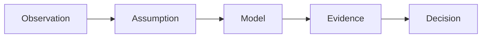

# Francis Bacon: Induction and the Idols of the Mind

## Real-world problem

In the foundational philosophy of data analysis, Francis Bacon's insights address a concrete challenge: discerning when data genuinely supports a decision versus when it conceals implicit assumptions, cognitive biases, fragile causality, or poorly framed questions. This is not an abstract concept but an operational criterion to improve data-driven choices by explicitly acknowledging error margins and evidence robustness.

## Conceptual model

Decision-making under uncertainty unfolds in four sequential steps:

A well-posed question translates into observable units, from which data quality is assessed before making a decision. Skipping any step yields elegant but fragile analyses.

| Step | Guiding question | Expected output |
|---|---|---|
| Framing | Which decision needs to change? | A concrete choice, not mere curiosity |
| Measurement | Which signal represents the phenomenon? | Metric, source, and granularity |
| Comparison | Against which baseline do I interpret results? | Benchmark or plausible counterfactual |
| Action | What do I do if the signal crosses the threshold? | Decision, owner, and next check |

## Rigorous formalization

We formalize Bacon's contribution as a relationship among four key elements:

| Element | Operational definition |
|---|---|
| Unit | observation, hypothesis, variable, causal mechanism, or evidence criterion |
| Signal | strength of evidence, causal coherence, robustness of assumptions, and cost of decision error |
| Baseline | alternative explanation, counterfactual, comparable group, or no-intervention scenario |
| Decision | accept, reject, or reformulate an explanation before applying it in a business context |

The practical rule is simple: a measure is useful only if it reduces uncertainty about a specific decision. If it does not change a choice, it is mere documentation; if it changes a choice without controls, it is risk.

## Bacon's four idols of the mind

Bacon identified four cognitive distortions undermining data analysis, called "idols of the mind":

| Idol | Source of distortion | Manifestation in modern data analysis |
|-------|--------------------|---------------------------------------|
| **Idola Tribus** (of the tribe) | Human nature, tendency to see patterns everywhere | Apophenia: seeing trends in few data points, confusing noise with signal |
| **Idola Specus** (of the cave) | Individual biases tied to education and habits | Interpretative preferences linked to professional background |
| **Idola Fori** (of the marketplace) | Ambiguity and imprecision of language | Different definitions for seemingly identical metrics |
| **Idola Theatri** (of the theater) | Dogmas, authorities, and unquestioned conventions | Uncritical acceptance of established rules and frameworks |

## Example or case study

In 2021, a company shifted 40% of its marketing budget from Facebook to TikTok based on three months of data showing Facebook's decline and TikTok's growth. This was a classic Idola Tribus case: the apparent trend was actually seasonal noise and honeymoon effect. Six months later, TikTok's ROAS collapsed and Facebook returned to prior levels.

An analytics committee applied Bacon's method by constructing a table with evidence, cautious interpretation, and consequent decision, clearly separating observation, assumption, and action:

| Evidence | Cautious interpretation | Consequent decision |
|---|---|---|
| Positive but isolated signal | The phenomenon exists, but cause is uncertain | Seek baseline or holdout |
| Segment with differing response | Average effect hides heterogeneity | Analyze cohorts or subgroups |
| Increasing operational cost | Evaluate result on margin | Apply economic thresholds |

## Lab / exercise

### Basic level

Choose a real decision and describe in five lines: objective, primary metric, baseline, main risk, and planned action. Limit to one primary metric.

### Intermediate level

Build a table with at least three segments or scenarios. For each, indicate signal, possible alternative explanation, and necessary control before deciding.

### Research-grade level

Design a validation plan: hypothesis, required data, exclusion criteria, decision threshold, and post-decision control. Specify what would make you change your mind.

### Recommended datasets and materials

Use decision case studies, product metrics, experiment results, simple DAGs, analytical reports, and simulated time series. If no real data is available, create a synthetic dataset with 200-500 rows including at least one temporal column, one segment column, one outcome metric, and one exposure variable.

## Common mistake to avoid

The most frequent error is treating Bacon's concept as a definition to memorize rather than a decision-making protocol. This happens when presenting a metric without baseline, a chart without hypothesis, or a recommendation without considering error cost.

A useful check is to ask: "If this result were false or unstable, what wrong decision would I make?" If the answer is unclear, the lesson has not been truly applied.

## Quiz or checkpoint

1. What concrete decision should this lesson improve?
2. Which baseline makes the result interpretable?
3. Which assumption, if wrong, would change the conclusion?
4. What minimum control would you use before presenting the recommendation?

## Operational summary

Francis Bacon teaches us that data analysis is a discipline requiring rigor in linking concept, data, and decision. Applying his principles means starting from a real problem, formalizing the signal, seeking a credible baseline, building concrete examples, and closing with practical checks to avoid cognitive and dogmatic errors. Only then does uncertainty become informed decision-making.

---

*References:* Bacon, F. (1620). *Novum Organum Scientiarum.* Kahneman, D. (2011). *Thinking, Fast and Slow.* Klein, G. (2007). "Francis Bacon." *Stanford Encyclopedia of Philosophy.*
