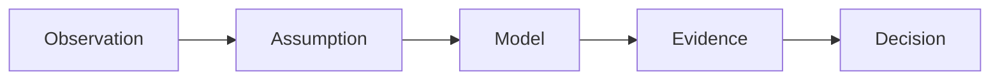

# Frequentism vs Bayesianism: Two Ways to Read Uncertainty

In data-driven decision-making, ambiguous results often arise, such as an A/B test with a borderline p-value. The question is not which statistical school wins, but which language of uncertainty leads to more transparent and reliable decisions. This lesson explores how frequentism and Bayesianism represent two distinct perspectives on interpreting uncertainty.

## Real-world Problem

Imagine deciding whether to implement a product change based on uncertain data. A p-value just below the traditional threshold might seem convincing, but without considering context and prior knowledge, you risk making wrong decisions. The challenge is to understand when data truly supports a choice and when it hides unspoken assumptions or biases.

## Conceptual Model

The decision process starts with a concrete question, translates it into observable data, assesses evidence quality, and finally leads to a decision. Skipping any step can produce elegant but fragile analyses.

| Step | Guiding Question | Expected Output |
|---|---|---|
| Framing | Which decision needs to change? | A concrete choice, not mere curiosity |
| Measurement | Which signal represents the phenomenon? | Metric, source, and granularity |
| Comparison | Against which baseline do I interpret the result? | Benchmark or plausible counterfactual |
| Action | What do I do if the signal passes the threshold? | Decision, owner, and next check |

## Rigorous Formalization

To interpret uncertainty robustly, define four key elements:

| Element | Operational Definition |
|---|---|
| Unit | Observation, hypothesis, variable, causal mechanism, or evidence criterion |
| Signal | Strength of evidence, causal coherence, robustness of assumptions, and cost of decision error |
| Baseline | Alternative explanation, counterfactual, comparable group, or no-intervention scenario |
| Decision | Accept, reject, or reformulate an explanation before applying it |

The practical rule: a measure is useful only if it reduces uncertainty about a specific decision. If it doesn't change a choice, it's just information; if it changes a choice without checks, it's risk.

## Two Definitions of Probability

Probability can be interpreted in fundamentally different ways:

| | **Frequentism** | **Bayesianism** |
|---|---|---|
| **Definition** | Limit frequency over infinite repetitions | Subjective degree of belief, updated with data |
| **Answers** | "How often would I see this result if I repeated the experiment infinitely?" | "How certain am I that the hypothesis is true, given these data?" |
| **Parameters** | Fixed but unknown | Random variables with distributions |
| **Tools** | p-values, confidence intervals | Posterior distributions, credible intervals |
| **Example** | "4% chance of observing these data if the null hypothesis is true" | "67% chance the effect lies between +1% and +3%" |

Confusing these interpretations leads to common mistakes.

## The p-value Problem (Misuse of Frequentism)

A p-value is the probability of observing data as extreme or more so, assuming the null hypothesis is true. It is not the probability that the null hypothesis is true, nor a measure of the real effect. Yet, it is often misinterpreted as such, causing flawed decisions.

**Example:** In 20 A/B tests, if 19 have no real effect and 1 does, publishing only those with p<0.05 means about half of the "significant" results could be false positives. Without context, the p-value is misleading.

## Bayesian Updating: From Belief to Knowledge

Bayesianism transparently updates beliefs:

1. **Prior**: your belief before seeing data (e.g., most UI changes have little to no effect)
2. **Likelihood**: probability of the data given parameters
3. **Posterior**: updated belief after seeing data
4. **Iteration**: posterior becomes new prior for future data

This approach provides direct answers to decision questions, such as the probability that a variant is better.

## Example or Case Study

Amazon runs thousands of simultaneous A/B tests. Applying classical frequentism would cause many false positives. Instead, they use a hierarchical Bayesian model that:

1. Estimates the distribution of past effects (empirical prior)
2. Combines prior with test data to obtain the posterior
3. Defines "significant" as >95% probability that effect exceeds a minimum practical threshold

This method increased decision speed by 40% and reduced false positives by 60% compared to frequentism.

## Lab / Exercise

### Basic Level

Describe a real decision involving frequentism or Bayesianism: objective, primary metric, baseline, main risk, and planned action, in no more than five lines.

### Intermediate Level

Build a table with at least three segments or scenarios, indicating for each the signal, possible alternative explanation, and necessary control before deciding.

### Research-grade Level

Design a validation plan: hypothesis, needed data, exclusion criteria, decision threshold, and post-decision checks. Specify what would make you change your mind.

### Recommended Datasets and Materials

Use decision case studies, product metrics, experiment results, simple DAGs, analytical reports, and simulated time series. If no real data is available, create a synthetic dataset with at least 200 rows, including temporal columns, segment identifiers, outcome metrics, and exposure variables.

## Common Pitfall to Avoid

Do not treat frequentism and Bayesianism as abstract definitions to memorize but as decision protocols. Presenting metrics without baselines, charts without hypotheses, or recommendations without error cost evaluation leads to fragile decisions.

A useful check is to ask: "If this result were false or unstable, what wrong decision would I make?" If you cannot answer, the lesson has not been truly applied.

## Quiz or Checkpoint

1. What concrete decision should this lesson improve?
2. Which baseline makes the result interpretable?
3. Which assumption, if wrong, would change the conclusion?
4. What minimal control would you use before presenting the recommendation?

## Operational Summary

Frequentism and Bayesianism offer two languages to read uncertainty. The skill lies in connecting concept, data, and decision, starting from a real problem, formalizing the signal, choosing a credible baseline, building examples, and concluding with practical checks. Applying this lesson makes decisions more honest and aware.

---

*References:*  
- Efron, B. & Hastie, T. (2016). *Computer Age Statistical Inference.* Cambridge University Press.  
- McElreath, R. (2020). *Statistical Rethinking*, 2nd ed. CRC Press.  
- Stucchio, C. (2021). "Bayesian A/B Testing at Amazon." *KDD 2021.*
