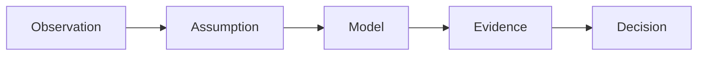

# Immanuel Kant: Causality as a Category of the Intellect

## Real-world problem

In the philosophical foundations of data analysis, Kant's concept of causality as a category of the intellect addresses a critical challenge: determining when data genuinely supports a decision versus when it conceals implicit assumptions, biases, or poorly framed questions. Observing correlations or patterns is not enough; we must recognize that every interpretation is filtered through mental categories that structure our perception and understanding. The challenge is to turn this awareness into an operational tool that improves data-driven decisions.

## Conceptual model

This sequential model reminds us that data analysis is not a linear process starting from data to reach objective truth. First, we formulate the question, then define observable units, evaluate data quality, and only finally decide. Skipping any step leads to analyses that may look sophisticated but are fragile.

| Step | Guiding question | Expected output |
|---|---|---|
| Framing | What decision must change? | A concrete choice, not a curiosity |
| Measurement | What signal represents the phenomenon? | Metric, source, and granularity |
| Comparison | Against which baseline do I interpret the result? | Benchmark or plausible counterfactual |
| Action | What do I do if the signal crosses the threshold? | Decision, owner, and next check |

## Rigorous formalization

We formalize Kantian causality as a relation among four key elements:

| Element | Operational definition |
|---|---|
| Unit | observation, hypothesis, variable, causal mechanism, or evidence criterion |
| Signal | strength of evidence, causal coherence, robustness of assumptions, cost of decision error |
| Baseline | alternative explanation, counterfactual, comparable group, or no-intervention scenario |
| Decision | accept, reject, or reformulate an explanation before use |

The practical rule is simple: a measure is useful only if it reduces uncertainty about a specific decision. If it does not change a choice, it is documentation; if it changes a choice without checks, it is risk.

## Example or case study

Imagine a committee interpreting a retention increase as proof that a new initiative worked. Applying Kant's lens, the team clearly separates observation, explanation, assumption, and decision, preventing an isolated data point from becoming a self-sufficient conclusion.

| Evidence | Prudent interpretation | Resulting decision |
|---|---|---|
| Positive but isolated signal | The phenomenon exists, but the cause is uncertain | Seek baseline or holdout |
| Segment with differing response | Average effect hides heterogeneity | Analyze cohorts or subgroups |
| Rising operational cost | Evaluate results on margin | Apply economic thresholds |

## Lab / exercise

### Basic level

Write in five lines a real decision linked to this lesson: objective, primary metric, baseline, main risk, and planned action. Use only one primary metric.

### Intermediate level

Build a table with at least three segments or scenarios. For each, indicate signal, possible alternative explanation, and necessary control before deciding.

### Research-grade level

Design a validation plan: hypothesis, required data, exclusion criteria, decision threshold, and post-decision control. Specify what would make you change your mind.

### Recommended datasets and materials

Use decision case studies, product metrics, experiment results, simple DAGs, analytic reports, and simulated time series. If real data is unavailable, create a synthetic dataset with 200-500 rows, including a time column, a segment column, an outcome metric, and an exposure variable.

## Common mistake to avoid

The most frequent error is treating Kantian causality as an abstract definition to memorize rather than a decision protocol. This happens when presenting a metric without a baseline, a chart without hypotheses, or a recommendation without assessing error cost. A useful check is asking: "If this result were false or unstable, what decision would I get wrong?" If the answer is unclear, the lesson has not been truly applied.

## Quiz or checkpoint

1. What concrete decision should this lesson improve?
2. Which baseline makes the result interpretable?
3. Which assumption, if wrong, would change the conclusion?
4. What minimal control would you use before presenting the recommendation?

## Operational summary

Kant's causality as a category of the intellect is a core skill to connect concept, data, and decision. Study it starting from a real problem, formalize the signal, find a credible baseline, build an example, and close with a practical check. Only then does philosophical knowledge become a tool for better decisions under uncertainty.

---

## Context and reflections

Kant reminds us that we never encounter "pure" data: we always organize it through mental categories like space, time, and causality. These categories are not objective world properties but universal lenses through which we interpret every phenomenon. In data work, this means every model, pattern, or causal relation is a mental construct, a framing choice.

For example, two analysts can look at the same dataset and draw opposite causal conclusions. This is not a technical error but an epistemological problem: which lens to apply? Knowing this changes everything: it is not about finding absolute truth but consciously choosing the lens best suited to context and decision goals.

## Real case: the COMPAS algorithm

In 2016, ProPublica's investigation revealed how the COMPAS system, seemingly race-neutral, produced racial discrimination. The algorithm did not use race as a variable but proxies like neighborhood or education level. The causality developers imposed was actually social causality, invisible because never questioned. This classic example shows how unexamined Kantian lenses can hide deep biases and decision risks.

## How to apply Kant in your work

1. Always make your categories and assumptions explicit.
2. Compare different models to rotate interpretive lenses.
3. Ask what you are not seeing, which variables or factors lie outside your frame.
4. Always check data quality and coherence before deciding.

Only then does the discipline of making decisions under uncertainty become a conscious and robust practice.
